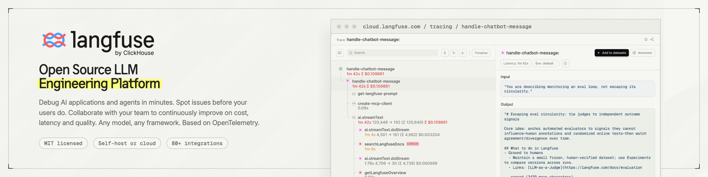
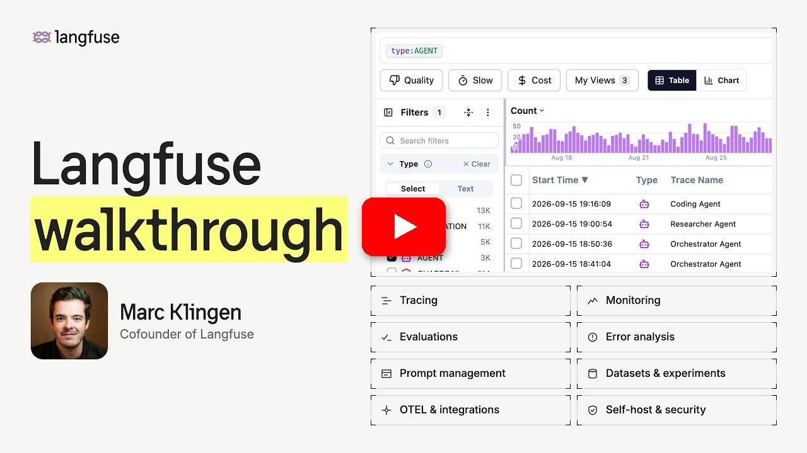

<div align="center">
   <div>
      <h3>
         <a href="https://langfuse.com/cn">
            <strong>🇨🇳 🤝 🪢</strong>
         </a> · 
         <a href="https://cloud.langfuse.com">
            <strong>Langfuse Cloud</strong>
         </a> · 
         <a href="https://langfuse.com/self-hosting">
            <strong>自托管</strong>
         </a> · 
         <a href="https://langfuse.com/docs/demo">
            <strong>演示</strong>
         </a>
      </h3>
   </div>

   <div>
      <a href="https://langfuse.com/docs"><strong>文档</strong></a> ·
      <a href="https://github.com/langfuse/langfuse/issues"><strong>报告问题</strong></a> ·
      <a href="https://github.com/orgs/langfuse/discussions/categories/ideas"><strong>功能请求</strong></a> ·
      <a href="https://langfuse.com/changelog"><strong>更新日志</strong></a> ·
      <a href="https://langfuse.com/docs/roadmap"><strong>路线图</strong></a>
   </div>
   <br/>
</div>

<p align="center">
   <a href="https://github.com/langfuse/langfuse/blob/main/LICENSE">
   
   </a>
   <a href="https://www.ycombinator.com/companies/langfuse"></a>
   <a href="https://hub.docker.com/u/langfuse" target="_blank">
   </a>
   <a href="https://pypi.python.org/pypi/langfuse"></a>
   <a href="https://www.npmjs.com/package/@langfuse/core"></a>
   <br/>
   <a href="https://discord.com/invite/7NXusRtqYU" target="_blank">
   </a>
   <a href="https://twitter.com/intent/follow?screen_name=langfuse" target="_blank">
   </a>
   <a href="https://www.linkedin.com/company/langfuse/" target="_blank">
   </a>
   <a href="https://github.com/langfuse/langfuse/graphs/commit-activity" target="_blank">
   </a>
   <a href="https://github.com/langfuse/langfuse/" target="_blank">
   </a>
   <a href="https://github.com/langfuse/langfuse/discussions/" target="_blank">
   </a>
</p>

<p align="center">
  <a href="./README.md"></a>
  <a href="./README.cn.md"></a>
  <a href="./README.ja.md"></a>
  <a href="./README.kr.md"></a>
</p>

Langfuse 是一个 **开源 AI 工程平台**，专注于 **AI 代理评估与可观测性**。它是一个开放平台，覆盖你公司发起的每一次 AI 调用和团队构建的每一个代理：跟踪用量和成本，**追踪并评估** 代理，并利用生产数据打造更好的 AI。你可以使用 Langfuse Cloud，也可以在几分钟内 **自托管**；Langfuse 已在大规模场景中经过 **实战考验**。

观看项目的快速演示：

<a href="https://langfuse.com/watch-demo"></a>

## ✨ 核心特性


- [AI 可观测性](https://langfuse.com/docs/observability/overview)：为你的应用添加埋点，并开始将追踪数据发送到 Langfuse，从而追踪 LLM 调用及应用中的其他相关逻辑（如检索、嵌入或代理操作）。检查并调试复杂日志及用户会话。基于 OpenTelemetry 构建。试试互动 [演示](https://langfuse.com/docs/demo) 看看效果。

- [提示管理](https://langfuse.com/docs/prompt-management/overview) 帮助你集中管理、版本控制并协作迭代提示。得益于服务器和客户端的高效缓存，你可以在不增加应用延迟的情况下迭代提示。[LLM 试玩平台](https://langfuse.com/docs/prompt-management/features/playground) 可用于测试提示和模型配置；当你在追踪中发现不理想的结果时，可以直接跳转到试玩平台进行迭代。

- [技能管理](https://langfuse.com/docs/skill-management/overview)（beta）为代理技能提供版本控制和标签：每个技能包含一个带有任务指令的 `SKILL.md` 以及可选的辅助文件。无需修改应用代码即可推广或回滚版本，并将技能版本与其产生的追踪关联起来。

- [评估](https://langfuse.com/docs/evaluation/overview) 是 AI 代理开发流程的关键环节，Langfuse 能够满足你的多样需求。它支持 LLM-as-a-judge、代码评估器、用户反馈收集、手动标注，以及通过 API/SDK 实现的自定义评估流程。使用 [数据集与实验](https://langfuse.com/docs/evaluation/experiments/datasets) 构建测试集和基准，用于部署前测试和持续改进。

- [AI 网关](https://langfuse.com/docs/gateway/overview)（beta）为你的组织提供一个统一的端点来调用各模型提供商。集中保管提供商凭证，为每个用户或服务账号发放网关密钥，集中审批模型，按用户、密钥和模型追踪 AI 支出，并将每次调用记录为 Langfuse 追踪。

- [指标与仪表板](https://langfuse.com/docs/metrics/overview)：通过 [自定义仪表板](https://langfuse.com/docs/metrics/features/custom-dashboards)、指标 API 和告警，从任意维度追踪延迟、成本和质量。

- [综合 API](https://langfuse.com/docs/api-and-data-platform/overview)：Langfuse 常被用来驱动定制化的 AI 工程工作流，并通过 API 使用 Langfuse 提供的构建模块。我们提供 OpenAPI 规范、Python 和 JS/TS 的类型化 SDK、[Langfuse CLI](https://langfuse.com/docs/api-and-data-platform/features/cli)，以及面向编码代理的 [Langfuse Agent Skill](https://langfuse.com/docs/api-and-data-platform/features/agent-skill)。

## 📦 部署 Langfuse


### Langfuse Cloud

由 Langfuse 团队管理的部署，提供慷慨的免费额度，无需信用卡。

**[注册 Langfuse Cloud →](https://langfuse.com/cloud)**

### 自托管 Langfuse

在你自己的基础设施上运行 Langfuse：

- [Docker Compose](https://langfuse.com/self-hosting/deployment/docker-compose)：在 5 分钟内于你自己的机器或单台虚拟机上运行 Langfuse。该指南还介绍了如何配置 Docker 日志轮转，避免容器日志占满磁盘。

  ```bash
  # 获取最新的 Langfuse 仓库副本
  git clone --depth=1 https://github.com/langfuse/langfuse.git
  cd langfuse

  # 运行 Langfuse 的 docker compose
  docker compose up
  ```

- [Kubernetes（Helm）](https://langfuse.com/self-hosting/deployment/kubernetes-helm)：使用 Helm 在 Kubernetes 集群上运行 Langfuse。这是推荐的生产环境部署方式。
- Terraform 模板：[AWS](https://langfuse.com/self-hosting/deployment/aws)、[Azure](https://langfuse.com/self-hosting/deployment/azure)、[GCP](https://langfuse.com/self-hosting/deployment/gcp)
- 社区维护：[Render](https://langfuse.com/self-hosting/deployment/render)、[Railway](https://langfuse.com/self-hosting/deployment/railway)

请参阅 [自托管文档](https://langfuse.com/self-hosting) 了解更多关于架构和配置选项的信息。

> [!TIP]
> **正在自托管 Langfuse？** 订阅 [自托管更新列表](https://langfuse.com/self-hosting#subscribe)，通过邮件获取开源 Langfuse 的重要功能和新版本发布信息——仅限自托管更新，没有营销内容。

## 🔌 集成


Langfuse 基于 [OpenTelemetry](https://langfuse.com/integrations/native/opentelemetry) 构建，因此任何使用 OpenTelemetry 埋点的应用、框架或 Collector 都可以将追踪数据发送到 Langfuse。

### 主要集成

| 集成                                                                            | 支持语言/平台                   | 描述                                                                                                                                 |
| ------------------------------------------------------------------------------- | ------------------------------- | ------------------------------------------------------------------------------------------------------------------------------------ |
| [OpenTelemetry](https://langfuse.com/integrations/native/opentelemetry)         | 任意语言                        | 从你的应用或 OpenTelemetry Collector 将 OTLP 追踪发送到 Langfuse 的 OpenTelemetry 端点。                                             |
| [Langfuse AI 网关](https://langfuse.com/docs/gateway/overview)（beta）          | 任意 OpenAI 或 Anthropic 客户端 | 通过一个端点路由模型调用，无需修改 SDK 或代码即可追踪每次调用、集中保管提供商密钥并追踪成本。                                        |
| [SDK](https://langfuse.com/docs/observability/sdk/overview)                     | Python, JS/TS                   | 使用 SDK 进行手动埋点，实现完全的灵活性。                                                                                            |
| [OpenAI](https://langfuse.com/integrations/model-providers/openai-py)           | Python, JS/TS                   | 通过直接替换 OpenAI SDK 实现自动埋点。                                                                                               |
| [LangChain & LangGraph](https://langfuse.com/integrations/frameworks/langchain) | Python, JS/TS                   | 通过向 LangChain 或 LangGraph 应用传入回调处理器实现自动埋点。                                                                       |
| [LlamaIndex](https://langfuse.com/integrations/frameworks/llamaindex)           | Python                          | 通过 LlamaIndex 回调系统实现自动埋点。                                                                                               |
| [Haystack](https://langfuse.com/integrations/frameworks/haystack)               | Python                          | 通过 Haystack 内容追踪系统实现自动埋点。                                                                                             |
| [LiteLLM](https://langfuse.com/integrations/gateways/litellm)                   | Python, JS/TS（仅代理）         | 允许使用任何 LLM 直接替代 GPT。支持 Azure、OpenAI、Cohere、Anthropic、Ollama、VLLM、Sagemaker、HuggingFace、Replicate（100+ LLMs）。 |
| [Vercel AI SDK](https://langfuse.com/integrations/frameworks/vercel-ai-sdk)     | JS/TS                           | 基于 TypeScript 的工具包，帮助开发者使用 React、Next.js、Vue、Svelte 和 Node.js 构建 AI 驱动的应用。                                 |
| [Mastra](https://langfuse.com/integrations/frameworks/mastra)                   | JS/TS                           | 用于构建 AI 代理和多代理系统的开源框架。                                                                                             |
| [API](https://langfuse.com/docs/api-and-data-platform/features/public-api)      |                                 | 直接调用公共 API。提供 OpenAPI 规范。                                                                                                |

### 与 Langfuse 集成的软件包

| 名称                                                                               | 类型          | 描述                                                                                    |
| ---------------------------------------------------------------------------------- | ------------- | --------------------------------------------------------------------------------------- |
| [OpenAI Agents SDK](https://langfuse.com/integrations/frameworks/openai-agents)    | 代理框架      | OpenAI 推出的轻量级框架，用于构建多代理工作流。                                         |
| [Claude Agent SDK](https://langfuse.com/integrations/frameworks/claude-agent-sdk)  | 代理框架      | Anthropic 的开源框架，用于构建可调用工具的代理，原生支持 MCP。                          |
| [Pydantic AI](https://langfuse.com/integrations/frameworks/pydantic-ai)            | 代理框架      | 用于构建类型安全的生产级应用的 Python 代理框架。                                        |
| [Google ADK](https://langfuse.com/integrations/frameworks/google-adk)              | 代理框架      | Google 的开源代理开发工具包（Agent Development Kit），用于构建代理。                    |
| [Strands Agents](https://langfuse.com/integrations/frameworks/strands-agents)      | 代理框架      | AWS 推出的开源 SDK，用于构建和运行 AI 代理。                                            |
| [Spring AI](https://langfuse.com/integrations/frameworks/spring-ai)                | 代理框架      | 用于在 Spring 生态中构建 AI 应用的 Java 框架。                                          |
| [CrewAI](https://langfuse.com/integrations/frameworks/crewai)                      | 代理框架      | 多代理框架，用于实现代理之间的协作与工具调用。                                          |
| [AutoGen](https://langfuse.com/integrations/frameworks/autogen)                    | 代理框架      | 用于构建分布式代理的开源 LLM 平台。                                                     |
| [smolagents](https://langfuse.com/integrations/frameworks/smolagents)              | 代理框架      | 开源 AI 代理框架。                                                                      |
| [Instructor](https://langfuse.com/integrations/frameworks/instructor)              | 库            | 用于获取结构化 LLM 输出（JSON、Pydantic）的库。                                         |
| [DSPy](https://langfuse.com/integrations/frameworks/dspy)                          | 库            | 系统性优化语言模型提示和权重的框架。                                                    |
| [Mirascope](https://langfuse.com/integrations/frameworks/mirascope)                | 库            | 构建 LLM 应用的 Python 工具包。                                                         |
| [Ollama](https://langfuse.com/integrations/model-providers/ollama)                 | 模型（本地）  | 在你的机器上轻松运行开源 LLM。                                                          |
| [Amazon Bedrock](https://langfuse.com/integrations/model-providers/amazon-bedrock) | 模型          | 在 AWS 上运行基础模型和微调模型。                                                       |
| [Flowise](https://langfuse.com/integrations/no-code/flowise)                       | 聊天/代理界面 | 基于 JS/TS 的无代码构建器，用于定制化 LLM 流程。                                        |
| [Langflow](https://langfuse.com/integrations/no-code/langflow)                     | 聊天/代理界面 | 基于 Python 的 LangChain 用户界面，采用 react-flow 设计，提供便捷的实验与原型构建体验。 |
| [Dify](https://langfuse.com/integrations/no-code/dify)                             | 聊天/代理界面 | 带有无代码构建器的开源 LLM 应用开发平台。                                               |
| [OpenWebUI](https://langfuse.com/integrations/no-code/openwebui)                   | 聊天/代理界面 | 自托管的 LLM 聊天网页界面，支持包括自托管和本地模型在内的多种 LLM 运行器。              |
| [LobeChat](https://langfuse.com/integrations/no-code/lobechat)                     | 聊天/代理界面 | 开源聊天机器人平台。                                                                    |
| [Gradio](https://langfuse.com/integrations/other/gradio)                           | 聊天/代理界面 | 开源 Python 库，可用于构建类似聊天 UI 的网页界面。                                      |
| [Promptfoo](https://langfuse.com/integrations/other/promptfoo)                     | 工具          | 开源 LLM 测试平台。                                                                     |
| [Vapi](https://langfuse.com/integrations/no-code/vapi)                             | 平台          | 开源语音 AI 平台。                                                                      |
| [Inferable](https://langfuse.com/integrations/frameworks/inferable)                | 代理框架      | 构建分布式代理的开源 LLM 平台。                                                         |
| [Goose](https://langfuse.com/integrations/no-code/goose)                           | 代理          | Block 推出的开源 AI 代理，用于自动化工程任务。                                          |

完整的 100+ 集成列表请参阅 [集成概览](https://langfuse.com/integrations)。

## 🚀 快速入门

为你的应用添加埋点，并开始将追踪数据发送到 Langfuse，从而记录 LLM 调用及应用中的其他相关逻辑（如检索、嵌入或代理操作）。检查并调试复杂日志及用户会话。

### 🤖 代理式安装（推荐）

安装 [Langfuse Agent Skill](https://github.com/langfuse/skills)，让你的编码代理可以使用 Langfuse 的全部功能，然后让它为你的应用添加追踪：

```txt
Install the Langfuse Agent Skill from github.com/langfuse/skills
and use it to add tracing to this application with Langfuse
following best practices.
```

你也可以通过 [skills CLI](https://www.npmjs.com/package/skills)（`npx skills add langfuse/skills --skill "langfuse"`）或 [Langfuse Cursor 插件](https://cursor.com/marketplace/langfuse) 安装该技能。如果你的代理支持 MCP，请添加 [Langfuse Docs MCP 服务器](https://langfuse.com/docs/docs-mcp)（`https://langfuse.com/api/mcp`，无需认证），以便它在工作时查阅最新文档。详情请参阅 [入门指南](https://langfuse.com/docs/observability/get-started)。

### 🛠️ 手动安装

#### 1️⃣ 创建新项目

1.  [创建 Langfuse 账户](https://langfuse.com/cloud) 或 [自托管](https://langfuse.com/self-hosting)
2.  创建一个新项目
3.  在项目设置中创建新的 API 凭证

#### 2️⃣ 记录你的第一个 LLM 调用

使用 [`@observe()` 装饰器](https://langfuse.com/docs/observability/sdk/instrumentation#observe-wrapper) 可以轻松追踪任何 Python LLM 应用。在本快速入门中，我们还使用了 Langfuse 的 [OpenAI 集成](https://langfuse.com/integrations/model-providers/openai-py) 来自动捕获所有模型参数。

> [!TIP]
> 不使用 OpenAI？请访问 [我们的文档](https://langfuse.com/docs/observability/get-started) 了解如何记录其他模型和框架。

```bash
pip install langfuse openai
```

```bash filename=".env"
LANGFUSE_SECRET_KEY="sk-lf-..."
LANGFUSE_PUBLIC_KEY="pk-lf-..."
LANGFUSE_BASE_URL="https://cloud.langfuse.com" # 🇪🇺 欧盟区域
# LANGFUSE_BASE_URL="https://us.cloud.langfuse.com" # 🇺🇸 美国区域
# LANGFUSE_BASE_URL="https://jp.cloud.langfuse.com" # 🇯🇵 日本区域
# LANGFUSE_BASE_URL="https://hipaa.cloud.langfuse.com" # ⚕️ HIPAA 区域
```

```python /@observe()/ /from langfuse.openai import openai/ filename="main.py"
from langfuse import observe
from langfuse.openai import openai # OpenAI 集成

@observe()
def story():
    return openai.chat.completions.create(
        model="gpt-4o",
        messages=[{"role": "user", "content": "What is Langfuse?"}],
    ).choices[0].message.content

@observe()
def main():
    return story()

main()
```

#### 3️⃣ 在 Langfuse 中查看追踪

在 Langfuse 中查看你的语言模型调用及其他应用逻辑。


_[Langfuse 中的公开示例追踪](https://cloud.langfuse.com/project/cloramnkj0002jz088vzn1ja4/traces/db22d0a442216b485abd83cc9df6d9ee)_

## 💭 支持

查找问题答案：

- 我们的 [文档](https://langfuse.com/docs) 是查找答案的最佳起点。内容全面，我们投入了大量时间进行维护。你也可以通过 GitHub 提出文档修改建议。
- [Langfuse 常见问题](https://langfuse.com/faq) 解答了最常见的问题。
- 使用 "[Ask AI](https://langfuse.com/docs/ask-ai)" 立即获取问题答案。

支持渠道：

- **在 GitHub Discussions 的 [公共问答](https://github.com/orgs/langfuse/discussions/categories/support) 中提出任何问题。** 请尽量提供详细信息（如代码片段、截图、背景信息）以帮助我们理解你的问题。
- 在 GitHub Discussions 中 [提出功能请求](https://github.com/orgs/langfuse/discussions/categories/ideas)。
- 在 GitHub Issues 中 [报告 Bug](https://github.com/langfuse/langfuse/issues)。
- 对于时效性较强的问题，请通过应用内聊天小部件联系我们。

## 🤝 贡献

欢迎你的贡献！

- 在 GitHub Discussions 中为 [想法](https://github.com/orgs/langfuse/discussions/categories/ideas) 投票。
- 提出并评论 [问题](https://github.com/langfuse/langfuse/issues)。
- 提交 PR —— 详情请参阅 [CONTRIBUTING.md](CONTRIBUTING.md)，了解如何搭建开发环境。

## 🥇 许可证

除 `ee` 文件夹外，本仓库采用 MIT 许可证。详情请参阅 [LICENSE](LICENSE) 以及 [文档](https://langfuse.com/handbook/chapters/open-source)。

## 依赖

我们使用 Docker 容器部署此代码库。镜像的构建方式（包括所用的基础镜像）请参阅 [web/Dockerfile](web/Dockerfile) 和 [worker/Dockerfile](worker/Dockerfile)。

## ⭐️ 星标历史

<a href="https://star-history.com/#langfuse/langfuse&Date">
 <picture>
   <source media="(prefers-color-scheme: dark)" srcset="https://api.star-history.com/svg?repos=langfuse/langfuse&type=Date&theme=dark" />
   <source media="(prefers-color-scheme: light)" srcset="https://api.star-history.com/svg?repos=langfuse/langfuse&type=Date" />
   
 </picture>
</a>

## ❤️ 使用 Langfuse 的开源项目

以下是使用 Langfuse Python 或 JS/TS SDK 的顶级开源项目，按星标数排名（[来源](https://github.com/langfuse/langfuse-docs/blob/main/components-mdx/dependents)）：

| 仓库                                                                                                                                                                                                                                                                                                           |   星数 |
| :------------------------------------------------------------------------------------------------------------------------------------------------------------------------------------------------------------------------------------------------------------------------------------------------------------- | -----: |
|  &nbsp; [Significant-Gravitas](https://github.com/Significant-Gravitas) / [AutoGPT](https://github.com/Significant-Gravitas/AutoGPT)                                                   | 187903 |
|  &nbsp; [langgenius](https://github.com/langgenius) / [dify](https://github.com/langgenius/dify)                                                                                       | 160407 |
|  &nbsp; [langflow-ai](https://github.com/langflow-ai) / [langflow](https://github.com/langflow-ai/langflow)                                                                             | 156333 |
|  &nbsp; [bytedance](https://github.com/bytedance) / [deer-flow](https://github.com/bytedance/deer-flow)                                                                                  |  84985 |
|  &nbsp; [cheaper-inference](https://github.com/cheaper-inference) / [OmniRoute](https://github.com/cheaper-inference/OmniRoute)                                                        |  84532 |
|  &nbsp; [lobehub](https://github.com/lobehub) / [lobehub](https://github.com/lobehub/lobehub)                                                                                          |  83873 |
|  &nbsp; [abi](https://github.com/abi) / [screenshot-to-code](https://github.com/abi/screenshot-to-code)                                                                                    |  81022 |
|  &nbsp; [microsoft](https://github.com/microsoft) / [ai-agents-for-beginners](https://github.com/microsoft/ai-agents-for-beginners)                                                      |  78925 |
|  &nbsp; [openai](https://github.com/openai) / [openai-cookbook](https://github.com/openai/openai-cookbook)                                                                              |  76955 |
|  &nbsp; [cline](https://github.com/cline) / [cline](https://github.com/cline/cline)                                                                                                    |  71312 |
|  &nbsp; [BerriAI](https://github.com/BerriAI) / [litellm](https://github.com/BerriAI/litellm)                                                                                          |  62709 |
|  &nbsp; [run-llama](https://github.com/run-llama) / [llama_index](https://github.com/run-llama/llama_index)                                                                            |  52806 |
|  &nbsp; [LibreChat-AI](https://github.com/LibreChat-AI) / [LibreChat](https://github.com/LibreChat-AI/LibreChat)                                                                       |  46745 |
|  &nbsp; [volcengine](https://github.com/volcengine) / [OpenViking](https://github.com/volcengine/OpenViking)                                                                            |  41535 |
|  &nbsp; [HKUDS](https://github.com/HKUDS) / [LightRAG](https://github.com/HKUDS/LightRAG)                                                                                              |  40529 |
|  &nbsp; [directus](https://github.com/directus) / [directus](https://github.com/directus/directus)                                                                                      |  38820 |
|  &nbsp; [DayuanJiang](https://github.com/DayuanJiang) / [next-ai-draw-io](https://github.com/DayuanJiang/next-ai-draw-io)                                                               |  36683 |
|  &nbsp; [onyx-dot-app](https://github.com/onyx-dot-app) / [onyx](https://github.com/onyx-dot-app/onyx)                                                                                 |  33212 |
|  &nbsp; [labring](https://github.com/labring) / [FastGPT](https://github.com/labring/FastGPT)                                                                                          |  29994 |
|  &nbsp; [mastra-ai](https://github.com/mastra-ai) / [mastra](https://github.com/mastra-ai/mastra)                                                                                      |  29335 |
|  &nbsp; [vercel](https://github.com/vercel) / [ai](https://github.com/vercel/ai)                                                                                                        |  27740 |
|  &nbsp; [onlook-dev](https://github.com/onlook-dev) / [onlook](https://github.com/onlook-dev/onlook)                                                                                   |  27117 |
|  &nbsp; [promptfoo](https://github.com/promptfoo) / [promptfoo](https://github.com/promptfoo/promptfoo)                                                                                |  26836 |
|  &nbsp; [kortix-ai](https://github.com/kortix-ai) / [CompanyOS](https://github.com/kortix-ai/CompanyOS)                                                                                |  20378 |
|  &nbsp; [gastownhall](https://github.com/gastownhall) / [gastown](https://github.com/gastownhall/gastown)                                                                              |  18691 |
|  &nbsp; [camel-ai](https://github.com/camel-ai) / [camel](https://github.com/camel-ai/camel)                                                                                           |  18010 |
|  &nbsp; [suitenumerique](https://github.com/suitenumerique) / [docs](https://github.com/suitenumerique/docs)                                                                           |  16967 |
|  &nbsp; [Arindam200](https://github.com/Arindam200) / [awesome-ai-apps](https://github.com/Arindam200/awesome-ai-apps)                                                                 |  16712 |
|  &nbsp; [apify](https://github.com/apify) / [apify-mcp-server](https://github.com/apify/apify-mcp-server)                                                                               |  14774 |
|  &nbsp; [The-PR-Agent](https://github.com/The-PR-Agent) / [pr-agent](https://github.com/The-PR-Agent/pr-agent)                                                                         |  14686 |
|  &nbsp; [microsoft](https://github.com/microsoft) / [agent-framework](https://github.com/microsoft/agent-framework)                                                                      |  14532 |
|  &nbsp; [The-Pocket](https://github.com/The-Pocket) / [PocketFlow](https://github.com/The-Pocket/PocketFlow)                                                                           |  11303 |
|  &nbsp; [openai](https://github.com/openai) / [codex-security](https://github.com/openai/codex-security)                                                                                |  11301 |
|  &nbsp; [tambo-ai](https://github.com/tambo-ai) / [tambo](https://github.com/tambo-ai/tambo)                                                                                           |  11222 |
|  &nbsp; [VoltAgent](https://github.com/VoltAgent) / [voltagent](https://github.com/VoltAgent/voltagent)                                                                                |  10920 |
|  &nbsp; [mcp-use](https://github.com/mcp-use) / [mcp-use](https://github.com/mcp-use/mcp-use)                                                                                          |  10846 |
|  &nbsp; [yugabyte](https://github.com/yugabyte) / [yugabyte-db](https://github.com/yugabyte/yugabyte-db)                                                                                |  10649 |
|  &nbsp; [droidrun](https://github.com/droidrun) / [mobilerun](https://github.com/droidrun/mobilerun)                                                                                   |   9947 |
|  &nbsp; [MervinPraison](https://github.com/MervinPraison) / [PraisonAI](https://github.com/MervinPraison/PraisonAI)                                                                       |   9321 |
|  &nbsp; [miurla](https://github.com/miurla) / [morphic](https://github.com/miurla/morphic)                                                                                               |   9275 |
|  &nbsp; [plastic-labs](https://github.com/plastic-labs) / [honcho](https://github.com/plastic-labs/honcho)                                                                             |   7944 |
|  &nbsp; [raycast](https://github.com/raycast) / [extensions](https://github.com/raycast/extensions)                                                                                     |   7832 |
|  &nbsp; [2FastLabs](https://github.com/2FastLabs) / [agent-squad](https://github.com/2FastLabs/agent-squad)                                                                            |   7799 |
|  &nbsp; [xerrors](https://github.com/xerrors) / [Yuxi](https://github.com/xerrors/Yuxi)                                                                                                 |   7601 |
|  &nbsp; [refly-ai](https://github.com/refly-ai) / [refly](https://github.com/refly-ai/refly)                                                                                           |   7547 |
|  &nbsp; [crestalnetwork](https://github.com/crestalnetwork) / [intentkit](https://github.com/crestalnetwork/intentkit)                                                                 |   6524 |
|  &nbsp; [coleam00](https://github.com/coleam00) / [ottomator-agents](https://github.com/coleam00/ottomator-agents)                                                                      |   5791 |
|  &nbsp; [zenml-io](https://github.com/zenml-io) / [zenml](https://github.com/zenml-io/zenml)                                                                                            |   5635 |
|  &nbsp; [colanode](https://github.com/colanode) / [colanode](https://github.com/colanode/colanode)                                                                                     |   5186 |
|  &nbsp; [getzep](https://github.com/getzep) / [zep](https://github.com/getzep/zep)                                                                                                     |   4989 |
|  &nbsp; [langflow-ai](https://github.com/langflow-ai) / [openrag](https://github.com/langflow-ai/openrag)                                                                               |   4671 |
|  &nbsp; [JoshuaC215](https://github.com/JoshuaC215) / [agent-service-toolkit](https://github.com/JoshuaC215/agent-service-toolkit)                                                       |   4564 |
|  &nbsp; [FlowElement-xinliuyuansu](https://github.com/FlowElement-xinliuyuansu) / [m_flow](https://github.com/FlowElement-xinliuyuansu/m_flow)                                         |   4509 |
|  &nbsp; [panaversity](https://github.com/panaversity) / [learn-agentic-ai](https://github.com/panaversity/learn-agentic-ai)                                                             |   4395 |
|  &nbsp; [bragai](https://github.com/bragai) / [bRAG-langchain](https://github.com/bragai/bRAG-langchain)                                                                               |   4196 |
|  &nbsp; [strukto-ai](https://github.com/strukto-ai) / [mirage](https://github.com/strukto-ai/mirage)                                                                                   |   3763 |
|  &nbsp; [awslabs](https://github.com/awslabs) / [agentcore-samples](https://github.com/awslabs/agentcore-samples)                                                                        |   3512 |
|  &nbsp; [ding113](https://github.com/ding113) / [claude-code-hub](https://github.com/ding113/claude-code-hub)                                                                           |   3399 |
|  &nbsp; [rpamis](https://github.com/rpamis) / [comet](https://github.com/rpamis/comet)                                                                                                 |   3270 |
|  &nbsp; [remix-project-org](https://github.com/remix-project-org) / [remix-project](https://github.com/remix-project-org/remix-project)                                                |   3096 |
|  &nbsp; [tsedio](https://github.com/tsedio) / [tsed](https://github.com/tsedio/tsed)                                                                                                    |   3091 |
|  &nbsp; [MetaMask](https://github.com/MetaMask) / [metamask-mobile](https://github.com/MetaMask/metamask-mobile)                                                                        |   3080 |
|  &nbsp; [pingcap](https://github.com/pingcap) / [autoflow](https://github.com/pingcap/autoflow)                                                                                         |   2979 |
|  &nbsp; [wassim249](https://github.com/wassim249) / [fastapi-langgraph-agent-production-ready-template](https://github.com/wassim249/fastapi-langgraph-agent-production-ready-template) |   2726 |
|  &nbsp; [Agent-Field](https://github.com/Agent-Field) / [agentfield](https://github.com/Agent-Field/agentfield)                                                                        |   2644 |
|  &nbsp; [suitenumerique](https://github.com/suitenumerique) / [meet](https://github.com/suitenumerique/meet)                                                                           |   2468 |
|  &nbsp; [YFGaia](https://github.com/YFGaia) / [dify-plus](https://github.com/YFGaia/dify-plus)                                                                                         |   2263 |
|  &nbsp; [PrimeIntellect-ai](https://github.com/PrimeIntellect-ai) / [prime-rl](https://github.com/PrimeIntellect-ai/prime-rl)                                                          |   2215 |
|  &nbsp; [TheSpaghettiDetective](https://github.com/TheSpaghettiDetective) / [obico-server](https://github.com/TheSpaghettiDetective/obico-server)                                       |   1924 |
|  &nbsp; [ai-hero-dev](https://github.com/ai-hero-dev) / [ai-hero](https://github.com/ai-hero-dev/ai-hero)                                                                              |   1915 |
|  &nbsp; [arabold](https://github.com/arabold) / [docs-mcp-server](https://github.com/arabold/docs-mcp-server)                                                                            |   1856 |
|  &nbsp; [trailofbits](https://github.com/trailofbits) / [buttercup](https://github.com/trailofbits/buttercup)                                                                            |   1741 |
|  &nbsp; [MLSysOps](https://github.com/MLSysOps) / [MLE-agent](https://github.com/MLSysOps/MLE-agent)                                                                                    |   1580 |
|  &nbsp; [kodustech](https://github.com/kodustech) / [kodus-ai](https://github.com/kodustech/kodus-ai)                                                                                   |   1565 |
|  &nbsp; [bugbasesecurity](https://github.com/bugbasesecurity) / [pentest-copilot](https://github.com/bugbasesecurity/pentest-copilot)                                                   |   1546 |
|  &nbsp; [agentconnect-md](https://github.com/agentconnect-md) / [agentconnect](https://github.com/agentconnect-md/agentconnect)                                                        |   1514 |
|  &nbsp; [TIGER-AI-Lab](https://github.com/TIGER-AI-Lab) / [TheoremExplainAgent](https://github.com/TIGER-AI-Lab/TheoremExplainAgent)                                                   |   1513 |
|  &nbsp; [hashgraph-online](https://github.com/hashgraph-online) / [awesome-codex-plugins](https://github.com/hashgraph-online/awesome-codex-plugins)                                   |   1508 |
|  &nbsp; [Gsync](https://github.com/Gsync) / [jobsync](https://github.com/Gsync/jobsync)                                                                                                 |   1493 |
|  &nbsp; [inkeep](https://github.com/inkeep) / [agents](https://github.com/inkeep/agents)                                                                                               |   1490 |
|  &nbsp; [zstar1003](https://github.com/zstar1003) / [ragflow-plus](https://github.com/zstar1003/ragflow-plus)                                                                           |   1465 |
|  &nbsp; [hotovo](https://github.com/hotovo) / [aider-desk](https://github.com/hotovo/aider-desk)                                                                                         |   1463 |
|  &nbsp; [cline](https://github.com/cline) / [kanban](https://github.com/cline/kanban)                                                                                                  |   1376 |
|  &nbsp; [wanxingai](https://github.com/wanxingai) / [LightAgent](https://github.com/wanxingai/LightAgent)                                                                              |   1245 |
|  &nbsp; [FranciscoMoretti](https://github.com/FranciscoMoretti) / [chat-js](https://github.com/FranciscoMoretti/chat-js)                                                                |   1203 |
|  &nbsp; [cognizant-ai-lab](https://github.com/cognizant-ai-lab) / [neuro-san-studio](https://github.com/cognizant-ai-lab/neuro-san-studio)                                              |   1194 |
|  &nbsp; [okou-ai](https://github.com/okou-ai) / [okou](https://github.com/okou-ai/okou)                                                                                                |   1162 |
|  &nbsp; [alishobeiri](https://github.com/alishobeiri) / [thread-notebook](https://github.com/alishobeiri/thread-notebook)                                                               |   1106 |
|  &nbsp; [openops-cloud](https://github.com/openops-cloud) / [openops](https://github.com/openops-cloud/openops)                                                                        |   1081 |
|  &nbsp; [dynamiq-ai](https://github.com/dynamiq-ai) / [dynamiq](https://github.com/dynamiq-ai/dynamiq)                                                                                 |   1073 |
|  &nbsp; [trendy-design](https://github.com/trendy-design) / [llmchat](https://github.com/trendy-design/llmchat)                                                                        |   1072 |
|  &nbsp; [cuga-project](https://github.com/cuga-project) / [cuga-agent](https://github.com/cuga-project/cuga-agent)                                                                     |   1070 |
|  &nbsp; [Minima-AI-Inc](https://github.com/Minima-AI-Inc) / [minima](https://github.com/Minima-AI-Inc/minima)                                                                          |   1056 |
|  &nbsp; [ZTE-AICloud](https://github.com/ZTE-AICloud) / [Co-Sight](https://github.com/ZTE-AICloud/Co-Sight)                                                                            |   1015 |
|  &nbsp; [china-qijizhifeng](https://github.com/china-qijizhifeng) / [agentic-harness-engineering](https://github.com/china-qijizhifeng/agentic-harness-engineering)                    |    959 |
|  &nbsp; [sanity-io](https://github.com/sanity-io) / [next-sanity](https://github.com/sanity-io/next-sanity)                                                                             |    956 |
|  &nbsp; [plastic-labs](https://github.com/plastic-labs) / [tutor-gpt](https://github.com/plastic-labs/tutor-gpt)                                                                       |    933 |
|  &nbsp; [strands-agents](https://github.com/strands-agents) / [samples](https://github.com/strands-agents/samples)                                                                     |    924 |
|  &nbsp; [andysingal](https://github.com/andysingal) / [llm-course](https://github.com/andysingal/llm-course)                                                                            |    891 |
|  &nbsp; [groq](https://github.com/groq) / [openbench](https://github.com/groq/openbench)                                                                                                 |    832 |

## 🔒 安全与隐私

我们非常重视数据安全和隐私。更多信息请参阅我们的 [安全与隐私](https://langfuse.com/security) 页面。

### 遥测

默认情况下，Langfuse 会自动将自托管实例的基础使用统计数据上报至集中服务器（PostHog）。

这有助于我们：

1. 了解 Langfuse 的使用情况，并改进最相关的功能。
2. 跟踪整体使用数据，用于内部及外部（例如融资）报告。

遥测数据不包括原始 traces、prompts、observations、scores 或数据集内容。我们在 [遥测文档](https://langfuse.com/self-hosting/security/telemetry) 中记录了收集的确切字段、数据的发送位置以及相关实现参考。

对于 Langfuse OSS，你可以通过设置 `TELEMETRY_ENABLED=false` 来选择退出。

<!-- Scarf pixel — cookie-free, privacy-friendly analytics for README views (no cookies, no IP/PII stored). https://docs.scarf.sh/web-traffic/ -->

