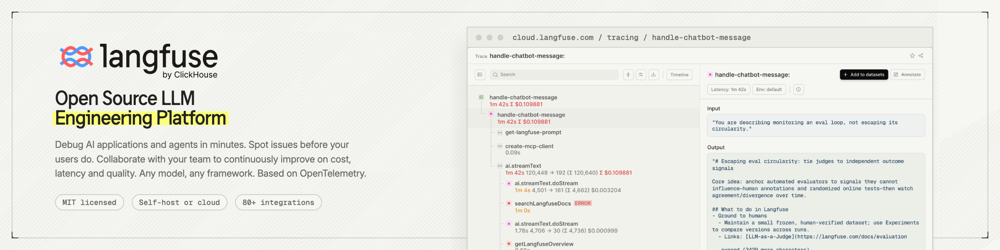
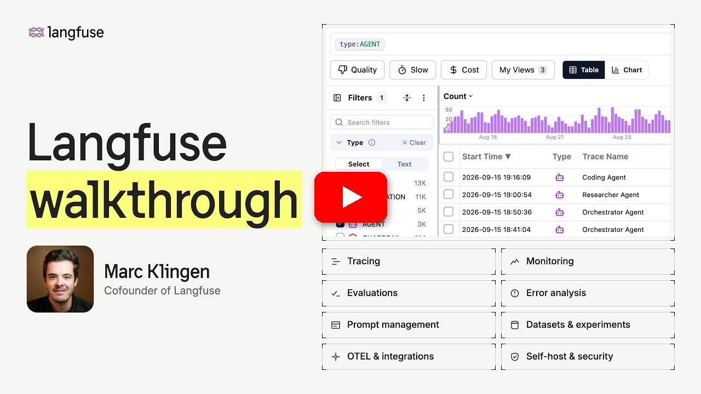

<div align="center">
   <div>
      <h3>
         <a href="https://langfuse.com/japan">
            <strong>🇯🇵 🤝 🪢</strong>
         </a> · 
         <a href="https://cloud.langfuse.com">
            <strong>Langfuse Cloud</strong>
         </a> · 
         <a href="https://langfuse.com/self-hosting">
            <strong>セルフホスティング</strong>
         </a> · 
         <a href="https://langfuse.com/docs/demo">
            <strong>デモ</strong>
         </a>
      </h3>
   </div>

   <div>
      <a href="https://langfuse.com/docs"><strong>ドキュメント</strong></a> ·
      <a href="https://github.com/langfuse/langfuse/issues"><strong>バグ報告</strong></a> ·
      <a href="https://github.com/orgs/langfuse/discussions/categories/ideas"><strong>機能リクエスト</strong></a> ·
      <a href="https://langfuse.com/changelog"><strong>変更履歴</strong></a> ·
      <a href="https://langfuse.com/docs/roadmap"><strong>ロードマップ</strong></a> ·
   </div>
   <br/>
   <div>
   </div>
</div>

<p align="center">
   <a href="https://github.com/langfuse/langfuse/blob/main/LICENSE">
   
   </a>
   <a href="https://www.ycombinator.com/companies/langfuse"></a>
   <a href="https://hub.docker.com/u/langfuse" target="_blank">
   </a>
   <a href="https://pypi.python.org/pypi/langfuse"></a>
   <a href="https://www.npmjs.com/package/@langfuse/core"></a>
   <br/>
   <a href="https://discord.com/invite/7NXusRtqYU" target="_blank">
   </a>
   <a href="https://twitter.com/intent/follow?screen_name=langfuse" target="_blank">
   </a>
   <a href="https://www.linkedin.com/company/langfuse/" target="_blank">
   </a>
   <a href="https://github.com/langfuse/langfuse/graphs/commit-activity" target="_blank">
   </a>
   <a href="https://github.com/langfuse/langfuse/" target="_blank">
   </a>
   <a href="https://github.com/langfuse/langfuse/discussions/" target="_blank">
   </a>
</p>

<p align="center">
  <a href="./README.md"></a>
  <a href="./README.cn.md"></a>
  <a href="./README.ja.md"></a>
  <a href="./README.kr.md"></a>
</p>

Langfuseは、**エージェントの評価とオブザーバビリティ**のための**オープンソースのAIエンジニアリングプラットフォーム**です。会社が行うすべてのAI呼び出しと、チームが構築するすべてのエージェントを1つのオープンなプラットフォームで扱えます。利用量とコストを追跡し、エージェントを**トレースして評価**し、本番データを活用してより良いAIを届けられます。Langfuse Cloudを利用することも、**数分でセルフホスト**することもでき、大規模な環境で**多くの実績**があります。

プロジェクトの簡単なデモはこちらからご覧いただけます:

<a href="https://langfuse.com/watch-demo"></a>

## ✨ コア機能


- [AIオブザーバビリティ](https://langfuse.com/docs/observability/overview): アプリケーションにインストゥルメンテーションを導入してLangfuseへトレースを取り込み、LLM呼び出しやリトリーバル、埋め込み、エージェントアクションなどの関連ロジックを追跡できます。複雑なログやユーザーセッションを調査・デバッグできます。OpenTelemetryをベースに構築されています。インタラクティブな[デモ](https://langfuse.com/docs/demo)で動作を確認してください。

- [プロンプト管理](https://langfuse.com/docs/prompt-management/overview): プロンプトを一元管理し、バージョン管理しながら共同で改善できます。サーバー側とクライアント側の強力なキャッシングにより、アプリケーションのレイテンシを増やすことなくプロンプトを改良できます。[LLMプレイグラウンド](https://langfuse.com/docs/prompt-management/features/playground)ではプロンプトやモデル設定をテストでき、トレースで望ましくない結果を見つけたら、そのままプレイグラウンドに移動して改善できます。

- [スキル管理](https://langfuse.com/docs/skill-management/overview)（ベータ）: エージェントスキルにバージョン管理とラベルを提供します。スキルはタスク指示を記述した`SKILL.md`と任意の補助ファイルで構成されます。アプリケーションのコードを変更せずにバージョンの昇格やロールバックができ、スキルのバージョンをそれが生成したトレースと紐付けられます。

- [評価](https://langfuse.com/docs/evaluation/overview): 評価はAIエージェント開発ワークフローの要であり、Langfuseは多様なニーズに対応します。LLM-as-a-judge、コード評価器、ユーザーフィードバックの収集、手動ラベリング、API/SDKを通じたカスタム評価パイプラインをサポートします。[データセットと実験](https://langfuse.com/docs/evaluation/experiments/datasets)を使って、デプロイ前のテストや継続的な改善のためのテストセットやベンチマークを構築できます。

- [AIゲートウェイ](https://langfuse.com/docs/gateway/overview)（ベータ）: 組織全体でモデルプロバイダーへの呼び出しを1つのエンドポイントに集約します。プロバイダーの認証情報を一か所で管理し、ユーザーごとやサービスアカウントごとにゲートウェイキーを発行し、モデルを一元的に承認し、ユーザー・キー・モデルごとのAI支出を追跡し、すべての呼び出しをLangfuseのトレースとして記録します。

- [メトリクスとダッシュボード](https://langfuse.com/docs/metrics/overview): [カスタムダッシュボード](https://langfuse.com/docs/metrics/features/custom-dashboards)、メトリクスAPI、アラートを使って、レイテンシ、コスト、品質をあらゆる軸で追跡できます。

- [包括的なAPI](https://langfuse.com/docs/api-and-data-platform/overview): LangfuseはAPIを通じて提供されるビルディングブロックを用い、カスタムAIエンジニアリングワークフローの基盤として頻繁に利用されています。OpenAPI仕様、PythonおよびJS/TS向けの型付きSDK、[Langfuse CLI](https://langfuse.com/docs/api-and-data-platform/features/cli)、コーディングエージェント向けの[Langfuse Agent Skill](https://langfuse.com/docs/api-and-data-platform/features/agent-skill)が利用可能です。

## 📦 Langfuseのデプロイ


### Langfuse Cloud

Langfuseチームによるマネージドデプロイメント。充実した無料枠があり、クレジットカードは不要です。

<div align="center">
    <a href="https://cloud.langfuse.com" target="_blank">
        
    </a>
</div>

### Langfuseのセルフホスティング

自身のインフラ上でLangfuseを実行できます:

- [Docker Compose](https://langfuse.com/self-hosting/deployment/docker-compose): 自分のマシンまたは単一の仮想マシン上で、5分でLangfuseを実行できます。ガイドでは、コンテナログでディスクが埋まらないようにDockerのログローテーションを設定する方法も説明しています。

  ```bash
  # 最新のLangfuseリポジトリのコピーを取得
  git clone --depth=1 https://github.com/langfuse/langfuse.git
  cd langfuse

  # Langfuseのdocker composeを起動
  docker compose up
  ```

- [Kubernetes (Helm)](https://langfuse.com/self-hosting/deployment/kubernetes-helm): Helmを使用してKubernetesクラスター上でLangfuseを実行します。本番環境で推奨されるデプロイ方法です。
- Terraformテンプレート: [AWS](https://langfuse.com/self-hosting/deployment/aws)、[Azure](https://langfuse.com/self-hosting/deployment/azure)、[GCP](https://langfuse.com/self-hosting/deployment/gcp)
- コミュニティによるメンテナンス: [Render](https://langfuse.com/self-hosting/deployment/render)、[Railway](https://langfuse.com/self-hosting/deployment/railway)

アーキテクチャや設定オプションの詳細は[セルフホスティングのドキュメント](https://langfuse.com/self-hosting)をご確認ください。

> [!TIP]
> **Langfuseをセルフホストしていますか？** [セルフホスティング更新リスト](https://langfuse.com/self-hosting#subscribe)に登録すると、オープンソース版Langfuseの重要な機能や新しいリリースについてメールでお知らせします。セルフホスティングの更新情報のみで、マーケティングメールは送りません。

## 🔌 インテグレーション


Langfuseは[OpenTelemetry](https://langfuse.com/integrations/native/opentelemetry)をベースに構築されているため、OpenTelemetryで計装されたあらゆるアプリケーション、フレームワーク、コレクターからLangfuseにトレースを送信できます。

### 主なインテグレーション:

| インテグレーション                                                              | 対応言語・環境                       | 説明                                                                                                                                                             |
| ------------------------------------------------------------------------------- | ------------------------------------ | ---------------------------------------------------------------------------------------------------------------------------------------------------------------- |
| [OpenTelemetry](https://langfuse.com/integrations/native/opentelemetry)         | 任意の言語                           | アプリケーションまたはOpenTelemetry CollectorからLangfuseのOpenTelemetryエンドポイントにOTLPトレースを送信します。                                               |
| [Langfuse AIゲートウェイ](https://langfuse.com/docs/gateway/overview)（ベータ） | 任意のOpenAI / Anthropicクライアント | モデル呼び出しを1つのエンドポイント経由でルーティングし、SDKやコードを変更せずにすべての呼び出しをトレースし、プロバイダーキーを一元管理し、コストを追跡します。 |
| [SDK](https://langfuse.com/docs/observability/sdk/overview)                     | Python, JS/TS                        | SDKを利用して手動でインストゥルメンテーションを実装し、完全な柔軟性を提供します。                                                                                |
| [OpenAI](https://langfuse.com/integrations/model-providers/openai-py)           | Python, JS/TS                        | OpenAI SDKのドロップイン置換による自動インストゥルメンテーションを実現します。                                                                                   |
| [LangChain & LangGraph](https://langfuse.com/integrations/frameworks/langchain) | Python, JS/TS                        | LangChainまたはLangGraphアプリケーションにコールバックハンドラーを渡すことで自動的に計装します。                                                                 |
| [LlamaIndex](https://langfuse.com/integrations/frameworks/llamaindex)           | Python                               | LlamaIndexのコールバックシステムを介して自動的に計装します。                                                                                                     |
| [Haystack](https://langfuse.com/integrations/frameworks/haystack)               | Python                               | Haystackのコンテンツトレースシステムを利用した自動インストゥルメンテーションを実現します。                                                                       |
| [LiteLLM](https://langfuse.com/integrations/gateways/litellm)                   | Python, JS/TS (proxy only)           | GPTのドロップイン置換として任意のLLMを使用できます。Azure、OpenAI、Cohere、Anthropic、Ollama、VLLM、Sagemaker、HuggingFace、Replicate（100+ LLM）に対応。        |
| [Vercel AI SDK](https://langfuse.com/integrations/frameworks/vercel-ai-sdk)     | JS/TS                                | React、Next.js、Vue、Svelte、Node.jsを使用してAI搭載アプリケーションの構築を支援するTypeScriptツールキットです。                                                 |
| [Mastra](https://langfuse.com/integrations/frameworks/mastra)                   | JS/TS                                | AIエージェントやマルチエージェントシステムを構築するためのオープンソースフレームワークです。                                                                     |
| [API](https://langfuse.com/docs/api-and-data-platform/features/public-api)      |                                      | 公開APIを直接呼び出すことが可能です。OpenAPI仕様も利用できます。                                                                                                 |

### Langfuseと統合されているパッケージ:

| 名前                                                                               | タイプ                     | 説明                                                                                                       |
| ---------------------------------------------------------------------------------- | -------------------------- | ---------------------------------------------------------------------------------------------------------- |
| [OpenAI Agents SDK](https://langfuse.com/integrations/frameworks/openai-agents)    | エージェントフレームワーク | マルチエージェントワークフローを構築するためのOpenAIの軽量フレームワーク                                   |
| [Claude Agent SDK](https://langfuse.com/integrations/frameworks/claude-agent-sdk)  | エージェントフレームワーク | ツールを使うエージェントを構築するためのAnthropicのオープンソースフレームワーク（MCPをネイティブサポート） |
| [Pydantic AI](https://langfuse.com/integrations/frameworks/pydantic-ai)            | エージェントフレームワーク | 型安全な本番向けアプリケーションを構築するためのPythonエージェントフレームワーク                           |
| [Google ADK](https://langfuse.com/integrations/frameworks/google-adk)              | エージェントフレームワーク | エージェント構築のためのGoogleのオープンソースAgent Development Kit                                        |
| [Strands Agents](https://langfuse.com/integrations/frameworks/strands-agents)      | エージェントフレームワーク | AIエージェントを構築・実行するためのAWS製オープンソースSDK                                                 |
| [Spring AI](https://langfuse.com/integrations/frameworks/spring-ai)                | エージェントフレームワーク | SpringエコシステムでAIアプリケーションを構築するためのJavaフレームワーク                                   |
| [CrewAI](https://langfuse.com/integrations/frameworks/crewai)                      | エージェントフレームワーク | エージェントの協調とツール利用を実現するマルチエージェントフレームワーク                                   |
| [AutoGen](https://langfuse.com/integrations/frameworks/autogen)                    | エージェントフレームワーク | 分散型エージェント構築のためのオープンソースLLMプラットフォーム                                            |
| [smolagents](https://langfuse.com/integrations/frameworks/smolagents)              | エージェントフレームワーク | オープンソースのAIエージェントフレームワーク                                                               |
| [Instructor](https://langfuse.com/integrations/frameworks/instructor)              | ライブラリ                 | 構造化されたLLM出力（JSON、Pydantic）を取得するためのライブラリ                                            |
| [DSPy](https://langfuse.com/integrations/frameworks/dspy)                          | ライブラリ                 | 言語モデルのプロンプトや重みを体系的に最適化するためのフレームワーク                                       |
| [Mirascope](https://langfuse.com/integrations/frameworks/mirascope)                | ライブラリ                 | LLMアプリケーション構築用のPythonツールキット                                                              |
| [Ollama](https://langfuse.com/integrations/model-providers/ollama)                 | モデル（ローカル）         | オープンソースLLMを手軽にローカルで実行するためのツール                                                    |
| [Amazon Bedrock](https://langfuse.com/integrations/model-providers/amazon-bedrock) | モデル                     | AWS上でファウンデーションモデルやファインチューニング済みモデルを実行                                      |
| [Flowise](https://langfuse.com/integrations/no-code/flowise)                       | チャット/エージェント UI   | JS/TSのノーコードビルダーで、カスタマイズ可能なLLMフローを構築                                             |
| [Langflow](https://langfuse.com/integrations/no-code/langflow)                     | チャット/エージェント UI   | PythonベースのUIで、react-flowを用いてLangChainの実験やプロトタイピングを容易に実現                        |
| [Dify](https://langfuse.com/integrations/no-code/dify)                             | チャット/エージェント UI   | ノーコードでLLMアプリ開発が可能なオープンソースプラットフォーム                                            |
| [OpenWebUI](https://langfuse.com/integrations/no-code/openwebui)                   | チャット/エージェント UI   | セルフホストおよびローカルモデルに対応するLLMチャットWeb UI                                                |
| [LobeChat](https://langfuse.com/integrations/no-code/lobechat)                     | チャット/エージェント UI   | オープンソースのチャットボットプラットフォーム                                                             |
| [Gradio](https://langfuse.com/integrations/other/gradio)                           | チャット/エージェント UI   | チャットUIなどのWebインターフェース構築のためのオープンソースPythonライブラリ                              |
| [Promptfoo](https://langfuse.com/integrations/other/promptfoo)                     | ツール                     | オープンソースのLLMテストプラットフォーム                                                                  |
| [Vapi](https://langfuse.com/integrations/no-code/vapi)                             | プラットフォーム           | オープンソースの音声AIプラットフォーム                                                                     |
| [Inferable](https://langfuse.com/integrations/frameworks/inferable)                | エージェント               | 分散型エージェント構築のためのオープンソースLLMプラットフォーム                                            |
| [Goose](https://langfuse.com/integrations/no-code/goose)                           | エージェント               | 分散型エージェント構築のためのオープンソースLLMプラットフォーム                                            |

100以上のインテグレーションの一覧は[インテグレーション概要](https://langfuse.com/integrations)をご覧ください。

## 🚀 クイックスタート

アプリケーションにインストゥルメンテーションを導入してLangfuseへトレースを取り込み、LLM呼び出しやリトリーバル、埋め込み、エージェントアクションなどの関連ロジックを追跡しましょう。複雑なログやユーザーセッションを調査・デバッグできます。

### 🤖 エージェントによるインストール（推奨）

[Langfuse Agent Skill](https://github.com/langfuse/skills)をインストールすると、コーディングエージェントがLangfuseのすべての機能を利用できるようになります。その後、アプリケーションにトレースを追加するようエージェントに依頼してください:

```txt
Install the Langfuse Agent Skill from github.com/langfuse/skills
and use it to add tracing to this application with Langfuse
following best practices.
```

スキルは[skills CLI](https://www.npmjs.com/package/skills)（`npx skills add langfuse/skills --skill "langfuse"`）や[Langfuse Cursorプラグイン](https://cursor.com/marketplace/langfuse)からもインストールできます。エージェントがMCPに対応している場合は、[Langfuse Docs MCPサーバー](https://langfuse.com/docs/docs-mcp)（`https://langfuse.com/api/mcp`、認証不要）を追加すると、作業中に最新のドキュメントを参照できます。詳しくは[スタートガイド](https://langfuse.com/docs/observability/get-started)をご覧ください。

### 🛠️ 手動インストール

#### 1️⃣ 新規プロジェクトの作成

1.  [Langfuseアカウントを作成](https://cloud.langfuse.com/auth/sign-up)するか、[セルフホスト](https://langfuse.com/self-hosting)します
2.  新規プロジェクトを作成します
3.  プロジェクト設定で新しいAPIクレデンシャルを作成します

#### 2️⃣ 初めてのLLM呼び出しを記録する

[`@observe()` デコレーター](https://langfuse.com/docs/observability/sdk/instrumentation#observe-wrapper)を使うと、任意のPython製LLMアプリケーションを簡単にトレースできます。このクイックスタートでは、Langfuseの[OpenAIインテグレーション](https://langfuse.com/integrations/model-providers/openai-py)も使用して、すべてのモデルパラメータを自動で取得します。

> [!TIP]
> OpenAIを利用していない場合は、[こちらのドキュメント](https://langfuse.com/docs/observability/get-started)で他のモデルやフレームワークのログ記録方法をご確認ください。

```bash
pip install langfuse openai
```

```bash filename=".env"
LANGFUSE_SECRET_KEY="sk-lf-..."
LANGFUSE_PUBLIC_KEY="pk-lf-..."
LANGFUSE_BASE_URL="https://cloud.langfuse.com" # 🇪🇺 EUリージョン
# LANGFUSE_BASE_URL="https://us.cloud.langfuse.com" # 🇺🇸 USリージョン
# LANGFUSE_BASE_URL="https://jp.cloud.langfuse.com" # 🇯🇵 日本リージョン
# LANGFUSE_BASE_URL="https://hipaa.cloud.langfuse.com" # ⚕️ HIPAAリージョン
```

```python /@observe()/ /from langfuse.openai import openai/ filename="main.py"
from langfuse import observe
from langfuse.openai import openai # OpenAIインテグレーション

@observe()
def story():
    return openai.chat.completions.create(
        model="gpt-4o",
        messages=[{"role": "user", "content": "What is Langfuse?"}],
    ).choices[0].message.content

@observe()
def main():
    return story()

main()
```

#### 3️⃣ Langfuseでトレースを確認する

LLM呼び出しやその他のアプリケーションロジックをLangfuse上で確認できます。


_[Langfuseの公開トレース例](https://cloud.langfuse.com/project/cloramnkj0002jz088vzn1ja4/traces/db22d0a442216b485abd83cc9df6d9ee)_

## 💭 サポート

質問への回答を探すには:

- [ドキュメント](https://langfuse.com/docs)が最初に見るべき場所です。内容は網羅的で、メンテナンスに多くの時間をかけています。GitHub経由でドキュメントの修正を提案することもできます。
- [Langfuse FAQ](https://langfuse.com/faq)では、よくある質問に回答しています。
- 「[Ask AI](https://langfuse.com/docs/ask-ai)」を使うと、質問に即座に回答が得られます。

サポートチャネル:

- **GitHub Discussionsの[公開Q&A](https://github.com/orgs/langfuse/discussions/categories/support)で質問してください。** 問題を理解しやすくするため、できるだけ詳しい情報（コードスニペット、スクリーンショット、背景情報など）を含めてください。
- GitHub Discussionsで[機能をリクエスト](https://github.com/orgs/langfuse/discussions/categories/ideas)できます。
- GitHub Issuesで[バグを報告](https://github.com/langfuse/langfuse/issues)できます。
- 急ぎの問い合わせは、アプリ内のチャットウィジェットからご連絡ください。

## 🤝 コントリビュート

コントリビューションを歓迎します！

- GitHub Discussionsの[アイデア](https://github.com/orgs/langfuse/discussions/categories/ideas)に投票してください。
- [Issues](https://github.com/langfuse/langfuse/issues)を作成したり、コメントしたりしてください。
- PRを送ってください。開発環境のセットアップ方法は[CONTRIBUTING.md](CONTRIBUTING.md)をご覧ください。

## 🥇 ライセンス

このリポジトリは、`ee`フォルダーを除きMITライセンスです。詳細は[LICENSE](LICENSE)および[ドキュメント](https://langfuse.com/handbook/chapters/open-source)をご覧ください。

## 依存関係

このコードベースは、Linux Alpineイメージ（[ソース](https://github.com/nodejs/docker-node)）をベースにしたDockerコンテナでデプロイしています。Dockerfileは[web/Dockerfile](web/Dockerfile)と[worker/Dockerfile](worker/Dockerfile)にあります。

## ⭐️ スター履歴

<a href="https://star-history.com/#langfuse/langfuse&Date">
 <picture>
   <source media="(prefers-color-scheme: dark)" srcset="https://api.star-history.com/svg?repos=langfuse/langfuse&type=Date&theme=dark" />
   <source media="(prefers-color-scheme: light)" srcset="https://api.star-history.com/svg?repos=langfuse/langfuse&type=Date" />
   
 </picture>
</a>

## ❤️ Langfuseを利用しているオープンソースプロジェクト

Langfuseを利用している主要なオープンソースPythonプロジェクト（スター数順、[ソース](https://github.com/langfuse/langfuse-docs/blob/main/components-mdx/dependents)）:

| リポジトリ                                                                                                                                                                                                                                                                                                     | スター |
| :------------------------------------------------------------------------------------------------------------------------------------------------------------------------------------------------------------------------------------------------------------------------------------------------------------- | -----: |
|  &nbsp; [langflow-ai](https://github.com/langflow-ai) / [langflow](https://github.com/langflow-ai/langflow)                                                                             | 116251 |
|  &nbsp; [open-webui](https://github.com/open-webui) / [open-webui](https://github.com/open-webui/open-webui)                                                                           | 109642 |
|  &nbsp; [abi](https://github.com/abi) / [screenshot-to-code](https://github.com/abi/screenshot-to-code)                                                                                    |  70877 |
|  &nbsp; [lobehub](https://github.com/lobehub) / [lobe-chat](https://github.com/lobehub/lobe-chat)                                                                                      |  65454 |
|  &nbsp; [infiniflow](https://github.com/infiniflow) / [ragflow](https://github.com/infiniflow/ragflow)                                                                                  |  64118 |
|  &nbsp; [firecrawl](https://github.com/firecrawl) / [firecrawl](https://github.com/firecrawl/firecrawl)                                                                                |  56713 |
|  &nbsp; [run-llama](https://github.com/run-llama) / [llama_index](https://github.com/run-llama/llama_index)                                                                            |  44203 |
|  &nbsp; [FlowiseAI](https://github.com/FlowiseAI) / [Flowise](https://github.com/FlowiseAI/Flowise)                                                                                    |  43547 |
|  &nbsp; [QuivrHQ](https://github.com/QuivrHQ) / [quivr](https://github.com/QuivrHQ/quivr)                                                                                              |  38415 |
|  &nbsp; [microsoft](https://github.com/microsoft) / [ai-agents-for-beginners](https://github.com/microsoft/ai-agents-for-beginners)                                                      |  38012 |
|  &nbsp; [chatchat-space](https://github.com/chatchat-space) / [Langchain-Chatchat](https://github.com/chatchat-space/Langchain-Chatchat)                                               |  36071 |
|  &nbsp; [mindsdb](https://github.com/mindsdb) / [mindsdb](https://github.com/mindsdb/mindsdb)                                                                                           |  35669 |
|  &nbsp; [danny-avila](https://github.com/danny-avila) / [LibreChat](https://github.com/danny-avila/LibreChat)                                                                          |  33142 |
|  &nbsp; [BerriAI](https://github.com/BerriAI) / [litellm](https://github.com/BerriAI/litellm)                                                                                          |  28726 |
|  &nbsp; [onlook-dev](https://github.com/onlook-dev) / [onlook](https://github.com/onlook-dev/onlook)                                                                                   |  22447 |
|  &nbsp; [NixOS](https://github.com/NixOS) / [nixpkgs](https://github.com/NixOS/nixpkgs)                                                                                                   |  21748 |
|  &nbsp; [kortix-ai](https://github.com/kortix-ai) / [suna](https://github.com/kortix-ai/suna)                                                                                          |  17976 |
|  &nbsp; [anthropics](https://github.com/anthropics) / [courses](https://github.com/anthropics/courses)                                                                                  |  17057 |
|  &nbsp; [mastra-ai](https://github.com/mastra-ai) / [mastra](https://github.com/mastra-ai/mastra)                                                                                      |  16484 |
|  &nbsp; [langfuse](https://github.com/langfuse) / [langfuse](https://github.com/langfuse/langfuse)                                                                                     |  16054 |
|  &nbsp; [Canner](https://github.com/Canner) / [WrenAI](https://github.com/Canner/WrenAI)                                                                                                 |  11868 |
|  &nbsp; [promptfoo](https://github.com/promptfoo) / [promptfoo](https://github.com/promptfoo/promptfoo)                                                                                |   8350 |
|  &nbsp; [The-Pocket](https://github.com/The-Pocket) / [PocketFlow](https://github.com/The-Pocket/PocketFlow)                                                                           |   8313 |
|  &nbsp; [OpenPipe](https://github.com/OpenPipe) / [ART](https://github.com/OpenPipe/ART)                                                                                               |   7093 |
|  &nbsp; [topoteretes](https://github.com/topoteretes) / [cognee](https://github.com/topoteretes/cognee)                                                                                |   7011 |
|  &nbsp; [awslabs](https://github.com/awslabs) / [agent-squad](https://github.com/awslabs/agent-squad)                                                                                    |   6785 |
|  &nbsp; [BasedHardware](https://github.com/BasedHardware) / [omi](https://github.com/BasedHardware/omi)                                                                                |   6231 |
|  &nbsp; [hatchet-dev](https://github.com/hatchet-dev) / [hatchet](https://github.com/hatchet-dev/hatchet)                                                                              |   6019 |
|  &nbsp; [zenml-io](https://github.com/zenml-io) / [zenml](https://github.com/zenml-io/zenml)                                                                                            |   4873 |
|  &nbsp; [refly-ai](https://github.com/refly-ai) / [refly](https://github.com/refly-ai/refly)                                                                                           |   4654 |
|  &nbsp; [coleam00](https://github.com/coleam00) / [ottomator-agents](https://github.com/coleam00/ottomator-agents)                                                                      |   4165 |
|  &nbsp; [JoshuaC215](https://github.com/JoshuaC215) / [agent-service-toolkit](https://github.com/JoshuaC215/agent-service-toolkit)                                                       |   3557 |
|  &nbsp; [colanode](https://github.com/colanode) / [colanode](https://github.com/colanode/colanode)                                                                                     |   3517 |
|  &nbsp; [VoltAgent](https://github.com/VoltAgent) / [voltagent](https://github.com/VoltAgent/voltagent)                                                                                |   3210 |
|  &nbsp; [bragai](https://github.com/bragai) / [bRAG-langchain](https://github.com/bragai/bRAG-langchain)                                                                               |   3010 |
|  &nbsp; [pingcap](https://github.com/pingcap) / [autoflow](https://github.com/pingcap/autoflow)                                                                                         |   2651 |
|  &nbsp; [sourcebot-dev](https://github.com/sourcebot-dev) / [sourcebot](https://github.com/sourcebot-dev/sourcebot)                                                                    |   2570 |
|  &nbsp; [open-webui](https://github.com/open-webui) / [pipelines](https://github.com/open-webui/pipelines)                                                                             |   2055 |
|  &nbsp; [YFGaia](https://github.com/YFGaia) / [dify-plus](https://github.com/YFGaia/dify-plus)                                                                                         |   1734 |
|  &nbsp; [TheSpaghettiDetective](https://github.com/TheSpaghettiDetective) / [obico-server](https://github.com/TheSpaghettiDetective/obico-server)                                       |   1687 |
|  &nbsp; [MLSysOps](https://github.com/MLSysOps) / [MLE-agent](https://github.com/MLSysOps/MLE-agent)                                                                                    |   1387 |
|  &nbsp; [TIGER-AI-Lab](https://github.com/TIGER-AI-Lab) / [TheoremExplainAgent](https://github.com/TIGER-AI-Lab/TheoremExplainAgent)                                                   |   1385 |
|  &nbsp; [trailofbits](https://github.com/trailofbits) / [buttercup](https://github.com/trailofbits/buttercup)                                                                            |   1223 |
|  &nbsp; [wassim249](https://github.com/wassim249) / [fastapi-langgraph-agent-production-ready-template](https://github.com/wassim249/fastapi-langgraph-agent-production-ready-template) |   1200 |
|  &nbsp; [alishobeiri](https://github.com/alishobeiri) / [thread](https://github.com/alishobeiri/thread)                                                                                 |   1098 |
|  &nbsp; [dmayboroda](https://github.com/dmayboroda) / [minima](https://github.com/dmayboroda/minima)                                                                                     |   1010 |
|  &nbsp; [zstar1003](https://github.com/zstar1003) / [ragflow-plus](https://github.com/zstar1003/ragflow-plus)                                                                           |    993 |
|  &nbsp; [openops-cloud](https://github.com/openops-cloud) / [openops](https://github.com/openops-cloud/openops)                                                                        |    939 |
|  &nbsp; [dynamiq-ai](https://github.com/dynamiq-ai) / [dynamiq](https://github.com/dynamiq-ai/dynamiq)                                                                                 |    927 |
|  &nbsp; [xataio](https://github.com/xataio) / [agent](https://github.com/xataio/agent)                                                                                                  |    857 |
|  &nbsp; [plastic-labs](https://github.com/plastic-labs) / [tutor-gpt](https://github.com/plastic-labs/tutor-gpt)                                                                       |    845 |
|  &nbsp; [trendy-design](https://github.com/trendy-design) / [llmchat](https://github.com/trendy-design/llmchat)                                                                        |    829 |
|  &nbsp; [hotovo](https://github.com/hotovo) / [aider-desk](https://github.com/hotovo/aider-desk)                                                                                         |    781 |
|  &nbsp; [opslane](https://github.com/opslane) / [opslane](https://github.com/opslane/opslane)                                                                                          |    719 |
|  &nbsp; [wrtnlabs](https://github.com/wrtnlabs) / [autoview](https://github.com/wrtnlabs/autoview)                                                                                     |    688 |
|  &nbsp; [andysingal](https://github.com/andysingal) / [llm-course](https://github.com/andysingal/llm-course)                                                                            |    643 |
|  &nbsp; [theopenconversationkit](https://github.com/theopenconversationkit) / [tock](https://github.com/theopenconversationkit/tock)                                                    |    587 |
|  &nbsp; [sentient-engineering](https://github.com/sentient-engineering) / [agent-q](https://github.com/sentient-engineering/agent-q)                                                   |    487 |
|  &nbsp; [NicholasGoh](https://github.com/NicholasGoh) / [fastapi-mcp-langgraph-template](https://github.com/NicholasGoh/fastapi-mcp-langgraph-template)                                 |    481 |
|  &nbsp; [i-am-alice](https://github.com/i-am-alice) / [3rd-devs](https://github.com/i-am-alice/3rd-devs)                                                                               |    472 |
|  &nbsp; [AIDotNet](https://github.com/AIDotNet) / [koala-ai](https://github.com/AIDotNet/koala-ai)                                                                                     |    470 |
|  &nbsp; [phospho-app](https://github.com/phospho-app) / [text-analytics-legacy](https://github.com/phospho-app/text-analytics-legacy)                                                  |    439 |
|  &nbsp; [inferablehq](https://github.com/inferablehq) / [inferable](https://github.com/inferablehq/inferable)                                                                          |    403 |
|  &nbsp; [duoyang666](https://github.com/duoyang666) / [ai_novel](https://github.com/duoyang666/ai_novel)                                                                               |    397 |
|  &nbsp; [strands-agents](https://github.com/strands-agents) / [samples](https://github.com/strands-agents/samples)                                                                     |    385 |
|  &nbsp; [FranciscoMoretti](https://github.com/FranciscoMoretti) / [sparka](https://github.com/FranciscoMoretti/sparka)                                                                  |    380 |
|  &nbsp; [RobotecAI](https://github.com/RobotecAI) / [rai](https://github.com/RobotecAI/rai)                                                                                             |    373 |
|  &nbsp; [ElectricCodeGuy](https://github.com/ElectricCodeGuy) / [SupabaseAuthWithSSR](https://github.com/ElectricCodeGuy/SupabaseAuthWithSSR)                                          |    370 |
|  &nbsp; [souzatharsis](https://github.com/souzatharsis) / [tamingLLMs](https://github.com/souzatharsis/tamingLLMs)                                                                      |    323 |
|  &nbsp; [aws-samples](https://github.com/aws-samples) / [aws-ai-ml-workshop-kr](https://github.com/aws-samples/aws-ai-ml-workshop-kr)                                                    |    295 |
|  &nbsp; [weizxfree](https://github.com/weizxfree) / [KnowFlow](https://github.com/weizxfree/KnowFlow)                                                                                   |    285 |
|  &nbsp; [zenml-io](https://github.com/zenml-io) / [zenml-projects](https://github.com/zenml-io/zenml-projects)                                                                          |    276 |
|  &nbsp; [wxai-space](https://github.com/wxai-space) / [LightAgent](https://github.com/wxai-space/LightAgent)                                                                           |    275 |
|  &nbsp; [Ozamatash](https://github.com/Ozamatash) / [deep-research-mcp](https://github.com/Ozamatash/deep-research-mcp)                                                                 |    269 |
|  &nbsp; [sql-agi](https://github.com/sql-agi) / [DB-GPT](https://github.com/sql-agi/DB-GPT)                                                                                            |    241 |
|  &nbsp; [guyernest](https://github.com/guyernest) / [advanced-rag](https://github.com/guyernest/advanced-rag)                                                                             |    238 |
|  &nbsp; [bklieger-groq](https://github.com/bklieger-groq) / [mathtutor-on-groq](https://github.com/bklieger-groq/mathtutor-on-groq)                                                    |    233 |
|  &nbsp; [plastic-labs](https://github.com/plastic-labs) / [honcho](https://github.com/plastic-labs/honcho)                                                                             |    224 |
|  &nbsp; [OVINC-CN](https://github.com/OVINC-CN) / [OpenWebUI](https://github.com/OVINC-CN/OpenWebUI)                                                                                   |    202 |
|  &nbsp; [zhutoutoutousan](https://github.com/zhutoutoutousan) / [worldquant-miner](https://github.com/zhutoutoutousan/worldquant-miner)                                                 |    202 |
|  &nbsp; [iceener](https://github.com/iceener) / [ai](https://github.com/iceener/ai)                                                                                                     |    186 |
|  &nbsp; [giselles-ai](https://github.com/giselles-ai) / [giselle](https://github.com/giselles-ai/giselle)                                                                              |    181 |
|  &nbsp; [ai-shifu](https://github.com/ai-shifu) / [ai-shifu](https://github.com/ai-shifu/ai-shifu)                                                                                     |    181 |
|  &nbsp; [aws-samples](https://github.com/aws-samples) / [sample-serverless-mcp-servers](https://github.com/aws-samples/sample-serverless-mcp-servers)                                    |    175 |
|  &nbsp; [celerforge](https://github.com/celerforge) / [freenote](https://github.com/celerforge/freenote)                                                                               |    171 |
|  &nbsp; [babelcloud](https://github.com/babelcloud) / [LLM-RGB](https://github.com/babelcloud/LLM-RGB)                                                                                 |    164 |
|  &nbsp; [8090-inc](https://github.com/8090-inc) / [xrx-sample-apps](https://github.com/8090-inc/xrx-sample-apps)                                                                       |    163 |
|  &nbsp; [deepset-ai](https://github.com/deepset-ai) / [haystack-core-integrations](https://github.com/deepset-ai/haystack-core-integrations)                                            |    163 |
|  &nbsp; [codecentric](https://github.com/codecentric) / [c4-genai-suite](https://github.com/codecentric/c4-genai-suite)                                                                  |    152 |
|  &nbsp; [XSpoonAi](https://github.com/XSpoonAi) / [spoon-core](https://github.com/XSpoonAi/spoon-core)                                                                                 |    150 |
|  &nbsp; [chatchat-space](https://github.com/chatchat-space) / [LangGraph-Chatchat](https://github.com/chatchat-space/LangGraph-Chatchat)                                               |    144 |
|  &nbsp; [langfuse](https://github.com/langfuse) / [langfuse-docs](https://github.com/langfuse/langfuse-docs)                                                                           |    139 |
|  &nbsp; [piyushgarg-dev](https://github.com/piyushgarg-dev) / [genai-cohort](https://github.com/piyushgarg-dev/genai-cohort)                                                            |    135 |
|  &nbsp; [i-dot-ai](https://github.com/i-dot-ai) / [redbox](https://github.com/i-dot-ai/redbox)                                                                                         |    132 |
|  &nbsp; [bmd1905](https://github.com/bmd1905) / [ChatOpsLLM](https://github.com/bmd1905/ChatOpsLLM)                                                                                     |    127 |
|  &nbsp; [Fintech-Dreamer](https://github.com/Fintech-Dreamer) / [FinSynth](https://github.com/Fintech-Dreamer/FinSynth)                                                                |    121 |
|  &nbsp; [kenshiro-o](https://github.com/kenshiro-o) / [nagato-ai](https://github.com/kenshiro-o/nagato-ai)                                                                               |    119 |

## 🔒 セキュリティとプライバシー

データのセキュリティとプライバシーを重視しています。詳細は[セキュリティとプライバシー](https://langfuse.com/security)のページをご覧ください。

### テレメトリー

デフォルトでは、Langfuseはセルフホストされたインスタンスの基本的な利用統計を中央サーバー（PostHog）に自動的に送信します。

これにより、以下のことが可能になります:

1. Langfuseの利用状況を把握し、最も重要な機能を改善する。
2. 社内外（資金調達など）への報告のために、全体的な利用状況を追跡する。

テレメトリーには、生の traces、prompts、observations、scores、またはデータセットの内容は含まれません。収集される正確なフィールド、送信先、実装の参照先は[テレメトリーのドキュメント](https://langfuse.com/self-hosting/security/telemetry)に記載しています。

Langfuse OSS では、`TELEMETRY_ENABLED=false` を設定することでテレメトリーをオプトアウトできます。

<!-- Scarf pixel — cookie-free, privacy-friendly analytics for README views (no cookies, no IP/PII stored). https://docs.scarf.sh/web-traffic/ -->

