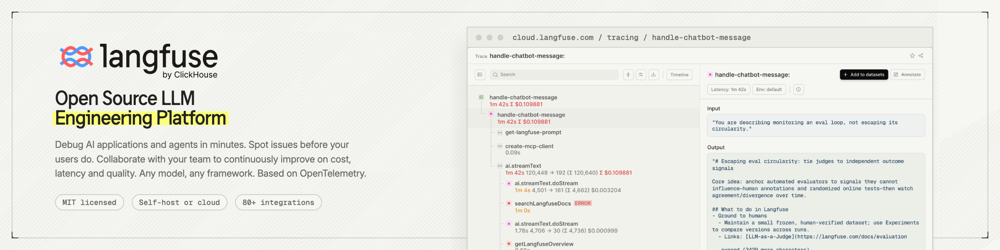
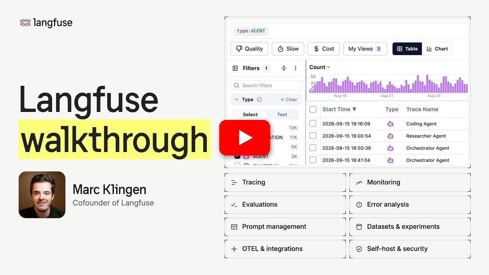

<div align="center">
   <div>
      <h3>
         <a href="https://langfuse.com/kr">
            <strong>🇰🇷 🤝 🪢</strong>
         </a> · 
         <a href="https://cloud.langfuse.com">
            <strong>Langfuse Cloud</strong>
         </a> · 
         <a href="https://langfuse.com/self-hosting">
            <strong>셀프 호스트</strong>
         </a> · 
         <a href="https://langfuse.com/docs/demo">
            <strong>데모</strong>
         </a>
      </h3>
   </div>

   <div>
      <a href="https://langfuse.com/docs"><strong>문서</strong></a> ·
      <a href="https://github.com/langfuse/langfuse/issues"><strong>버그 신고</strong></a> ·
      <a href="https://github.com/orgs/langfuse/discussions/categories/ideas"><strong>기능 요청</strong></a> ·
      <a href="https://langfuse.com/changelog"><strong>변경 로그</strong></a> ·
      <a href="https://langfuse.com/docs/roadmap"><strong>로드맵</strong></a>
   </div>
   <br/>
</div>

<p align="center">
   <a href="https://github.com/langfuse/langfuse/blob/main/LICENSE">
   
   </a>
   <a href="https://www.ycombinator.com/companies/langfuse"></a>
   <a href="https://hub.docker.com/u/langfuse" target="_blank">
   </a>
   <a href="https://pypi.python.org/pypi/langfuse"></a>
   <a href="https://www.npmjs.com/package/@langfuse/core"></a>
   <br/>
   <a href="https://discord.com/invite/7NXusRtqYU" target="_blank">
   </a>
   <a href="https://twitter.com/intent/follow?screen_name=langfuse" target="_blank">
   </a>
   <a href="https://www.linkedin.com/company/langfuse/" target="_blank">
   </a>
   <a href="https://github.com/langfuse/langfuse/graphs/commit-activity" target="_blank">
   </a>
   <a href="https://github.com/langfuse/langfuse/" target="_blank">
   </a>
   <a href="https://github.com/langfuse/langfuse/discussions/" target="_blank">
   </a>
</p>

<p align="center">
  <a href="./README.md"></a>
  <a href="./README.cn.md"></a>
  <a href="./README.ja.md"></a>
  <a href="./README.kr.md"></a>
</p>

Langfuse는 **에이전트 평가와 관측성**을 위한 **오픈 소스 AI 엔지니어링 플랫폼**입니다. 회사에서 발생하는 모든 AI 호출과 팀이 만드는 모든 에이전트를 하나의 개방형 플랫폼에서 다룹니다. 사용량과 비용을 파악하고, 에이전트를 **추적하고 평가**하며, 프로덕션 데이터를 활용해 더 나은 AI를 출시하세요. Langfuse Cloud를 사용하거나 **몇 분 안에 셀프 호스팅**할 수 있으며, 대규모 환경에서 **검증된(battle-tested)** 솔루션입니다.

프로젝트의 짧은 데모를 여기에서 확인하세요:

<a href="https://langfuse.com/watch-demo"></a>

## ✨ 주요 기능


- [AI 관측성](https://langfuse.com/docs/observability/overview): 앱에 계측(instrumentation)을 추가하고 Langfuse로 trace를 수집하여 LLM 호출과 검색, 임베딩, 에이전트 동작 등 앱의 기타 관련 로직을 추적하세요. 복잡한 로그와 사용자 세션을 확인하고 디버깅할 수 있습니다. OpenTelemetry를 기반으로 합니다. 인터랙티브 [데모](https://langfuse.com/docs/demo)에서 실제 동작을 확인해 보세요.

- [프롬프트 관리](https://langfuse.com/docs/prompt-management/overview): 프롬프트를 중앙에서 관리하고 버전 관리하며 협업으로 개선할 수 있도록 도와줍니다. 서버와 클라이언트 측의 강력한 캐싱 덕분에 애플리케이션에 지연(latency)을 추가하지 않고도 프롬프트를 반복 개선할 수 있습니다. [LLM 플레이그라운드](https://langfuse.com/docs/prompt-management/features/playground)에서 프롬프트와 모델 설정을 테스트할 수 있으며, trace에서 좋지 않은 결과를 발견하면 바로 플레이그라운드로 이동해 개선할 수 있습니다.

- [스킬 관리](https://langfuse.com/docs/skill-management/overview)(베타): 에이전트 스킬에 버전 관리와 라벨을 제공합니다. 스킬은 작업 지침이 담긴 `SKILL.md`와 선택적인 보조 파일로 구성됩니다. 애플리케이션 코드를 변경하지 않고 버전을 승격하거나 롤백할 수 있으며, 스킬 버전을 해당 스킬이 생성한 trace와 연결할 수 있습니다.

- [평가](https://langfuse.com/docs/evaluation/overview): 평가는 AI 에이전트 개발 워크플로우의 핵심이며, Langfuse는 여러분의 필요에 맞게 유연하게 대응합니다. LLM-as-a-judge, 코드 평가기, 사용자 피드백 수집, 수동 라벨링 및 API/SDK를 통한 맞춤 평가 파이프라인을 지원합니다. [데이터셋과 실험](https://langfuse.com/docs/evaluation/experiments/datasets)을 사용해 배포 전 테스트와 지속적인 개선을 위한 테스트 세트와 벤치마크를 구축하세요.

- [AI 게이트웨이](https://langfuse.com/docs/gateway/overview)(베타): 조직 전체의 모델 제공자 호출을 하나의 엔드포인트로 모읍니다. 제공자 자격 증명을 한곳에서 관리하고, 사용자별 또는 서비스 계정별 게이트웨이 키를 발급하며, 모델을 중앙에서 승인하고, 사용자·키·모델별 AI 지출을 추적하고, 모든 호출을 Langfuse trace로 기록합니다.

- [메트릭과 대시보드](https://langfuse.com/docs/metrics/overview): [커스텀 대시보드](https://langfuse.com/docs/metrics/features/custom-dashboards), 메트릭 API, 알림을 통해 지연 시간, 비용, 품질을 모든 차원에서 추적하세요.

- [포괄적인 API](https://langfuse.com/docs/api-and-data-platform/overview): Langfuse는 API를 통해 제공되는 빌딩 블록을 활용해 맞춤형 AI 엔지니어링 워크플로우를 구동하는 데 자주 사용됩니다. OpenAPI 명세, Python 및 JS/TS용 타입 SDK, [Langfuse CLI](https://langfuse.com/docs/api-and-data-platform/features/cli), 코딩 에이전트를 위한 [Langfuse Agent Skill](https://langfuse.com/docs/api-and-data-platform/features/agent-skill)을 제공합니다.

## 📦 Langfuse 배포


### Langfuse Cloud

Langfuse 팀이 관리하는 배포 옵션으로, 넉넉한 무료 티어를 제공하며 신용카드가 필요 없습니다.

**[Langfuse Cloud 가입하기 →](https://langfuse.com/cloud)**

### Langfuse 셀프 호스팅

자체 인프라에서 Langfuse를 실행하세요:

- [Docker Compose](https://langfuse.com/self-hosting/deployment/docker-compose): 로컬 머신이나 단일 가상 머신에서 5분 만에 Langfuse를 실행합니다. 가이드에서는 컨테이너 로그가 디스크를 가득 채우지 않도록 Docker 로그 로테이션을 설정하는 방법도 다룹니다.

  ```bash
  # 최신 Langfuse 저장소 복제
  git clone --depth=1 https://github.com/langfuse/langfuse.git
  cd langfuse

  # Langfuse docker compose 실행
  docker compose up
  ```

- [Kubernetes (Helm)](https://langfuse.com/self-hosting/deployment/kubernetes-helm): Helm을 사용하여 Kubernetes 클러스터에서 Langfuse를 실행합니다. 프로덕션 환경에 권장되는 배포 방식입니다.
- Terraform 템플릿: [AWS](https://langfuse.com/self-hosting/deployment/aws), [Azure](https://langfuse.com/self-hosting/deployment/azure), [GCP](https://langfuse.com/self-hosting/deployment/gcp)
- 커뮤니티 관리: [Render](https://langfuse.com/self-hosting/deployment/render), [Railway](https://langfuse.com/self-hosting/deployment/railway)

아키텍처와 구성 옵션에 대한 자세한 내용은 [셀프 호스팅 문서](https://langfuse.com/self-hosting)를 참조하세요.

> [!TIP]
> **Langfuse를 셀프 호스팅하고 계신가요?** [셀프 호스팅 업데이트 목록](https://langfuse.com/self-hosting#subscribe)을 구독하면 오픈 소스 Langfuse의 주요 기능과 새 릴리스 소식을 이메일로 받아볼 수 있습니다. 셀프 호스팅 업데이트만 보내며 마케팅 메일은 보내지 않습니다.

## 🔌 통합


Langfuse는 [OpenTelemetry](https://langfuse.com/integrations/native/opentelemetry)를 기반으로 하므로, OpenTelemetry로 계측된 모든 애플리케이션, 프레임워크 또는 컬렉터가 Langfuse로 trace를 보낼 수 있습니다.

### 주요 통합

| 통합                                                                            | 지원                                  | 설명                                                                                                                                                                   |
| ------------------------------------------------------------------------------- | ------------------------------------- | ---------------------------------------------------------------------------------------------------------------------------------------------------------------------- |
| [OpenTelemetry](https://langfuse.com/integrations/native/opentelemetry)         | 모든 언어                             | 애플리케이션 또는 OpenTelemetry Collector에서 Langfuse의 OpenTelemetry 엔드포인트로 OTLP trace를 전송합니다.                                                           |
| [Langfuse AI 게이트웨이](https://langfuse.com/docs/gateway/overview)(베타)      | 모든 OpenAI 또는 Anthropic 클라이언트 | 하나의 엔드포인트로 모델 호출을 라우팅하여 SDK나 코드 변경 없이 모든 호출을 추적하고, 제공자 키를 한곳에서 관리하며, 비용을 추적합니다.                                |
| [SDK](https://langfuse.com/docs/observability/sdk/overview)                     | Python, JS/TS                         | SDK를 사용한 수동 계측으로 최대한의 유연성을 제공합니다.                                                                                                               |
| [OpenAI](https://langfuse.com/integrations/model-providers/openai-py)           | Python, JS/TS                         | OpenAI SDK의 드롭인 대체를 통한 자동 계측입니다.                                                                                                                       |
| [LangChain & LangGraph](https://langfuse.com/integrations/frameworks/langchain) | Python, JS/TS                         | LangChain 또는 LangGraph 애플리케이션에 콜백 핸들러를 전달하여 자동 계측합니다.                                                                                        |
| [LlamaIndex](https://langfuse.com/integrations/frameworks/llamaindex)           | Python                                | LlamaIndex 콜백 시스템을 통한 자동 계측입니다.                                                                                                                         |
| [Haystack](https://langfuse.com/integrations/frameworks/haystack)               | Python                                | Haystack 콘텐츠 추적 시스템을 통한 자동 계측입니다.                                                                                                                    |
| [LiteLLM](https://langfuse.com/integrations/gateways/litellm)                   | Python, JS/TS (프록시 전용)           | 어떤 LLM이든 GPT의 드롭인 대체로 사용할 수 있습니다. Azure, OpenAI, Cohere, Anthropic, Ollama, VLLM, Sagemaker, HuggingFace, Replicate(100개 이상의 LLM)를 지원합니다. |
| [Vercel AI SDK](https://langfuse.com/integrations/frameworks/vercel-ai-sdk)     | JS/TS                                 | React, Next.js, Vue, Svelte, Node.js로 AI 기반 애플리케이션을 구축할 수 있도록 돕는 TypeScript 툴킷입니다.                                                             |
| [Mastra](https://langfuse.com/integrations/frameworks/mastra)                   | JS/TS                                 | AI 에이전트와 멀티 에이전트 시스템을 구축하기 위한 오픈 소스 프레임워크입니다.                                                                                         |
| [API](https://langfuse.com/docs/api-and-data-platform/features/public-api)      |                                       | 공개 API를 직접 호출합니다. OpenAPI 명세를 제공합니다.                                                                                                                 |

### Langfuse와 통합된 패키지

| 이름                                                                               | 유형                | 설명                                                                                           |
| ---------------------------------------------------------------------------------- | ------------------- | ---------------------------------------------------------------------------------------------- |
| [OpenAI Agents SDK](https://langfuse.com/integrations/frameworks/openai-agents)    | 에이전트 프레임워크 | 멀티 에이전트 워크플로우를 구축하기 위한 OpenAI의 경량 프레임워크                              |
| [Claude Agent SDK](https://langfuse.com/integrations/frameworks/claude-agent-sdk)  | 에이전트 프레임워크 | 도구를 사용하는 에이전트를 구축하기 위한 Anthropic의 오픈 소스 프레임워크(MCP 기본 지원)       |
| [Pydantic AI](https://langfuse.com/integrations/frameworks/pydantic-ai)            | 에이전트 프레임워크 | 타입 안전한 프로덕션급 애플리케이션을 구축하기 위한 Python 에이전트 프레임워크                 |
| [Google ADK](https://langfuse.com/integrations/frameworks/google-adk)              | 에이전트 프레임워크 | 에이전트 구축을 위한 Google의 오픈 소스 Agent Development Kit                                  |
| [Strands Agents](https://langfuse.com/integrations/frameworks/strands-agents)      | 에이전트 프레임워크 | AI 에이전트를 구축하고 실행하기 위한 AWS의 오픈 소스 SDK                                       |
| [Spring AI](https://langfuse.com/integrations/frameworks/spring-ai)                | 에이전트 프레임워크 | Spring 생태계에서 AI 애플리케이션을 구축하기 위한 Java 프레임워크                              |
| [CrewAI](https://langfuse.com/integrations/frameworks/crewai)                      | 에이전트 프레임워크 | 에이전트 간 협업과 도구 사용을 위한 멀티 에이전트 프레임워크                                   |
| [AutoGen](https://langfuse.com/integrations/frameworks/autogen)                    | 에이전트 프레임워크 | 분산 에이전트를 구축하기 위한 오픈 소스 LLM 플랫폼                                             |
| [smolagents](https://langfuse.com/integrations/frameworks/smolagents)              | 에이전트 프레임워크 | 오픈 소스 AI 에이전트 프레임워크                                                               |
| [Instructor](https://langfuse.com/integrations/frameworks/instructor)              | 라이브러리          | 구조화된 LLM 출력(JSON, Pydantic)을 얻기 위한 라이브러리                                       |
| [DSPy](https://langfuse.com/integrations/frameworks/dspy)                          | 라이브러리          | 언어 모델의 프롬프트와 가중치를 체계적으로 최적화하는 프레임워크                               |
| [Mirascope](https://langfuse.com/integrations/frameworks/mirascope)                | 라이브러리          | LLM 애플리케이션 구축을 위한 Python 툴킷                                                       |
| [Ollama](https://langfuse.com/integrations/model-providers/ollama)                 | 모델 (로컬)         | 오픈 소스 LLM을 로컬 머신에서 손쉽게 실행                                                      |
| [Amazon Bedrock](https://langfuse.com/integrations/model-providers/amazon-bedrock) | 모델                | AWS에서 파운데이션 모델과 파인튜닝된 모델을 실행                                               |
| [Flowise](https://langfuse.com/integrations/no-code/flowise)                       | 채팅/에이전트 UI    | 맞춤형 LLM 플로우를 위한 JS/TS 노코드 빌더                                                     |
| [Langflow](https://langfuse.com/integrations/no-code/langflow)                     | 채팅/에이전트 UI    | react-flow로 설계되어 플로우를 손쉽게 실험하고 프로토타이핑할 수 있는 Python 기반 LangChain UI |
| [Dify](https://langfuse.com/integrations/no-code/dify)                             | 채팅/에이전트 UI    | 노코드 빌더를 갖춘 오픈 소스 LLM 앱 개발 플랫폼                                                |
| [OpenWebUI](https://langfuse.com/integrations/no-code/openwebui)                   | 채팅/에이전트 UI    | 셀프 호스팅 및 로컬 모델을 포함한 다양한 LLM 러너를 지원하는 셀프 호스팅 LLM 채팅 웹 UI        |
| [LobeChat](https://langfuse.com/integrations/no-code/lobechat)                     | 채팅/에이전트 UI    | 오픈 소스 챗봇 플랫폼                                                                          |
| [Gradio](https://langfuse.com/integrations/other/gradio)                           | 채팅/에이전트 UI    | 채팅 UI 같은 웹 인터페이스를 만들기 위한 오픈 소스 Python 라이브러리                           |
| [Promptfoo](https://langfuse.com/integrations/other/promptfoo)                     | 도구                | 오픈 소스 LLM 테스트 플랫폼                                                                    |
| [Vapi](https://langfuse.com/integrations/no-code/vapi)                             | 플랫폼              | 오픈 소스 음성 AI 플랫폼                                                                       |
| [Inferable](https://langfuse.com/integrations/frameworks/inferable)                | 에이전트 프레임워크 | 분산 에이전트를 구축하기 위한 오픈 소스 LLM 플랫폼                                             |
| [Goose](https://langfuse.com/integrations/no-code/goose)                           | 에이전트            | Block이 만든, 엔지니어링 작업을 자동화하는 오픈 소스 AI 에이전트                               |

100개 이상의 전체 통합 목록은 [통합 개요](https://langfuse.com/integrations)에서 확인하세요.

## 🚀 빠른 시작

앱에 계측을 추가하고 Langfuse로 trace를 수집하여 LLM 호출과 검색, 임베딩, 에이전트 동작 등 앱의 기타 관련 로직을 추적하세요. 복잡한 로그와 사용자 세션을 확인하고 디버깅할 수 있습니다.

### 🤖 에이전트를 통한 설치 (권장)

[Langfuse Agent Skill](https://github.com/langfuse/skills)을 설치하면 코딩 에이전트가 Langfuse의 모든 기능을 사용할 수 있습니다. 그런 다음 에이전트에게 애플리케이션에 트레이싱을 추가하도록 요청하세요:

```txt
Install the Langfuse Agent Skill from github.com/langfuse/skills
and use it to add tracing to this application with Langfuse
following best practices.
```

[skills CLI](https://www.npmjs.com/package/skills)(`npx skills add langfuse/skills --skill "langfuse"`) 또는 [Langfuse Cursor 플러그인](https://cursor.com/marketplace/langfuse)으로도 스킬을 설치할 수 있습니다. 에이전트가 MCP를 지원한다면 [Langfuse Docs MCP 서버](https://langfuse.com/docs/docs-mcp)(`https://langfuse.com/api/mcp`, 인증 불필요)를 추가하여 작업 중에 최신 문서를 참조하도록 하세요. 자세한 내용은 [시작 가이드](https://langfuse.com/docs/observability/get-started)를 참조하세요.

### 🛠️ 수동 설치

#### 1️⃣ 새 프로젝트 생성

1.  [Langfuse 계정을 생성](https://langfuse.com/cloud)하거나 [셀프 호스팅](https://langfuse.com/self-hosting)하세요
2.  새 프로젝트를 생성하세요
3.  프로젝트 설정에서 새 API 자격 증명을 생성하세요

#### 2️⃣ 첫 번째 LLM 호출 기록하기

[`@observe()` 데코레이터](https://langfuse.com/docs/observability/sdk/instrumentation#observe-wrapper)를 사용하면 모든 Python LLM 애플리케이션을 쉽게 추적할 수 있습니다. 이 빠른 시작에서는 Langfuse [OpenAI 통합](https://langfuse.com/integrations/model-providers/openai-py)을 함께 사용하여 모든 모델 파라미터를 자동으로 수집합니다.

> [!TIP]
> OpenAI를 사용하지 않나요? 다른 모델과 프레임워크를 기록하는 방법은 [문서](https://langfuse.com/docs/observability/get-started)를 참고하세요.

```bash
pip install langfuse openai
```

```bash filename=".env"
LANGFUSE_SECRET_KEY="sk-lf-..."
LANGFUSE_PUBLIC_KEY="pk-lf-..."
LANGFUSE_BASE_URL="https://cloud.langfuse.com" # 🇪🇺 EU 리전
# LANGFUSE_BASE_URL="https://us.cloud.langfuse.com" # 🇺🇸 US 리전
# LANGFUSE_BASE_URL="https://jp.cloud.langfuse.com" # 🇯🇵 일본 리전
# LANGFUSE_BASE_URL="https://hipaa.cloud.langfuse.com" # ⚕️ HIPAA 리전
```

```python /@observe()/ /from langfuse.openai import openai/ filename="main.py"
from langfuse import observe
from langfuse.openai import openai # OpenAI 통합

@observe()
def story():
    return openai.chat.completions.create(
        model="gpt-4o",
        messages=[{"role": "user", "content": "What is Langfuse?"}],
    ).choices[0].message.content

@observe()
def main():
    return story()

main()
```

#### 3️⃣ Langfuse에서 trace 확인하기

Langfuse에서 LLM 호출 및 애플리케이션의 기타 로직을 확인하세요.


_[Langfuse의 공개 예제 trace](https://cloud.langfuse.com/project/cloramnkj0002jz088vzn1ja4/traces/db22d0a442216b485abd83cc9df6d9ee)_

## 💭 지원

질문에 대한 답변을 찾는 방법:

- [문서](https://langfuse.com/docs)는 답을 찾기 위한 최적의 장소입니다. 문서가 매우 포괄적이며, 유지보수에 많은 노력을 기울이고 있습니다. GitHub를 통해 문서 수정 제안도 가능합니다.
- [Langfuse FAQ](https://langfuse.com/faq)에서는 가장 흔한 질문에 대해 답변하고 있습니다.
- 질문에 즉각적인 답변이 필요하다면 "[Ask AI](https://langfuse.com/docs/ask-ai)"를 사용해 보세요.

지원 채널:

- **GitHub Discussions의 [공개 Q&A](https://github.com/orgs/langfuse/discussions/categories/support)에 질문을 남겨주세요.** 가능한 한 많은 세부 사항(예: 코드 스니펫, 스크린샷, 배경 정보)을 포함해 주시기 바랍니다.
- GitHub Discussions에서 [기능 요청](https://github.com/orgs/langfuse/discussions/categories/ideas)을 남겨주세요.
- GitHub Issues에서 [버그를 신고](https://github.com/langfuse/langfuse/issues)해 주세요.
- 긴급한 문의는 앱 내 채팅 위젯을 통해 연락 바랍니다.

## 🤝 기여하기

여러분의 기여를 환영합니다!

- GitHub Discussions의 [아이디어](https://github.com/orgs/langfuse/discussions/categories/ideas)에 투표해 보세요.
- [이슈](https://github.com/langfuse/langfuse/issues)를 제기하고 댓글을 남겨주세요.
- PR을 제출하세요. 개발 환경 설정 방법 등 자세한 내용은 [CONTRIBUTING.md](CONTRIBUTING.md)를 참조하세요.

## 🥇 라이선스

이 저장소는 `ee` 폴더를 제외하고 MIT 라이선스가 적용됩니다. 자세한 내용은 [LICENSE](LICENSE)와 [문서](https://langfuse.com/handbook/chapters/open-source)를 확인하세요.

## 의존성

이 코드베이스는 Docker 컨테이너로 배포됩니다. 사용하는 베이스 이미지를 포함한 이미지 빌드 방식은 [web/Dockerfile](web/Dockerfile)과 [worker/Dockerfile](worker/Dockerfile)을 참고하세요.

## ⭐️ 별(Star) 히스토리

<a href="https://star-history.com/#langfuse/langfuse&Date">
 <picture>
   <source media="(prefers-color-scheme: dark)" srcset="https://api.star-history.com/svg?repos=langfuse/langfuse&type=Date&theme=dark" />
   <source media="(prefers-color-scheme: light)" srcset="https://api.star-history.com/svg?repos=langfuse/langfuse&type=Date" />
   
 </picture>
</a>

## ❤️ Langfuse를 사용하는 오픈 소스 프로젝트

별(star) 수를 기준으로 순위가 매겨진 Langfuse Python 또는 JS/TS SDK를 사용하는 상위 오픈 소스 프로젝트들 ([출처](https://github.com/langfuse/langfuse-docs/blob/main/components-mdx/dependents)):

| 저장소                                                                                                                                                                                                                                                                                                         |     별 |
| :------------------------------------------------------------------------------------------------------------------------------------------------------------------------------------------------------------------------------------------------------------------------------------------------------------- | -----: |
|  &nbsp; [Significant-Gravitas](https://github.com/Significant-Gravitas) / [AutoGPT](https://github.com/Significant-Gravitas/AutoGPT)                                                   | 187903 |
|  &nbsp; [langgenius](https://github.com/langgenius) / [dify](https://github.com/langgenius/dify)                                                                                       | 160407 |
|  &nbsp; [langflow-ai](https://github.com/langflow-ai) / [langflow](https://github.com/langflow-ai/langflow)                                                                             | 156333 |
|  &nbsp; [bytedance](https://github.com/bytedance) / [deer-flow](https://github.com/bytedance/deer-flow)                                                                                  |  84985 |
|  &nbsp; [cheaper-inference](https://github.com/cheaper-inference) / [OmniRoute](https://github.com/cheaper-inference/OmniRoute)                                                        |  84532 |
|  &nbsp; [lobehub](https://github.com/lobehub) / [lobehub](https://github.com/lobehub/lobehub)                                                                                          |  83873 |
|  &nbsp; [abi](https://github.com/abi) / [screenshot-to-code](https://github.com/abi/screenshot-to-code)                                                                                    |  81022 |
|  &nbsp; [microsoft](https://github.com/microsoft) / [ai-agents-for-beginners](https://github.com/microsoft/ai-agents-for-beginners)                                                      |  78925 |
|  &nbsp; [openai](https://github.com/openai) / [openai-cookbook](https://github.com/openai/openai-cookbook)                                                                              |  76955 |
|  &nbsp; [cline](https://github.com/cline) / [cline](https://github.com/cline/cline)                                                                                                    |  71312 |
|  &nbsp; [BerriAI](https://github.com/BerriAI) / [litellm](https://github.com/BerriAI/litellm)                                                                                          |  62709 |
|  &nbsp; [run-llama](https://github.com/run-llama) / [llama_index](https://github.com/run-llama/llama_index)                                                                            |  52806 |
|  &nbsp; [LibreChat-AI](https://github.com/LibreChat-AI) / [LibreChat](https://github.com/LibreChat-AI/LibreChat)                                                                       |  46745 |
|  &nbsp; [volcengine](https://github.com/volcengine) / [OpenViking](https://github.com/volcengine/OpenViking)                                                                            |  41535 |
|  &nbsp; [HKUDS](https://github.com/HKUDS) / [LightRAG](https://github.com/HKUDS/LightRAG)                                                                                              |  40529 |
|  &nbsp; [directus](https://github.com/directus) / [directus](https://github.com/directus/directus)                                                                                      |  38820 |
|  &nbsp; [DayuanJiang](https://github.com/DayuanJiang) / [next-ai-draw-io](https://github.com/DayuanJiang/next-ai-draw-io)                                                               |  36683 |
|  &nbsp; [onyx-dot-app](https://github.com/onyx-dot-app) / [onyx](https://github.com/onyx-dot-app/onyx)                                                                                 |  33212 |
|  &nbsp; [labring](https://github.com/labring) / [FastGPT](https://github.com/labring/FastGPT)                                                                                          |  29994 |
|  &nbsp; [mastra-ai](https://github.com/mastra-ai) / [mastra](https://github.com/mastra-ai/mastra)                                                                                      |  29335 |
|  &nbsp; [vercel](https://github.com/vercel) / [ai](https://github.com/vercel/ai)                                                                                                        |  27740 |
|  &nbsp; [onlook-dev](https://github.com/onlook-dev) / [onlook](https://github.com/onlook-dev/onlook)                                                                                   |  27117 |
|  &nbsp; [promptfoo](https://github.com/promptfoo) / [promptfoo](https://github.com/promptfoo/promptfoo)                                                                                |  26836 |
|  &nbsp; [kortix-ai](https://github.com/kortix-ai) / [CompanyOS](https://github.com/kortix-ai/CompanyOS)                                                                                |  20378 |
|  &nbsp; [gastownhall](https://github.com/gastownhall) / [gastown](https://github.com/gastownhall/gastown)                                                                              |  18691 |
|  &nbsp; [camel-ai](https://github.com/camel-ai) / [camel](https://github.com/camel-ai/camel)                                                                                           |  18010 |
|  &nbsp; [suitenumerique](https://github.com/suitenumerique) / [docs](https://github.com/suitenumerique/docs)                                                                           |  16967 |
|  &nbsp; [Arindam200](https://github.com/Arindam200) / [awesome-ai-apps](https://github.com/Arindam200/awesome-ai-apps)                                                                 |  16712 |
|  &nbsp; [apify](https://github.com/apify) / [apify-mcp-server](https://github.com/apify/apify-mcp-server)                                                                               |  14774 |
|  &nbsp; [The-PR-Agent](https://github.com/The-PR-Agent) / [pr-agent](https://github.com/The-PR-Agent/pr-agent)                                                                         |  14686 |
|  &nbsp; [microsoft](https://github.com/microsoft) / [agent-framework](https://github.com/microsoft/agent-framework)                                                                      |  14532 |
|  &nbsp; [The-Pocket](https://github.com/The-Pocket) / [PocketFlow](https://github.com/The-Pocket/PocketFlow)                                                                           |  11303 |
|  &nbsp; [openai](https://github.com/openai) / [codex-security](https://github.com/openai/codex-security)                                                                                |  11301 |
|  &nbsp; [tambo-ai](https://github.com/tambo-ai) / [tambo](https://github.com/tambo-ai/tambo)                                                                                           |  11222 |
|  &nbsp; [VoltAgent](https://github.com/VoltAgent) / [voltagent](https://github.com/VoltAgent/voltagent)                                                                                |  10920 |
|  &nbsp; [mcp-use](https://github.com/mcp-use) / [mcp-use](https://github.com/mcp-use/mcp-use)                                                                                          |  10846 |
|  &nbsp; [yugabyte](https://github.com/yugabyte) / [yugabyte-db](https://github.com/yugabyte/yugabyte-db)                                                                                |  10649 |
|  &nbsp; [droidrun](https://github.com/droidrun) / [mobilerun](https://github.com/droidrun/mobilerun)                                                                                   |   9947 |
|  &nbsp; [MervinPraison](https://github.com/MervinPraison) / [PraisonAI](https://github.com/MervinPraison/PraisonAI)                                                                       |   9321 |
|  &nbsp; [miurla](https://github.com/miurla) / [morphic](https://github.com/miurla/morphic)                                                                                               |   9275 |
|  &nbsp; [plastic-labs](https://github.com/plastic-labs) / [honcho](https://github.com/plastic-labs/honcho)                                                                             |   7944 |
|  &nbsp; [raycast](https://github.com/raycast) / [extensions](https://github.com/raycast/extensions)                                                                                     |   7832 |
|  &nbsp; [2FastLabs](https://github.com/2FastLabs) / [agent-squad](https://github.com/2FastLabs/agent-squad)                                                                            |   7799 |
|  &nbsp; [xerrors](https://github.com/xerrors) / [Yuxi](https://github.com/xerrors/Yuxi)                                                                                                 |   7601 |
|  &nbsp; [refly-ai](https://github.com/refly-ai) / [refly](https://github.com/refly-ai/refly)                                                                                           |   7547 |
|  &nbsp; [crestalnetwork](https://github.com/crestalnetwork) / [intentkit](https://github.com/crestalnetwork/intentkit)                                                                 |   6524 |
|  &nbsp; [coleam00](https://github.com/coleam00) / [ottomator-agents](https://github.com/coleam00/ottomator-agents)                                                                      |   5791 |
|  &nbsp; [zenml-io](https://github.com/zenml-io) / [zenml](https://github.com/zenml-io/zenml)                                                                                            |   5635 |
|  &nbsp; [colanode](https://github.com/colanode) / [colanode](https://github.com/colanode/colanode)                                                                                     |   5186 |
|  &nbsp; [getzep](https://github.com/getzep) / [zep](https://github.com/getzep/zep)                                                                                                     |   4989 |
|  &nbsp; [langflow-ai](https://github.com/langflow-ai) / [openrag](https://github.com/langflow-ai/openrag)                                                                               |   4671 |
|  &nbsp; [JoshuaC215](https://github.com/JoshuaC215) / [agent-service-toolkit](https://github.com/JoshuaC215/agent-service-toolkit)                                                       |   4564 |
|  &nbsp; [FlowElement-xinliuyuansu](https://github.com/FlowElement-xinliuyuansu) / [m_flow](https://github.com/FlowElement-xinliuyuansu/m_flow)                                         |   4509 |
|  &nbsp; [panaversity](https://github.com/panaversity) / [learn-agentic-ai](https://github.com/panaversity/learn-agentic-ai)                                                             |   4395 |
|  &nbsp; [bragai](https://github.com/bragai) / [bRAG-langchain](https://github.com/bragai/bRAG-langchain)                                                                               |   4196 |
|  &nbsp; [strukto-ai](https://github.com/strukto-ai) / [mirage](https://github.com/strukto-ai/mirage)                                                                                   |   3763 |
|  &nbsp; [awslabs](https://github.com/awslabs) / [agentcore-samples](https://github.com/awslabs/agentcore-samples)                                                                        |   3512 |
|  &nbsp; [ding113](https://github.com/ding113) / [claude-code-hub](https://github.com/ding113/claude-code-hub)                                                                           |   3399 |
|  &nbsp; [rpamis](https://github.com/rpamis) / [comet](https://github.com/rpamis/comet)                                                                                                 |   3270 |
|  &nbsp; [remix-project-org](https://github.com/remix-project-org) / [remix-project](https://github.com/remix-project-org/remix-project)                                                |   3096 |
|  &nbsp; [tsedio](https://github.com/tsedio) / [tsed](https://github.com/tsedio/tsed)                                                                                                    |   3091 |
|  &nbsp; [MetaMask](https://github.com/MetaMask) / [metamask-mobile](https://github.com/MetaMask/metamask-mobile)                                                                        |   3080 |
|  &nbsp; [pingcap](https://github.com/pingcap) / [autoflow](https://github.com/pingcap/autoflow)                                                                                         |   2979 |
|  &nbsp; [wassim249](https://github.com/wassim249) / [fastapi-langgraph-agent-production-ready-template](https://github.com/wassim249/fastapi-langgraph-agent-production-ready-template) |   2726 |
|  &nbsp; [Agent-Field](https://github.com/Agent-Field) / [agentfield](https://github.com/Agent-Field/agentfield)                                                                        |   2644 |
|  &nbsp; [suitenumerique](https://github.com/suitenumerique) / [meet](https://github.com/suitenumerique/meet)                                                                           |   2468 |
|  &nbsp; [YFGaia](https://github.com/YFGaia) / [dify-plus](https://github.com/YFGaia/dify-plus)                                                                                         |   2263 |
|  &nbsp; [PrimeIntellect-ai](https://github.com/PrimeIntellect-ai) / [prime-rl](https://github.com/PrimeIntellect-ai/prime-rl)                                                          |   2215 |
|  &nbsp; [TheSpaghettiDetective](https://github.com/TheSpaghettiDetective) / [obico-server](https://github.com/TheSpaghettiDetective/obico-server)                                       |   1924 |
|  &nbsp; [ai-hero-dev](https://github.com/ai-hero-dev) / [ai-hero](https://github.com/ai-hero-dev/ai-hero)                                                                              |   1915 |
|  &nbsp; [arabold](https://github.com/arabold) / [docs-mcp-server](https://github.com/arabold/docs-mcp-server)                                                                            |   1856 |
|  &nbsp; [trailofbits](https://github.com/trailofbits) / [buttercup](https://github.com/trailofbits/buttercup)                                                                            |   1741 |
|  &nbsp; [MLSysOps](https://github.com/MLSysOps) / [MLE-agent](https://github.com/MLSysOps/MLE-agent)                                                                                    |   1580 |
|  &nbsp; [kodustech](https://github.com/kodustech) / [kodus-ai](https://github.com/kodustech/kodus-ai)                                                                                   |   1565 |
|  &nbsp; [bugbasesecurity](https://github.com/bugbasesecurity) / [pentest-copilot](https://github.com/bugbasesecurity/pentest-copilot)                                                   |   1546 |
|  &nbsp; [agentconnect-md](https://github.com/agentconnect-md) / [agentconnect](https://github.com/agentconnect-md/agentconnect)                                                        |   1514 |
|  &nbsp; [TIGER-AI-Lab](https://github.com/TIGER-AI-Lab) / [TheoremExplainAgent](https://github.com/TIGER-AI-Lab/TheoremExplainAgent)                                                   |   1513 |
|  &nbsp; [hashgraph-online](https://github.com/hashgraph-online) / [awesome-codex-plugins](https://github.com/hashgraph-online/awesome-codex-plugins)                                   |   1508 |
|  &nbsp; [Gsync](https://github.com/Gsync) / [jobsync](https://github.com/Gsync/jobsync)                                                                                                 |   1493 |
|  &nbsp; [inkeep](https://github.com/inkeep) / [agents](https://github.com/inkeep/agents)                                                                                               |   1490 |
|  &nbsp; [zstar1003](https://github.com/zstar1003) / [ragflow-plus](https://github.com/zstar1003/ragflow-plus)                                                                           |   1465 |
|  &nbsp; [hotovo](https://github.com/hotovo) / [aider-desk](https://github.com/hotovo/aider-desk)                                                                                         |   1463 |
|  &nbsp; [cline](https://github.com/cline) / [kanban](https://github.com/cline/kanban)                                                                                                  |   1376 |
|  &nbsp; [wanxingai](https://github.com/wanxingai) / [LightAgent](https://github.com/wanxingai/LightAgent)                                                                              |   1245 |
|  &nbsp; [FranciscoMoretti](https://github.com/FranciscoMoretti) / [chat-js](https://github.com/FranciscoMoretti/chat-js)                                                                |   1203 |
|  &nbsp; [cognizant-ai-lab](https://github.com/cognizant-ai-lab) / [neuro-san-studio](https://github.com/cognizant-ai-lab/neuro-san-studio)                                              |   1194 |
|  &nbsp; [okou-ai](https://github.com/okou-ai) / [okou](https://github.com/okou-ai/okou)                                                                                                |   1162 |
|  &nbsp; [alishobeiri](https://github.com/alishobeiri) / [thread-notebook](https://github.com/alishobeiri/thread-notebook)                                                               |   1106 |
|  &nbsp; [openops-cloud](https://github.com/openops-cloud) / [openops](https://github.com/openops-cloud/openops)                                                                        |   1081 |
|  &nbsp; [dynamiq-ai](https://github.com/dynamiq-ai) / [dynamiq](https://github.com/dynamiq-ai/dynamiq)                                                                                 |   1073 |
|  &nbsp; [trendy-design](https://github.com/trendy-design) / [llmchat](https://github.com/trendy-design/llmchat)                                                                        |   1072 |
|  &nbsp; [cuga-project](https://github.com/cuga-project) / [cuga-agent](https://github.com/cuga-project/cuga-agent)                                                                     |   1070 |
|  &nbsp; [Minima-AI-Inc](https://github.com/Minima-AI-Inc) / [minima](https://github.com/Minima-AI-Inc/minima)                                                                          |   1056 |
|  &nbsp; [ZTE-AICloud](https://github.com/ZTE-AICloud) / [Co-Sight](https://github.com/ZTE-AICloud/Co-Sight)                                                                            |   1015 |
|  &nbsp; [china-qijizhifeng](https://github.com/china-qijizhifeng) / [agentic-harness-engineering](https://github.com/china-qijizhifeng/agentic-harness-engineering)                    |    959 |
|  &nbsp; [sanity-io](https://github.com/sanity-io) / [next-sanity](https://github.com/sanity-io/next-sanity)                                                                             |    956 |
|  &nbsp; [plastic-labs](https://github.com/plastic-labs) / [tutor-gpt](https://github.com/plastic-labs/tutor-gpt)                                                                       |    933 |
|  &nbsp; [strands-agents](https://github.com/strands-agents) / [samples](https://github.com/strands-agents/samples)                                                                     |    924 |
|  &nbsp; [andysingal](https://github.com/andysingal) / [llm-course](https://github.com/andysingal/llm-course)                                                                            |    891 |
|  &nbsp; [groq](https://github.com/groq) / [openbench](https://github.com/groq/openbench)                                                                                                 |    832 |

## 🔒 보안 & 개인정보 보호

우리는 데이터 보안과 개인정보 보호를 매우 중요하게 생각합니다. 자세한 내용은 [보안 및 개인정보 보호](https://langfuse.com/security) 페이지를 참조하세요.

### 텔레메트리

기본적으로 Langfuse는 셀프 호스팅 인스턴스의 기본 사용 통계를 중앙 서버(PostHog)로 자동 보고합니다.

이를 통해:

1. Langfuse가 어떻게 사용되는지 이해하고, 가장 관련성 높은 기능을 개선할 수 있습니다.
2. 내부 및 외부(예: 투자 유치) 보고를 위한 전체 사용량을 추적할 수 있습니다.

텔레메트리에는 원시 traces, prompts, observations, scores 또는 데이터셋 내용이 포함되지 않습니다. 수집되는 정확한 필드, 전송 대상, 구현 참조는 [텔레메트리 문서](https://langfuse.com/self-hosting/security/telemetry)에 정리되어 있습니다.

Langfuse OSS에서는 환경 변수 `TELEMETRY_ENABLED=false`를 설정하여 옵트아웃할 수 있습니다.

<!-- Scarf pixel — cookie-free, privacy-friendly analytics for README views (no cookies, no IP/PII stored). https://docs.scarf.sh/web-traffic/ -->

