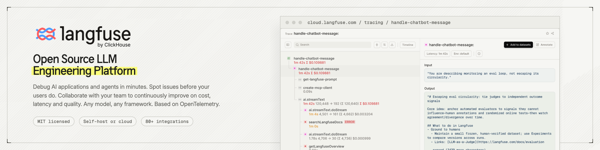
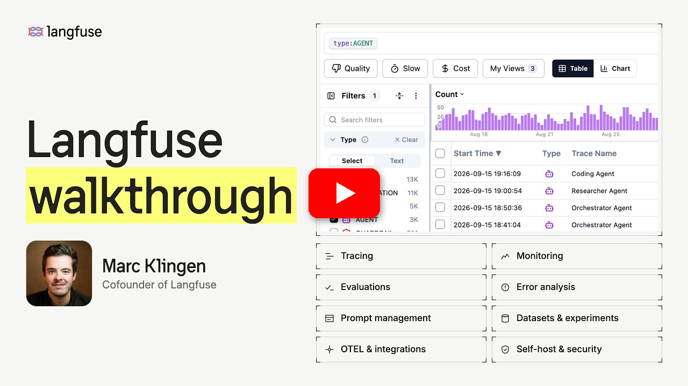

<div align="center">
   <div>
      <h3>
         <a href="https://cloud.langfuse.com">
            <strong>Langfuse Cloud</strong>
         </a> · 
         <a href="https://langfuse.com/self-hosting">
            <strong>Self-Host</strong>
         </a> · 
         <a href="https://langfuse.com/docs/demo">
            <strong>Demo</strong>
         </a>
      </h3>
   </div>

   <div>
      <a href="https://langfuse.com/docs"><strong>Docs</strong></a> ·
      <a href="https://github.com/langfuse/langfuse/issues"><strong>Report Bug</strong></a> ·
      <a href="https://github.com/orgs/langfuse/discussions/categories/ideas"><strong>Feature Request</strong></a> ·
      <a href="https://langfuse.com/changelog"><strong>Changelog</strong></a> ·
      <a href="https://langfuse.com/docs/roadmap"><strong>Roadmap</strong></a>
   </div>
   <br/>
</div>

<p align="center">
   <a href="https://github.com/langfuse/langfuse/blob/main/LICENSE">
   
   </a>
   <a href="https://www.ycombinator.com/companies/langfuse"></a>
   <a href="https://hub.docker.com/u/langfuse" target="_blank">
   </a>
   <a href="https://pypi.python.org/pypi/langfuse"></a>
   <a href="https://www.npmjs.com/package/@langfuse/core"></a>
   <br/>
   <a href="https://discord.com/invite/7NXusRtqYU" target="_blank">
   </a>
   <a href="https://twitter.com/intent/follow?screen_name=langfuse" target="_blank">
   </a>
   <a href="https://www.linkedin.com/company/langfuse/" target="_blank">
   </a>
   <a href="https://github.com/langfuse/langfuse/graphs/commit-activity" target="_blank">
   </a>
   <a href="https://github.com/langfuse/langfuse/" target="_blank">
   </a>
   <a href="https://github.com/langfuse/langfuse/discussions/" target="_blank">
   </a>
</p>

<p align="center">
  <a href="./README.md"></a>
  <a href="./README.cn.md"></a>
  <a href="./README.ja.md"></a>
  <a href="./README.kr.md"></a>
</p>

Langfuse is an **open source AI engineering platform** for **agent evals and observability**. It is one open platform for every AI call your company makes and every agent your teams build: track usage and costs, **trace and evaluate** agents, and use production data to ship better AI. Use Langfuse Cloud or **self-host in minutes**; Langfuse is **battle-tested** at scale.

Watch a quick demo of the project here:

<a href="https://langfuse.com/watch-demo"></a>

> ### 🧑‍💻 We're hiring
>
> Interested in contributing to Langfuse full-time? Langfuse is growing fast (we doubled the team in the last 6 months). Since January 2026 we're part of ClickHouse. We hire remotely, with offices in Berlin, San Francisco, Amsterdam, and New York.
> **[See open roles →](https://langfuse.com/careers?utm_source=github&utm_medium=readme&utm_campaign=hiring&utm_content=langfuse)**

## ✨ Core Features


- [AI Observability](https://langfuse.com/docs/observability/overview): Instrument your app and start ingesting traces to Langfuse, thereby tracking LLM calls and other relevant logic in your app such as retrieval, embedding, or agent actions. Inspect and debug complex logs and user sessions. Built on OpenTelemetry. Try the interactive [demo](https://langfuse.com/docs/demo) to see this in action.

- [Prompt Management](https://langfuse.com/docs/prompt-management/overview) helps you centrally manage, version control, and collaboratively iterate on your prompts. Thanks to strong caching on server and client side, you can iterate on prompts without adding latency to your application. The [LLM Playground](https://langfuse.com/docs/prompt-management/features/playground) lets you test prompts and model configurations; when you see a bad result in tracing, you can jump straight to the playground to iterate on it.

- [Skill Management](https://langfuse.com/docs/skill-management/overview) (beta) brings versioning and labels to agent skills: a `SKILL.md` with task instructions plus optional supporting files. Promote or roll back versions without changing application code, and link skill versions to the traces they produced.

- [Evaluations](https://langfuse.com/docs/evaluation/overview) are key to the AI agent development workflow, and Langfuse adapts to your needs. It supports LLM-as-a-judge, code evaluators, user feedback collection, manual labeling, and custom evaluation pipelines via APIs/SDKs. Use [Datasets and Experiments](https://langfuse.com/docs/evaluation/experiments/datasets) to build test sets and benchmarks for pre-deployment testing and continuous improvement.

- [AI Gateway](https://langfuse.com/docs/gateway/overview) (beta) gives your organization one endpoint for calls to your model providers. Keep provider credentials in one place, hand out per-user or service account gateway keys, approve models centrally, track AI spend per user, key, and model, and record every call as a Langfuse trace.

- [Metrics and Dashboards](https://langfuse.com/docs/metrics/overview): Track latency, cost, and quality across any dimension with [custom dashboards](https://langfuse.com/docs/metrics/features/custom-dashboards), the metrics API, and alerts.

- [Comprehensive API](https://langfuse.com/docs/api-and-data-platform/overview): Langfuse is frequently used to power bespoke AI engineering workflows while using the building blocks provided by Langfuse via the API. An OpenAPI spec, typed SDKs for Python and JS/TS, the [Langfuse CLI](https://langfuse.com/docs/api-and-data-platform/features/cli), and the [Langfuse Agent Skill](https://langfuse.com/docs/api-and-data-platform/features/agent-skill) for coding agents are available.

## 📦 Deploy Langfuse


### Langfuse Cloud

Managed deployment by the Langfuse team, generous free tier, no credit card required.

**[Sign up for Langfuse Cloud →](https://langfuse.com/cloud)**

### Self-Host Langfuse

Run Langfuse on your own infrastructure:

- [Docker Compose](https://langfuse.com/self-hosting/deployment/docker-compose): Run Langfuse on your own machine or a single virtual machine in 5 minutes. The guide also covers configuring Docker log rotation so container logs don't fill up the disk.

  ```bash
  # Get a copy of the latest Langfuse repository
  git clone --depth=1 https://github.com/langfuse/langfuse.git
  cd langfuse

  # Run the langfuse docker compose
  docker compose up
  ```

- [Kubernetes (Helm)](https://langfuse.com/self-hosting/deployment/kubernetes-helm): Run Langfuse on a Kubernetes cluster using Helm. This is the preferred production deployment.
- Terraform Templates: [AWS](https://langfuse.com/self-hosting/deployment/aws), [Azure](https://langfuse.com/self-hosting/deployment/azure), [GCP](https://langfuse.com/self-hosting/deployment/gcp)
- Community-maintained: [Render](https://langfuse.com/self-hosting/deployment/render), [Railway](https://langfuse.com/self-hosting/deployment/railway)

See [self-hosting documentation](https://langfuse.com/self-hosting) to learn more about architecture and configuration options.

> [!TIP]
> **Self-hosting Langfuse?** Subscribe to the [self-hosting update list](https://langfuse.com/self-hosting#subscribe) to get an email about important features and new releases for open source Langfuse — self-hosting updates only, no marketing.

## 🔌 Integrations


Langfuse is built on [OpenTelemetry](https://langfuse.com/integrations/native/opentelemetry), so any OpenTelemetry-instrumented application, framework, or collector can send traces to Langfuse.

### Main Integrations

| Integration                                                                     | Supports                       | Description                                                                                                                                      |
| ------------------------------------------------------------------------------- | ------------------------------ | ------------------------------------------------------------------------------------------------------------------------------------------------ |
| [OpenTelemetry](https://langfuse.com/integrations/native/opentelemetry)         | Any language                   | Send OTLP traces from your application or OpenTelemetry Collector to Langfuse's OpenTelemetry endpoint.                                          |
| [Langfuse AI Gateway](https://langfuse.com/docs/gateway/overview) (beta)        | Any OpenAI or Anthropic client | Route model calls through one endpoint to trace every call, keep provider keys in one place, and track cost without SDK or code changes.         |
| [SDK](https://langfuse.com/docs/observability/sdk/overview)                     | Python, JS/TS                  | Manual instrumentation using the SDKs for full flexibility.                                                                                      |
| [OpenAI](https://langfuse.com/integrations/model-providers/openai-py)           | Python, JS/TS                  | Automated instrumentation using drop-in replacement of OpenAI SDK.                                                                               |
| [LangChain & LangGraph](https://langfuse.com/integrations/frameworks/langchain) | Python, JS/TS                  | Automated instrumentation by passing callback handler to LangChain or LangGraph application.                                                     |
| [LlamaIndex](https://langfuse.com/integrations/frameworks/llamaindex)           | Python                         | Automated instrumentation via LlamaIndex callback system.                                                                                        |
| [Haystack](https://langfuse.com/integrations/frameworks/haystack)               | Python                         | Automated instrumentation via Haystack content tracing system.                                                                                   |
| [LiteLLM](https://langfuse.com/integrations/gateways/litellm)                   | Python, JS/TS (proxy only)     | Use any LLM as a drop-in replacement for GPT. Use Azure, OpenAI, Cohere, Anthropic, Ollama, VLLM, Sagemaker, HuggingFace, Replicate (100+ LLMs). |
| [Vercel AI SDK](https://langfuse.com/integrations/frameworks/vercel-ai-sdk)     | JS/TS                          | TypeScript toolkit designed to help developers build AI-powered applications with React, Next.js, Vue, Svelte, Node.js.                          |
| [Mastra](https://langfuse.com/integrations/frameworks/mastra)                   | JS/TS                          | Open source framework for building AI agents and multi-agent systems.                                                                            |
| [API](https://langfuse.com/docs/api-and-data-platform/features/public-api)      |                                | Directly call the public API. OpenAPI spec available.                                                                                            |

### Packages integrated with Langfuse

| Name                                                                               | Type               | Description                                                                                                             |
| ---------------------------------------------------------------------------------- | ------------------ | ----------------------------------------------------------------------------------------------------------------------- |
| [OpenAI Agents SDK](https://langfuse.com/integrations/frameworks/openai-agents)    | Agent Framework    | Lightweight framework from OpenAI for building multi-agent workflows.                                                   |
| [Claude Agent SDK](https://langfuse.com/integrations/frameworks/claude-agent-sdk)  | Agent Framework    | Anthropic's open source framework for building tool-using agents with native MCP support.                               |
| [Pydantic AI](https://langfuse.com/integrations/frameworks/pydantic-ai)            | Agent Framework    | Python agent framework for building production-grade applications with type safety.                                     |
| [Google ADK](https://langfuse.com/integrations/frameworks/google-adk)              | Agent Framework    | Google's open source Agent Development Kit for building agents.                                                         |
| [Strands Agents](https://langfuse.com/integrations/frameworks/strands-agents)      | Agent Framework    | Open source SDK by AWS for building and running AI agents.                                                              |
| [Spring AI](https://langfuse.com/integrations/frameworks/spring-ai)                | Agent Framework    | Java framework for building AI applications in the Spring ecosystem.                                                    |
| [CrewAI](https://langfuse.com/integrations/frameworks/crewai)                      | Agent Framework    | Multi agent framework for agent collaboration and tool use.                                                             |
| [AutoGen](https://langfuse.com/integrations/frameworks/autogen)                    | Agent Framework    | Open source LLM platform for building distributed agents.                                                               |
| [smolagents](https://langfuse.com/integrations/frameworks/smolagents)              | Agent Framework    | Open source AI agents framework.                                                                                        |
| [Instructor](https://langfuse.com/integrations/frameworks/instructor)              | Library            | Library to get structured LLM outputs (JSON, Pydantic).                                                                 |
| [DSPy](https://langfuse.com/integrations/frameworks/dspy)                          | Library            | Framework that systematically optimizes language model prompts and weights.                                             |
| [Mirascope](https://langfuse.com/integrations/frameworks/mirascope)                | Library            | Python toolkit for building LLM applications.                                                                           |
| [Ollama](https://langfuse.com/integrations/model-providers/ollama)                 | Model (local)      | Easily run open source LLMs on your own machine.                                                                        |
| [Amazon Bedrock](https://langfuse.com/integrations/model-providers/amazon-bedrock) | Model              | Run foundation and fine-tuned models on AWS.                                                                            |
| [Flowise](https://langfuse.com/integrations/no-code/flowise)                       | Chat/Agent&nbsp;UI | JS/TS no-code builder for customized LLM flows.                                                                         |
| [Langflow](https://langfuse.com/integrations/no-code/langflow)                     | Chat/Agent&nbsp;UI | Python-based UI for LangChain, designed with react-flow to provide an effortless way to experiment and prototype flows. |
| [Dify](https://langfuse.com/integrations/no-code/dify)                             | Chat/Agent&nbsp;UI | Open source LLM app development platform with no-code builder.                                                          |
| [OpenWebUI](https://langfuse.com/integrations/no-code/openwebui)                   | Chat/Agent&nbsp;UI | Self-hosted LLM Chat web ui supporting various LLM runners including self-hosted and local models.                      |
| [LobeChat](https://langfuse.com/integrations/no-code/lobechat)                     | Chat/Agent&nbsp;UI | Open source chatbot platform.                                                                                           |
| [Gradio](https://langfuse.com/integrations/other/gradio)                           | Chat/Agent&nbsp;UI | Open source Python library to build web interfaces like Chat UI.                                                        |
| [Promptfoo](https://langfuse.com/integrations/other/promptfoo)                     | Tool               | Open source LLM testing platform.                                                                                       |
| [Vapi](https://langfuse.com/integrations/no-code/vapi)                             | Platform           | Open source voice AI platform.                                                                                          |
| [Inferable](https://langfuse.com/integrations/frameworks/inferable)                | Agent Framework    | Open source LLM platform for building distributed agents.                                                               |
| [Goose](https://langfuse.com/integrations/no-code/goose)                           | Agent              | Open source AI agent by Block that automates engineering tasks.                                                         |

See the [integrations overview](https://langfuse.com/integrations) for the full list of 100+ integrations.

## 🚀 Quickstart

Instrument your app and start ingesting traces to Langfuse, thereby tracking LLM calls and other relevant logic in your app such as retrieval, embedding, or agent actions. Inspect and debug complex logs and user sessions.

### 🤖 Agentic installation (recommended)

Install the [Langfuse Agent Skill](https://github.com/langfuse/skills) to let your coding agent access all Langfuse features, then ask it to add tracing to your application:

```txt
Install the Langfuse Agent Skill from github.com/langfuse/skills
and use it to add tracing to this application with Langfuse
following best practices.
```

You can also install the skill with the [skills CLI](https://www.npmjs.com/package/skills) (`npx skills add langfuse/skills --skill "langfuse"`) or the [Langfuse Cursor plugin](https://cursor.com/marketplace/langfuse). If your agent supports MCP, add the [Langfuse Docs MCP server](https://langfuse.com/docs/docs-mcp) (`https://langfuse.com/api/mcp`, no authentication) so it can look up current documentation while it works. See the [get started guide](https://langfuse.com/docs/observability/get-started) for details.

### 🛠️ Manual installation

#### 1️⃣ Create new project

1.  [Create Langfuse account](https://langfuse.com/cloud) or [self-host](https://langfuse.com/self-hosting)
2.  Create a new project
3.  Create new API credentials in the project settings

#### 2️⃣ Log your first LLM call

The [`@observe()` decorator](https://langfuse.com/docs/observability/sdk/instrumentation#observe-wrapper) makes it easy to trace any Python LLM application. In this quickstart we also use the Langfuse [OpenAI integration](https://langfuse.com/integrations/model-providers/openai-py) to automatically capture all model parameters.

> [!TIP]
> Not using OpenAI? Visit [our documentation](https://langfuse.com/docs/observability/get-started) to learn how to log other models and frameworks.

```bash
pip install langfuse openai
```

```bash filename=".env"
LANGFUSE_SECRET_KEY="sk-lf-..."
LANGFUSE_PUBLIC_KEY="pk-lf-..."
LANGFUSE_BASE_URL="https://cloud.langfuse.com" # 🇪🇺 EU region
# LANGFUSE_BASE_URL="https://us.cloud.langfuse.com" # 🇺🇸 US region
# LANGFUSE_BASE_URL="https://jp.cloud.langfuse.com" # 🇯🇵 Japan region
# LANGFUSE_BASE_URL="https://hipaa.cloud.langfuse.com" # ⚕️ HIPAA region
```

```python /@observe()/ /from langfuse.openai import openai/ filename="main.py"
from langfuse import observe
from langfuse.openai import openai # OpenAI integration

@observe()
def story():
    return openai.chat.completions.create(
        model="gpt-4o",
        messages=[{"role": "user", "content": "What is Langfuse?"}],
    ).choices[0].message.content

@observe()
def main():
    return story()

main()
```

#### 3️⃣ See traces in Langfuse

See your language model calls and other application logic in Langfuse.


_[Public example trace in Langfuse](https://cloud.langfuse.com/project/cloramnkj0002jz088vzn1ja4/traces/db22d0a442216b485abd83cc9df6d9ee)_

## 💭 Support

Finding an answer to your question:

- Our [documentation](https://langfuse.com/docs) is the best place to start looking for answers. It is comprehensive, and we invest significant time into maintaining it. You can also suggest edits to the docs via GitHub.
- [Langfuse FAQs](https://langfuse.com/faq) where the most common questions are answered.
- Use "[Ask AI](https://langfuse.com/docs/ask-ai)" to get instant answers to your questions.

Support Channels:

- **Ask any question in our [public Q&A](https://github.com/orgs/langfuse/discussions/categories/support) on GitHub Discussions.** Please include as much detail as possible (e.g. code snippets, screenshots, background information) to help us understand your question.
- [Request a feature](https://github.com/orgs/langfuse/discussions/categories/ideas) on GitHub Discussions.
- [Report a Bug](https://github.com/langfuse/langfuse/issues) on GitHub Issues.
- For time-sensitive queries, ping us via the in-app chat widget.

## 🤝 Contributing

Your contributions are welcome!

- Vote on [Ideas](https://github.com/orgs/langfuse/discussions/categories/ideas) in GitHub Discussions.
- Raise and comment on [Issues](https://github.com/langfuse/langfuse/issues).
- Open a PR - see [CONTRIBUTING.md](CONTRIBUTING.md) for details on how to setup a development environment.

## 🥇 License

This repository is MIT licensed, except for the `ee` folders. See [LICENSE](LICENSE) and [docs](https://langfuse.com/handbook/chapters/open-source) for more details.

## Dependencies

We deploy this code base in Docker containers. See [web/Dockerfile](web/Dockerfile) and [worker/Dockerfile](worker/Dockerfile) for how the images are built, including the base images they use.

## ⭐️ Star History

<a href="https://star-history.com/#langfuse/langfuse&Date">
 <picture>
   <source media="(prefers-color-scheme: dark)" srcset="https://api.star-history.com/svg?repos=langfuse/langfuse&type=Date&theme=dark" />
   <source media="(prefers-color-scheme: light)" srcset="https://api.star-history.com/svg?repos=langfuse/langfuse&type=Date" />
   
 </picture>
</a>

## ❤️ Open Source Projects Using Langfuse

Top open-source projects that use the Langfuse Python or JS/TS SDK, ranked by stars ([Source](https://github.com/langfuse/langfuse-docs/blob/main/components-mdx/dependents)):

| Repository                                                                                                                                                                                                                                                                                                     |  Stars |
| :------------------------------------------------------------------------------------------------------------------------------------------------------------------------------------------------------------------------------------------------------------------------------------------------------------- | -----: |
|  &nbsp; [Significant-Gravitas](https://github.com/Significant-Gravitas) / [AutoGPT](https://github.com/Significant-Gravitas/AutoGPT)                                                   | 187903 |
|  &nbsp; [langgenius](https://github.com/langgenius) / [dify](https://github.com/langgenius/dify)                                                                                       | 160407 |
|  &nbsp; [langflow-ai](https://github.com/langflow-ai) / [langflow](https://github.com/langflow-ai/langflow)                                                                             | 156333 |
|  &nbsp; [bytedance](https://github.com/bytedance) / [deer-flow](https://github.com/bytedance/deer-flow)                                                                                  |  84985 |
|  &nbsp; [cheaper-inference](https://github.com/cheaper-inference) / [OmniRoute](https://github.com/cheaper-inference/OmniRoute)                                                        |  84532 |
|  &nbsp; [lobehub](https://github.com/lobehub) / [lobehub](https://github.com/lobehub/lobehub)                                                                                          |  83873 |
|  &nbsp; [abi](https://github.com/abi) / [screenshot-to-code](https://github.com/abi/screenshot-to-code)                                                                                    |  81022 |
|  &nbsp; [microsoft](https://github.com/microsoft) / [ai-agents-for-beginners](https://github.com/microsoft/ai-agents-for-beginners)                                                      |  78925 |
|  &nbsp; [openai](https://github.com/openai) / [openai-cookbook](https://github.com/openai/openai-cookbook)                                                                              |  76955 |
|  &nbsp; [cline](https://github.com/cline) / [cline](https://github.com/cline/cline)                                                                                                    |  71312 |
|  &nbsp; [BerriAI](https://github.com/BerriAI) / [litellm](https://github.com/BerriAI/litellm)                                                                                          |  62709 |
|  &nbsp; [run-llama](https://github.com/run-llama) / [llama_index](https://github.com/run-llama/llama_index)                                                                            |  52806 |
|  &nbsp; [LibreChat-AI](https://github.com/LibreChat-AI) / [LibreChat](https://github.com/LibreChat-AI/LibreChat)                                                                       |  46745 |
|  &nbsp; [volcengine](https://github.com/volcengine) / [OpenViking](https://github.com/volcengine/OpenViking)                                                                            |  41535 |
|  &nbsp; [HKUDS](https://github.com/HKUDS) / [LightRAG](https://github.com/HKUDS/LightRAG)                                                                                              |  40529 |
|  &nbsp; [directus](https://github.com/directus) / [directus](https://github.com/directus/directus)                                                                                      |  38820 |
|  &nbsp; [DayuanJiang](https://github.com/DayuanJiang) / [next-ai-draw-io](https://github.com/DayuanJiang/next-ai-draw-io)                                                               |  36683 |
|  &nbsp; [onyx-dot-app](https://github.com/onyx-dot-app) / [onyx](https://github.com/onyx-dot-app/onyx)                                                                                 |  33212 |
|  &nbsp; [labring](https://github.com/labring) / [FastGPT](https://github.com/labring/FastGPT)                                                                                          |  29994 |
|  &nbsp; [mastra-ai](https://github.com/mastra-ai) / [mastra](https://github.com/mastra-ai/mastra)                                                                                      |  29335 |
|  &nbsp; [vercel](https://github.com/vercel) / [ai](https://github.com/vercel/ai)                                                                                                        |  27740 |
|  &nbsp; [onlook-dev](https://github.com/onlook-dev) / [onlook](https://github.com/onlook-dev/onlook)                                                                                   |  27117 |
|  &nbsp; [promptfoo](https://github.com/promptfoo) / [promptfoo](https://github.com/promptfoo/promptfoo)                                                                                |  26836 |
|  &nbsp; [kortix-ai](https://github.com/kortix-ai) / [CompanyOS](https://github.com/kortix-ai/CompanyOS)                                                                                |  20378 |
|  &nbsp; [gastownhall](https://github.com/gastownhall) / [gastown](https://github.com/gastownhall/gastown)                                                                              |  18691 |
|  &nbsp; [camel-ai](https://github.com/camel-ai) / [camel](https://github.com/camel-ai/camel)                                                                                           |  18010 |
|  &nbsp; [suitenumerique](https://github.com/suitenumerique) / [docs](https://github.com/suitenumerique/docs)                                                                           |  16967 |
|  &nbsp; [Arindam200](https://github.com/Arindam200) / [awesome-ai-apps](https://github.com/Arindam200/awesome-ai-apps)                                                                 |  16712 |
|  &nbsp; [apify](https://github.com/apify) / [apify-mcp-server](https://github.com/apify/apify-mcp-server)                                                                               |  14774 |
|  &nbsp; [The-PR-Agent](https://github.com/The-PR-Agent) / [pr-agent](https://github.com/The-PR-Agent/pr-agent)                                                                         |  14686 |
|  &nbsp; [microsoft](https://github.com/microsoft) / [agent-framework](https://github.com/microsoft/agent-framework)                                                                      |  14532 |
|  &nbsp; [The-Pocket](https://github.com/The-Pocket) / [PocketFlow](https://github.com/The-Pocket/PocketFlow)                                                                           |  11303 |
|  &nbsp; [openai](https://github.com/openai) / [codex-security](https://github.com/openai/codex-security)                                                                                |  11301 |
|  &nbsp; [tambo-ai](https://github.com/tambo-ai) / [tambo](https://github.com/tambo-ai/tambo)                                                                                           |  11222 |
|  &nbsp; [VoltAgent](https://github.com/VoltAgent) / [voltagent](https://github.com/VoltAgent/voltagent)                                                                                |  10920 |
|  &nbsp; [mcp-use](https://github.com/mcp-use) / [mcp-use](https://github.com/mcp-use/mcp-use)                                                                                          |  10846 |
|  &nbsp; [yugabyte](https://github.com/yugabyte) / [yugabyte-db](https://github.com/yugabyte/yugabyte-db)                                                                                |  10649 |
|  &nbsp; [droidrun](https://github.com/droidrun) / [mobilerun](https://github.com/droidrun/mobilerun)                                                                                   |   9947 |
|  &nbsp; [MervinPraison](https://github.com/MervinPraison) / [PraisonAI](https://github.com/MervinPraison/PraisonAI)                                                                       |   9321 |
|  &nbsp; [miurla](https://github.com/miurla) / [morphic](https://github.com/miurla/morphic)                                                                                               |   9275 |
|  &nbsp; [plastic-labs](https://github.com/plastic-labs) / [honcho](https://github.com/plastic-labs/honcho)                                                                             |   7944 |
|  &nbsp; [raycast](https://github.com/raycast) / [extensions](https://github.com/raycast/extensions)                                                                                     |   7832 |
|  &nbsp; [2FastLabs](https://github.com/2FastLabs) / [agent-squad](https://github.com/2FastLabs/agent-squad)                                                                            |   7799 |
|  &nbsp; [xerrors](https://github.com/xerrors) / [Yuxi](https://github.com/xerrors/Yuxi)                                                                                                 |   7601 |
|  &nbsp; [refly-ai](https://github.com/refly-ai) / [refly](https://github.com/refly-ai/refly)                                                                                           |   7547 |
|  &nbsp; [crestalnetwork](https://github.com/crestalnetwork) / [intentkit](https://github.com/crestalnetwork/intentkit)                                                                 |   6524 |
|  &nbsp; [coleam00](https://github.com/coleam00) / [ottomator-agents](https://github.com/coleam00/ottomator-agents)                                                                      |   5791 |
|  &nbsp; [zenml-io](https://github.com/zenml-io) / [zenml](https://github.com/zenml-io/zenml)                                                                                            |   5635 |
|  &nbsp; [colanode](https://github.com/colanode) / [colanode](https://github.com/colanode/colanode)                                                                                     |   5186 |
|  &nbsp; [getzep](https://github.com/getzep) / [zep](https://github.com/getzep/zep)                                                                                                     |   4989 |
|  &nbsp; [langflow-ai](https://github.com/langflow-ai) / [openrag](https://github.com/langflow-ai/openrag)                                                                               |   4671 |
|  &nbsp; [JoshuaC215](https://github.com/JoshuaC215) / [agent-service-toolkit](https://github.com/JoshuaC215/agent-service-toolkit)                                                       |   4564 |
|  &nbsp; [FlowElement-xinliuyuansu](https://github.com/FlowElement-xinliuyuansu) / [m_flow](https://github.com/FlowElement-xinliuyuansu/m_flow)                                         |   4509 |
|  &nbsp; [panaversity](https://github.com/panaversity) / [learn-agentic-ai](https://github.com/panaversity/learn-agentic-ai)                                                             |   4395 |
|  &nbsp; [bragai](https://github.com/bragai) / [bRAG-langchain](https://github.com/bragai/bRAG-langchain)                                                                               |   4196 |
|  &nbsp; [strukto-ai](https://github.com/strukto-ai) / [mirage](https://github.com/strukto-ai/mirage)                                                                                   |   3763 |
|  &nbsp; [awslabs](https://github.com/awslabs) / [agentcore-samples](https://github.com/awslabs/agentcore-samples)                                                                        |   3512 |
|  &nbsp; [ding113](https://github.com/ding113) / [claude-code-hub](https://github.com/ding113/claude-code-hub)                                                                           |   3399 |
|  &nbsp; [rpamis](https://github.com/rpamis) / [comet](https://github.com/rpamis/comet)                                                                                                 |   3270 |
|  &nbsp; [remix-project-org](https://github.com/remix-project-org) / [remix-project](https://github.com/remix-project-org/remix-project)                                                |   3096 |
|  &nbsp; [tsedio](https://github.com/tsedio) / [tsed](https://github.com/tsedio/tsed)                                                                                                    |   3091 |
|  &nbsp; [MetaMask](https://github.com/MetaMask) / [metamask-mobile](https://github.com/MetaMask/metamask-mobile)                                                                        |   3080 |
|  &nbsp; [pingcap](https://github.com/pingcap) / [autoflow](https://github.com/pingcap/autoflow)                                                                                         |   2979 |
|  &nbsp; [wassim249](https://github.com/wassim249) / [fastapi-langgraph-agent-production-ready-template](https://github.com/wassim249/fastapi-langgraph-agent-production-ready-template) |   2726 |
|  &nbsp; [Agent-Field](https://github.com/Agent-Field) / [agentfield](https://github.com/Agent-Field/agentfield)                                                                        |   2644 |
|  &nbsp; [suitenumerique](https://github.com/suitenumerique) / [meet](https://github.com/suitenumerique/meet)                                                                           |   2468 |
|  &nbsp; [YFGaia](https://github.com/YFGaia) / [dify-plus](https://github.com/YFGaia/dify-plus)                                                                                         |   2263 |
|  &nbsp; [PrimeIntellect-ai](https://github.com/PrimeIntellect-ai) / [prime-rl](https://github.com/PrimeIntellect-ai/prime-rl)                                                          |   2215 |
|  &nbsp; [TheSpaghettiDetective](https://github.com/TheSpaghettiDetective) / [obico-server](https://github.com/TheSpaghettiDetective/obico-server)                                       |   1924 |
|  &nbsp; [ai-hero-dev](https://github.com/ai-hero-dev) / [ai-hero](https://github.com/ai-hero-dev/ai-hero)                                                                              |   1915 |
|  &nbsp; [arabold](https://github.com/arabold) / [docs-mcp-server](https://github.com/arabold/docs-mcp-server)                                                                            |   1856 |
|  &nbsp; [trailofbits](https://github.com/trailofbits) / [buttercup](https://github.com/trailofbits/buttercup)                                                                            |   1741 |
|  &nbsp; [MLSysOps](https://github.com/MLSysOps) / [MLE-agent](https://github.com/MLSysOps/MLE-agent)                                                                                    |   1580 |
|  &nbsp; [kodustech](https://github.com/kodustech) / [kodus-ai](https://github.com/kodustech/kodus-ai)                                                                                   |   1565 |
|  &nbsp; [bugbasesecurity](https://github.com/bugbasesecurity) / [pentest-copilot](https://github.com/bugbasesecurity/pentest-copilot)                                                   |   1546 |
|  &nbsp; [agentconnect-md](https://github.com/agentconnect-md) / [agentconnect](https://github.com/agentconnect-md/agentconnect)                                                        |   1514 |
|  &nbsp; [TIGER-AI-Lab](https://github.com/TIGER-AI-Lab) / [TheoremExplainAgent](https://github.com/TIGER-AI-Lab/TheoremExplainAgent)                                                   |   1513 |
|  &nbsp; [hashgraph-online](https://github.com/hashgraph-online) / [awesome-codex-plugins](https://github.com/hashgraph-online/awesome-codex-plugins)                                   |   1508 |
|  &nbsp; [Gsync](https://github.com/Gsync) / [jobsync](https://github.com/Gsync/jobsync)                                                                                                 |   1493 |
|  &nbsp; [inkeep](https://github.com/inkeep) / [agents](https://github.com/inkeep/agents)                                                                                               |   1490 |
|  &nbsp; [zstar1003](https://github.com/zstar1003) / [ragflow-plus](https://github.com/zstar1003/ragflow-plus)                                                                           |   1465 |
|  &nbsp; [hotovo](https://github.com/hotovo) / [aider-desk](https://github.com/hotovo/aider-desk)                                                                                         |   1463 |
|  &nbsp; [cline](https://github.com/cline) / [kanban](https://github.com/cline/kanban)                                                                                                  |   1376 |
|  &nbsp; [wanxingai](https://github.com/wanxingai) / [LightAgent](https://github.com/wanxingai/LightAgent)                                                                              |   1245 |
|  &nbsp; [FranciscoMoretti](https://github.com/FranciscoMoretti) / [chat-js](https://github.com/FranciscoMoretti/chat-js)                                                                |   1203 |
|  &nbsp; [cognizant-ai-lab](https://github.com/cognizant-ai-lab) / [neuro-san-studio](https://github.com/cognizant-ai-lab/neuro-san-studio)                                              |   1194 |
|  &nbsp; [okou-ai](https://github.com/okou-ai) / [okou](https://github.com/okou-ai/okou)                                                                                                |   1162 |
|  &nbsp; [alishobeiri](https://github.com/alishobeiri) / [thread-notebook](https://github.com/alishobeiri/thread-notebook)                                                               |   1106 |
|  &nbsp; [openops-cloud](https://github.com/openops-cloud) / [openops](https://github.com/openops-cloud/openops)                                                                        |   1081 |
|  &nbsp; [dynamiq-ai](https://github.com/dynamiq-ai) / [dynamiq](https://github.com/dynamiq-ai/dynamiq)                                                                                 |   1073 |
|  &nbsp; [trendy-design](https://github.com/trendy-design) / [llmchat](https://github.com/trendy-design/llmchat)                                                                        |   1072 |
|  &nbsp; [cuga-project](https://github.com/cuga-project) / [cuga-agent](https://github.com/cuga-project/cuga-agent)                                                                     |   1070 |
|  &nbsp; [Minima-AI-Inc](https://github.com/Minima-AI-Inc) / [minima](https://github.com/Minima-AI-Inc/minima)                                                                          |   1056 |
|  &nbsp; [ZTE-AICloud](https://github.com/ZTE-AICloud) / [Co-Sight](https://github.com/ZTE-AICloud/Co-Sight)                                                                            |   1015 |
|  &nbsp; [china-qijizhifeng](https://github.com/china-qijizhifeng) / [agentic-harness-engineering](https://github.com/china-qijizhifeng/agentic-harness-engineering)                    |    959 |
|  &nbsp; [sanity-io](https://github.com/sanity-io) / [next-sanity](https://github.com/sanity-io/next-sanity)                                                                             |    956 |
|  &nbsp; [plastic-labs](https://github.com/plastic-labs) / [tutor-gpt](https://github.com/plastic-labs/tutor-gpt)                                                                       |    933 |
|  &nbsp; [strands-agents](https://github.com/strands-agents) / [samples](https://github.com/strands-agents/samples)                                                                     |    924 |
|  &nbsp; [andysingal](https://github.com/andysingal) / [llm-course](https://github.com/andysingal/llm-course)                                                                            |    891 |
|  &nbsp; [groq](https://github.com/groq) / [openbench](https://github.com/groq/openbench)                                                                                                 |    832 |

## 🔒 Security & Privacy

We take data security and privacy seriously. Please refer to our [Security and Privacy](https://langfuse.com/security) page for more information.

### Telemetry

By default, Langfuse automatically reports basic usage statistics of self-hosted instances to a centralized server (PostHog).

This helps us to:

1. Understand how Langfuse is used and improve the most relevant features.
2. Track overall usage for internal and external (e.g. fundraising) reporting.

The telemetry does not include raw traces, prompts, observations, scores, or dataset contents. We document the exact fields that are collected, where they are sent, and the implementation reference in our [telemetry docs](https://langfuse.com/self-hosting/security/telemetry).

For Langfuse OSS, you can opt out by setting `TELEMETRY_ENABLED=false`.

<!-- Scarf pixel — cookie-free, privacy-friendly analytics for README views (no cookies, no IP/PII stored). https://docs.scarf.sh/web-traffic/ -->

