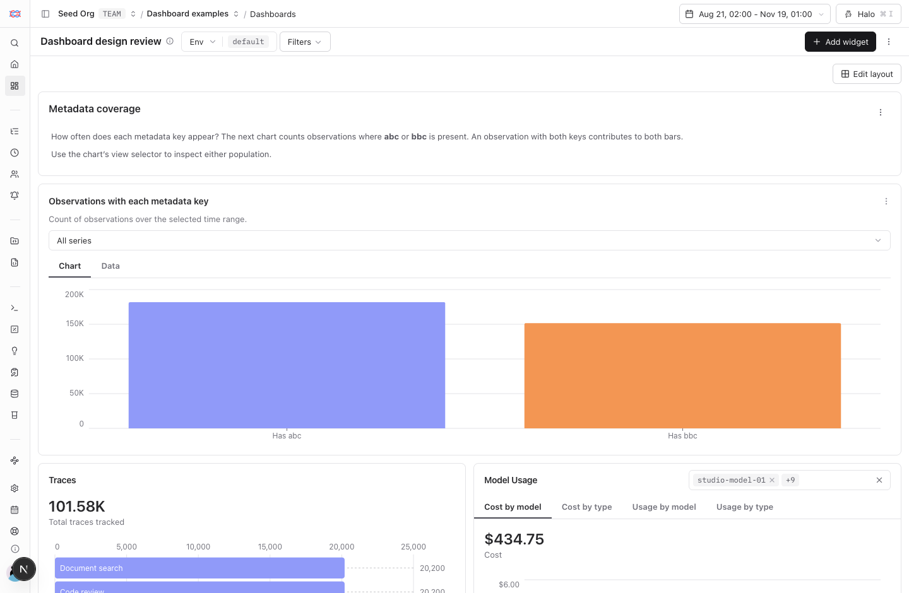
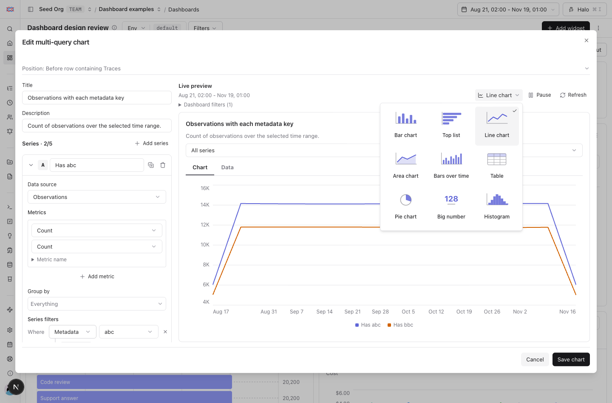

# Saved dashboard blocks

In a pilot project, open a dashboard and choose **Add widget → New multi-query chart** to compare independently filtered populations. Use **Add series** for the second population, name each one, and choose a chart type in the live preview. Save the chart to this dashboard. Choose **Add widget → Markdown** to place an explanation above a chart row. Existing widgets and Home cards remain available in the same menu.

## Implementation

`DashboardBlocksProvider` owns capabilities, saved server state, and editor opening. `DashboardBlockEditor` owns revision-aware saves. `DashboardBlockCard` renders Markdown or the multi-query chart and owns removal confirmation. Markdown uses the existing safe Markdown renderer.

`DashboardBlocksCanvas` interleaves blocks before the anchored chart row. `block-layout.ts` groups overlapping rows without changing saved geometry. Layout editing renders one original `DashboardGrid`, preserving cross-row drag and resize. Missing anchors fall back after the grid. With no enabled saved blocks, the original grid interaction is unchanged.

The `multi-query/` subtree owns its query editor, execution, preparation, and chart presentation. Flags are independent and server-authoritative. Editor content is masked in session replay. Instrumentation records structural interactions and counts.

## Pilot and rollback

Apply the additive PostgreSQL migration before rolling out web servers. No backfill or ClickHouse migration is required. Keep both pilots disabled until every web replica can clone saved blocks. Enable each capability by setting its web environment variable to an exact, comma-separated list of project IDs, then rolling the web processes. An unset or empty list disables that capability everywhere.

| Variable                                             | Enables                                  |
| ---------------------------------------------------- | ---------------------------------------- |
| `LANGFUSE_DASHBOARD_MULTI_QUERY_ENABLED_PROJECT_IDS` | Create, edit and read multi-query charts |
| `LANGFUSE_DASHBOARD_MARKDOWN_ENABLED_PROJECT_IDS`    | Create, edit and read Markdown blocks    |

To pause a pilot, remove the project from the relevant list and roll the web processes. Updated servers immediately reject writes for the disabled kind. An open foreground dashboard rechecks its capabilities. Re-enabling the same project restores the saved blocks, positions and revisions. A rolling deployment can briefly serve clients from replicas with different settings. Leave the additive table in place when rolling back the application.

Existing widget and preset placements keep their original JSON representation. Blocks have independent revision checks and refer to an existing placement ID or the end of the dashboard. When an anchor disappears, its block displays at the end. Saving the existing grid with an older server preserves the blocks. Upgraded servers clone same-project blocks together with the parent, including dormant blocks. Older servers and the classic JSON export represent only the original grid. Parent deletion includes its blocks through a foreign key.

Multi-query schedules up to five ordinary analytics queries per chart. A query can share its filters across several measures. Each independently filtered population can require a separate scan. For example, counting observations with `metadata.abc` and with `metadata.bbc` requests two counts, and observations with both keys contribute to both. Presentation edits reuse compatible query results. Discarding a draft leaves the saved chart untouched. The v4 streaming path supports aborts. A previously submitted v3 request can finish on the server after the editor closes.

Before widening either pilot, exercise one project with each flag combination, including both disabled. Check an old widget and its layout, discard an unsaved edit, toggle off a saved block, reload, and restore the pilot. Compare the two source counts in a real chart to two independently filtered requests over the same window.

## Evolving a definition

`kind` selects the editor. `config.version` identifies the persisted format for that kind. `revision` counts successful edits to one saved block and prevents stale writes. A Markdown edit can move revision 6 to 7 while the format stays at version 1. The analytics API read version (`v1`/`v2`) separately selects a data source at query time.

Bump the format when an older editor could discard a saved option or change its meaning. For example, a new percentile label that exists only in the editor UI can reuse the format. A new persisted member that describes a formula needs a version that understands the member. Introduce readers for both formats before turning on a newer writer. Convert one definition at a time on an explicit save, or use a measured migration for a later rollout. Existing classic widgets require no rewrite.

A reader skips an unsupported block version. An individual update or removal also checks the stored format and edit revision before changing the row. Same-project clones on upgraded servers copy each config as stored, including formats the running server cannot display. Unversioned pilot Markdown is read as version 1. New Markdown and multi-query writes carry an explicit version.
