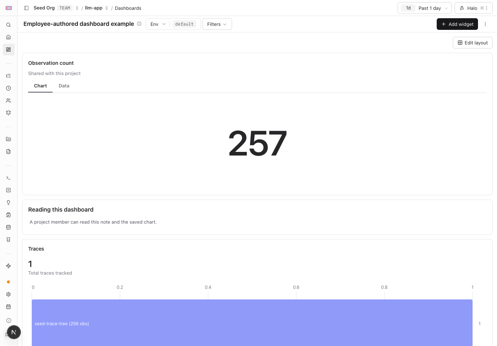

# Saved dashboard blocks

With the employee authoring preview enabled and permission to edit the dashboard, choose **Add widget → New multi-query chart** to compare independently filtered populations. Use **Add series** for the second population, name each one, and choose a chart type in the live preview. Save the chart to this dashboard. Choose **Add widget → Markdown** to place an explanation above a chart row. Everyone with access to the dashboard can read the saved chart or note. The employee preview controls who can author them.


## Implementation

`useDashboardBlocksData` loads saved blocks independently of the employee’s authoring permissions and supplies placement labels. `DashboardBlocksProvider` owns editor opening. The save/remove hooks in `useDashboardBlockMutations` own cache invalidation. `DashboardBlockEditor` owns revision-aware save inputs. `DashboardBlockCard` renders Markdown or the multi-query chart and owns removal confirmation. Markdown uses the existing safe Markdown renderer and design-system form fields backed by React Hook Form.

`DashboardBlocksAddControl` is the context-free Add widget view; `DashboardBlocksAddMenu` connects dashboard state. It preserves the classic Add widget flow for users outside the preview. `DashboardBlockPlacement` supports existing string placement IDs.

`DashboardBlocksCanvas` interleaves blocks before the anchored chart row. `block-layout.ts` groups overlapping rows without changing saved geometry. Layout editing renders one original `DashboardGrid`, preserving cross-row drag and resize. Missing anchors fall back after the grid. Dashboards without saved blocks use the original grid.

The `multi-query/` subtree owns its query editor, execution, preparation, and chart presentation. The server checks the personal authoring flag and existing dashboard permissions for block mutations. Editor content is masked in session replay. Instrumentation records structural interactions and counts.

## Employee rollout and migration

This release uses the existing PostgreSQL `dashboards.definition` JSON column. It requires no database migration, backfill or ClickHouse changes.

When the upgraded app reads a classic `{ "widgets": [...] }` dashboard, it treats the placements as v1 blocks in memory. The read leaves the stored definition and its update timestamp untouched. The next layout edit or new-block save writes the root version `"1"` and both arrays, even if the edit only moves a classic card. This works for dashboards created by an older server during a rolling deployment. Newly created dashboards on upgraded servers can write v1 immediately. That array contains all classic placements and the new blocks. The `widgets` array mirrors only classic chart and preset placements, so older readers can display it unchanged. For example, a dashboard with a Home card and a note can be stored as follows.

```json
{
  "version": "1",
  "widgets": [
    { "type": "preset", "id": "traces", "presetId": "home-traces", "x": 0, "y": 0, "x_size": 12, "y_size": 5 }
  ],
  "blocks": [
    { "type": "preset", "id": "traces", "presetId": "home-traces", "x": 0, "y": 0, "x_size": 12, "y_size": 5 },
    { "id": "90426bdb-2e6f-494b-b306-b048beeae938", "kind": "markdown", "config": { "version": 1, "title": "Traffic", "content": "The chart counts traces in the selected period." }, "revision": 1, "beforePlacementId": "traces" }
  ]
}
```

The dashboard router accepts either the original layout or a single block edit through `updateDashboardDefinition`. A block edit locks the dashboard row, compares the saved block revision, then patches that block. Two editors can update different blocks. If they edit the same block from the same revision, the second receives a conflict and must reload.

Once every web replica supports the versioned definition and clone path, staff can opt in from their account menu. Select **Internal view** under **View mode**, then open **Feature preview** and enable **Dashboard block authoring** (`dashboardBlockAuthoring`). As in Topics, staff eligibility uses the account email's exact domain, `@langfuse.com` or `@clickhouse.com`, case-insensitively. Self-hosted installations use the same email-domain convention. The preview defaults off. After enrollment, authoring works in either view on dashboards the employee can edit. Staff can opt out in either view and re-enroll in Internal view. Ordinary readers retain access to the saved blocks. Organization defaults and deployment-wide experimental settings cannot grant block authoring.

| Person opening a project dashboard                         | Can see saved charts and Markdown | Can add, edit, move or remove blocks |
| ---------------------------------------------------------- | --------------------------------- | ------------------------------------ |
| Employee opted in, with dashboard edit permission          | Yes                               | Yes                                  |
| Employee opted out, or another authorized dashboard reader | Yes                               | No                                   |
| Person without dashboard read permission                   | No                                | No                                   |



The existing dashboard read includes a presence hint so an ordinary classic dashboard can load without a separate block-list request. A new client pointed at a pre-feature server falls back to the classic dashboard. Older application versions continue to read and save the original grid. Turning the preview off keeps both the document and its contents visible on the upgraded app. A true application rollback restores the pre-feature layout writer. Opening a dashboard on that version preserves the complete document, but saving a classic layout replaces it with `{widgets}` and drops the new blocks on that dashboard. During a rollback, pause layout edits on pilot dashboards that must retain their blocks or back up their definitions before editing.

A block refers to an existing chart placement or the end of the dashboard. If its anchor disappears, it displays at the end. Upgraded same-project clones include stored blocks and revisions are checked on updates. A clone created by a pre-feature server contains only the classic grid. The classic JSON export contains the original grid.

Multi-query schedules up to five ordinary analytics queries per chart. For example, an observation containing both `metadata.abc` and `metadata.bbc` contributes to both independently filtered counts. Compatible presentation changes reuse existing results. Abandoned v4 streams can be aborted. On the legacy transport an already submitted request retains its concurrency slot until it settles.

## Public API and MCP

The unstable dashboards API and its MCP tools expose the same dashboard definition. For a supported dashboard, `version: "1"` and `blocks` describe the chart placements, Markdown and multi-query blocks. Clients can continue reading or writing the deprecated `widgets` projection. Classic placements use the public grid fields `width` and `height` in both arrays.

To move a classic chart using the v1 API, GET the dashboard, update the chart placement in `blocks`, then PATCH the definition with `version` and `blocks`. If you also send `widgets`, keep it equal to the classic placements in `blocks`. Preserve the saved inline block IDs, configurations, anchors and revisions. An API key may read or echo those blocks during the staff pilot. Creating, changing or removing them requires a signed-in employee with the personal opt-in and dashboard edit permission. A stale snapshot should be fetched again before retrying.

An older `{widgets}` client can save its layout without knowing which inline blocks exist. A reader encountering an unsupported future root receives the classic projection. Its stored definition can be edited by a server that understands that version.

## Evolving a definition

`kind` selects the editor. `config.version` identifies the persisted format for that kind. `revision` counts successful edits to one saved block and prevents stale writes. A Markdown edit can move revision 6 to 7 while the format stays at version 1. The analytics API read version (`v1`/`v2`) separately selects a data source at query time.

Bump the format when an older editor could discard a saved option or change its meaning. For example, a new percentile label that exists only in the editor UI can reuse the format. A new persisted member that describes a formula needs a version that understands the member. Introduce readers for both formats before turning on a newer writer. Convert one definition at a time on an explicit save, or use a measured migration for a later rollout. Existing classic widgets require no rewrite.

A reader skips an unsupported block version. An individual update or removal also checks the stored format and edit revision before changing the block. Same-project clones on upgraded servers copy each config as stored, including formats the running server cannot display. Unversioned pilot Markdown is read as version 1. New Markdown and multi-query writes carry an explicit version.
