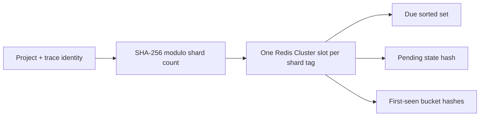

# Internal cloud trace-batch experiment

This experiment measures full-event reads and transcript assembly for idle
traces, then summarizes allowlisted projects from that assembled transcript.
It requires `NEXT_PUBLIC_LANGFUSE_CLOUD_REGION` and explicit opt-in. The enablement
flags and transcript-metrics switch below default to `false`; an ordinary release
needs no infrastructure changes. The four enablement flags stay commented in env
templates. The local dev template sets the idle time below.

## Readiness requirements

- Every admitted event refreshes the trace's idle deadline. Tracking uses the
  project's configured idle interval, or the deployment default when unset.
- Keep pending scheduling state separate from retained historical bounds. Enqueue
  acknowledgement clears pending state; history survives to support later arrivals.
- A late arrival within history retention opens a new pending window and reads the
  whole known trace, using the earliest and latest retained event starts plus the
  existing two-minute buffer. Backdated arrivals must preserve the previous tail.
- The consumer checks existing summaries against the job enqueue time. Retries
  skip facets completed by this job; later redispatches append updated summaries.
- Bounds, counters, revision and due time are merged atomically. Readiness is
  revalidated before enqueue, and acknowledgement must preserve any newer revision.
- Pending state must survive its idle interval plus recovery grace. Historical
  values have an independent logical TTL and expire without field scans.
- Use Redis 7-compatible operations on standalone Redis, Sentinel and Cluster.
  Every multi-key Lua call stays in one slot; cleanup and Lua batches are bounded.
  One renewable dispatcher lease coordinates scheduling across all shards.
- Redis loss and events outside retained history can leave gaps. There is no
  reconciler, and retained timestamps cannot recover data that was never observed.

## Controls

| Variable                                          | Default     | Role                                                                                                                                                                                                                                                                                                                                                                                                         |
| ------------------------------------------------- | ----------- | ------------------------------------------------------------------------------------------------------------------------------------------------------------------------------------------------------------------------------------------------------------------------------------------------------------------------------------------------------------------------------------------------------------ |
| `LANGFUSE_TRACE_BATCH_INGESTION_ENABLED`          | `false`     | Track accepted direct-v4 event writes in Redis.                                                                                                                                                                                                                                                                                                                                                              |
| `LANGFUSE_TRACE_BATCH_DISPATCHER_ENABLED`         | `false`     | Schedule idle traces into BullMQ jobs.                                                                                                                                                                                                                                                                                                                                                                       |
| `QUEUE_CONSUMER_TRACE_BATCH_QUEUE_IS_ENABLED`     | `false`     | Register the batch worker.                                                                                                                                                                                                                                                                                                                                                                                   |
| `LANGFUSE_TRACE_BATCH_READ_ENABLED`               | `false`     | Allow the worker to query ClickHouse; otherwise discard jobs.                                                                                                                                                                                                                                                                                                                                                |
| `LANGFUSE_TRACE_BATCH_TRANSCRIPT_METRICS_ENABLED` | `false`     | Emit transcript size distributions. Span attributes and failure counters stay on either way.                                                                                                                                                                                                                                                                                                                 |
| `LANGFUSE_TRACE_BATCH_SAMPLING_RATE`              | `0`         | Fraction of other projects admitted by ingestion, from 0 to 1. Unset or `0` is off. Topics-active projects are always admitted.                                                                                                                                                                                                                                                                              |
| `LANGFUSE_TRACE_BATCH_STRATEGY`                   | `project`   | Choose project-order packing or opt-in locality grouping.                                                                                                                                                                                                                                                                                                                                                    |
| `LANGFUSE_TRACE_BATCH_MAX_SIZE`                   | `60`        | Maximum traces per job, up to 10,000.                                                                                                                                                                                                                                                                                                                                                                        |
| `LANGFUSE_TRACE_BATCH_MAX_BATCH_EVENT_UPDATES`    | `1500`      | Estimated event updates per multi-trace job; `0` disables.                                                                                                                                                                                                                                                                                                                                                   |
| `LANGFUSE_TRACE_BATCH_MAX_BATCH_SERIALIZED_BYTES` | `67108864`  | Estimated serialized event bytes per multi-trace job (64 MiB); `0` disables.                                                                                                                                                                                                                                                                                                                                 |
| `LANGFUSE_TRACE_BATCH_MAX_TRACE_EVENT_UPDATES`    | `5000`      | Exclude a trace whose retained read-window estimate exceeds this many event updates; `0` disables.                                                                                                                                                                                                                                                                                                           |
| `LANGFUSE_TRACE_BATCH_MAX_TRACE_SERIALIZED_BYTES` | `52428800`  | Exclude a trace whose retained read-window estimate exceeds these serialized bytes (50 MiB); `0` disables.                                                                                                                                                                                                                                                                                                   |
| `LANGFUSE_TRACE_BATCH_MAX_THREADS`                | `2`         | ClickHouse threads per query (positive integer).                                                                                                                                                                                                                                                                                                                                                             |
| `LANGFUSE_TRACE_BATCH_REQUEST_TIMEOUT_MS`         | `40000`     | ClickHouse client socket idle timeout in milliseconds, including pauses for summary backpressure. Independent of the 30-second server query execution limit.                                                                                                                                                                                                                                                 |
| `LANGFUSE_TRACE_BATCH_MAX_PENDING_SUMMARY_BYTES`  | `104857600` | Queued input/output/metadata payload threshold (100 MiB). Includes the active summary; excludes the current trace, tool fields, transport buffers and JavaScript object overhead.                                                                                                                                                                                                                            |
| `LANGFUSE_TRACE_BATCH_MAX_BLOCK_SIZE`             | unset       | Optional positive `max_block_size` hint; unset inherits the server profile.                                                                                                                                                                                                                                                                                                                                  |
| `LANGFUSE_TRACE_BATCH_EXPERIMENT_ID`              | unset       | Optional 1–64 character attempt/query label: letters, digits, `.`, `_`, `-`; first character alphanumeric.                                                                                                                                                                                                                                                                                                   |
| `LANGFUSE_TRACE_BATCH_CONCURRENCY`                | `2`         | Concurrent batch jobs per worker process.                                                                                                                                                                                                                                                                                                                                                                    |
| `LANGFUSE_TOPICS_TRACE_CONCURRENCY`               | `20`        | Topics traces summarized and embedded at once per batch job (positive integer). Tokenization stays one trace at a time.                                                                                                                                                                                                                                                                                      |
| `LANGFUSE_TRACE_BATCH_IDLE_MS`                    | `600000`    | Default idle time before a trace is ready. Unset and `DEV` uses `120000` (2 minutes); every other region uses 10 minutes. A project's `tracing_readiness_settings.trace_idle_ms` (60 seconds to 60 minutes) overrides it, capped at the pending TTL minus the dispatch interval. The project value is cached in Redis for 5 minutes; saving replaces it, and a failed read uses the default without caching. |
| `LANGFUSE_TRACE_BATCH_PENDING_TTL_MS`             | `7200000`   | Recovery grace after a trace becomes due (2 hours). Pending keys expire no earlier than the latest required due-plus-grace deadline.                                                                                                                                                                                                                                                                         |
| `LANGFUSE_TRACE_BATCH_FIRST_SEEN_TTL_MS`          | `86400000`  | Historical event-start bounds and size estimates retained after activity or dispatch (24 hours; at most 48 hours). Internal and cloud-gated.                                                                                                                                                                                                                                                                 |
| `LANGFUSE_TRACE_BATCH_SHARD_COUNT`                | `auto`      | 16 on Redis Cluster; 1 on standalone/Sentinel. Override with 1–256. Fixed across Redis resizing; drain before changing.                                                                                                                                                                                                                                                                                      |
| `LANGFUSE_TRACE_BATCH_DISPATCH_INTERVAL_MS`       | `30000`     | Dispatcher cadence (30 seconds).                                                                                                                                                                                                                                                                                                                                                                             |

Producer, dispatcher and consumer can run independently. Sampling reuses the
evaluator's deterministic trace-ID sampler; every observation of the same trace
gets the same admission decision. Dispatch and consumption do not resample.
Cloud guards cover ingestion, dispatcher execution, worker registration and
processing, and the shared queue accessor, including admin queue inspection.

## Redis state and expiry

- `{trace-batch:<shard>}:due`: sorted set, with JSON `[projectId, traceId]` members and
  Redis server time plus idle delay as the score.
- `{trace-batch:<shard>}:state`: hash with the same members and JSON
  `{minStart, maxStart, revision, historyBucket, eventUpdateCount, serializedEventBytes}` values. Bounds describe observed event start
  times; revision protects newer ingestion from an older dispatch acknowledgment.
- `{trace-batch}:dispatcher`: renewable dispatcher lease.
- `{trace-batch:<shard>}:first:<bucket>`: hourly hashes retaining the minimum and
  maximum event starts independently of pending state. Fields are the first 16 binary
  bytes of SHA-256 of the JSON project/trace pair; values are MessagePack
  `[minStart, maxStart, expiresAt, eventUpdateCount, serializedEventBytes]`.
  A bounds-only tuple has unknown estimates. This accepts the negligible collision probability of a
  128-bit identity. Key shape is independent of the processing unit.

Sharding uses the shared SHA-256 shard helper on the complete project/trace pair,
so a large project spreads across shards. Every Lua call uses only keys with
one shard's hash tag. The single dispatcher lease covers all shards; batch
packing combines ready traces from every shard. Queue slots are unchanged.

When pending state is absent or has no bucket pointer, tracking looks up the
bounded set of live time buckets (26 keys for the default TTL), never scans their
fields, and atomically merges the historical bounds. Valid pending state contains
both bounds, cumulative size estimates and its current history bucket, allowing direct movement to the new
bucket on subsequent activity and guarded acknowledgement. The Redis server clock owns
both retention and readiness. Values with an elapsed deadline are ignored;
whole-key expiry at bucket end plus retention removes storage without scans.
Physical removal can lag logical expiry by up to one hour (or the TTL for a
shorter test override). Activity and guarded acknowledgement refresh retention,
so the post-dispatch window lasts the configured TTL independently of idle delay.
One live copy per identity
is retained under a consistent TTL.

No event payloads are stored here. Atomic Lua updates accumulate estimates and
refresh bounds, revision and readiness:

```text
due = last admitted activity + effective project idle
pending expiry = due + recovery grace
```

Tracking uses the project's configured idle duration when available. The default
is 600 seconds outside DEV and 120 seconds in DEV, with the existing environment
override.

Both pending keys receive a whole-key `PEXPIREAT` covering the required expiry,
preserving any existing later deadline with `PEXPIRETIME` (Redis 7+). During
activity, cleanup removes at most 100 members per call with
`due <= now - recovery grace`, using the existing due index. This supports
different project idle durations without another per-member expiry index.
Cleanup runs during ingestion and dispatch; whole-key expiry also clears abandoned
state if all processes stop. Acknowledgement normally removes pending entries
as soon as enqueueing succeeds, independently of their safety deadline.

### Sharding and atomicity

The shard is `SHA256(JSON.stringify([projectId, traceId]))[first 32 bits] % N`.
It is stable for a fixed shard count and hashes the trace identity rather than
the project alone. Redis Cluster then maps the shared `{trace-batch:N}` tag to
one of its 16,384 slots; the number of logical readiness shards is independent
of the number of Redis primaries. Standalone Redis executes the same layout.
Use a `REDIS_KEY_PREFIX` without its own hash tag: Redis uses the first tag in
the full key, so a tagged prefix would collapse every shard onto one slot.



| Operation       | Atomic boundary                                                                                                                                                                            |
| --------------- | ------------------------------------------------------------------------------------------------------------------------------------------------------------------------------------------ |
| Track activity  | One Lua call reads retained starts and pending state, merges min/max and counters, replaces the revision, sets readiness, moves first-seen history and sets expiry. All keys share a slot. |
| Snapshot/expiry | One Lua call removes a bounded expired cohort and returns readiness counts and the cutoff.                                                                                                 |
| Hydrate         | One Lua call rechecks due scores and reads corresponding state/revisions. Freshly reactivated traces are not dispatched from an obsolete snapshot.                                         |
| Acknowledge     | One Lua call compares the revision, refreshes first-seen retention from dispatch time and removes due/state only when it still matches.                                                    |
| Enqueue         | A separate BullMQ operation precedes acknowledgement. Stable job IDs reduce duplicates if acknowledgement fails. Concurrent arrivals survive the guarded acknowledgement.                  |

No application-side read-then-write decides a trace's bounds, revision or due
score. `TIME` before tracking selects the bounded bucket keys; Lua reads Redis
time again and rejects a stale bucket selection before mutating anything.
Scripts serialize within a Redis primary; different primaries can execute
different shards concurrently. Tracking, hydration and acknowledgement calls
contain at most 50 traces; cleanup handles at most 100. Ingestion sends at most
four tracking scripts per pipeline, all in one shard, using one Redis clock lookup
per ingestion call. A group requiring only one script uses a direct call.
Successful pipeline commands remain committed when a sibling
fails; only commands rejected with `NOSCRIPT` are retried using `EVAL`. A pipeline
is not one atomic operation; each Lua call is atomic independently.
Dispatch still pools
up to 1,000 hydrated candidates for locality selection, so script call size does
not constrain queue batch packing. Scripts use cached `EVALSHA`, falling back
to `EVAL` after a missing script cache on the selected primary. Dispatch holds one renewable lease across
all shards, and checks/extends it while making progress. The lease excludes other
dispatchers; it does not lock ingestion. Only each synchronous Redis command or
Lua call blocks its primary, not the dispatcher's entire read/pack/enqueue run.

Lua atomicity prevents command interleaving, but is not an ACID transaction
across Redis, BullMQ and ClickHouse and does not roll back writes on a runtime
script error. Duplicate runs and the accepted Redis failover gap remain part of
this pipeline's delivery contract. There is no reconciler.

## Dispatch and reads

One dispatcher holds the renewable lease and snapshots each shard in turn. It
selects the complete due cohort at each shard's cutoff; there is no per-run trace
limit. Each due-ID range read and the combined in-memory candidate list grow
with the due cohort, even though subsequent Lua calls and selection pools are
bounded. It sorts ready IDs by project and due time across shards, then hydrates
and revalidates state in single-slot calls of up to 50. Locality
selection combines those calls into pools of up to 1,000. Jobs contain up
to the configured trace cap and weight budgets; project leftovers can share a job. The dispatcher
enqueues before acknowledging matching revisions, so concurrent intake stays
pending and failed enqueueing can be retried. Successful enqueues are
acknowledged by shard after each hydration window, including when a later
enqueue fails, so Redis calls stay bounded by 50 traces rather than job size.
Stable job IDs limit duplicates.

Acknowledgement removes due/state only. Late arrivals within first-seen
retention reopen readiness with the merged historical and incoming minimum and
maximum starts; the existing two-minute query padding reads the trace again.
Tracking does not classify events as late by comparing timestamps. Every admitted
event updates readiness; retained history supplies the earlier bound even when
the incoming start equals it. History without pending state can also result from
pending expiry, so it does not prove a previous dispatch. Concurrent arrivals
replace the revision and survive an acknowledgement of an older snapshot.

The consumer reads the supplied trace window and checks existing summaries for
each facet. A summary processed since this job was enqueued is skipped on retry;
a later redispatch generates and appends an updated row. There are no Redis
completion markers or staged results. BullMQ still uses Redis for queue delivery.

`ReplacingMergeTree(processed_at)` retains the greatest processing timestamp
when the Topics sort key matches. That key includes the start minute: an event
revealing a genuinely earlier start in a different minute can leave the previous
summary under its original key. `processed_at` is assigned when summary
processing starts, so it orders processing attempts rather than dispatch windows.
An older, narrower dispatch processed later can replace a summary that includes
newer events. This is an accepted limitation; dispatch-order versioning must be
revisited before requiring the newest dispatch window to win.

Retaining the historical maximum preserves the previous tail even when a late
event's start precedes that tail by more than the query buffer. Once historical
bounds expire or are lost, the prior window cannot be reconstructed from this map.

### Trace-window size estimates

Accepted direct-v4 writes contribute their final serialized UTF-8 event size after
field overflow handling, reusing the writer's existing `event_bytes` calculation.
The accounting field itself is excluded. Acceptance means admission to the writer,
not confirmation of a ClickHouse flush. `eventUpdateCount` counts accepted updates,
including retries and repeated observation versions, rather than unique observations.

Pending state and history carry cumulative estimates for the retained read window.
Tracking adds newly accepted updates to valid pending totals. When reopening a
trace, it initializes totals from retained history before adding the new updates.
Acknowledgement preserves estimates with the bounds, including for oversized
exclusions. A late window therefore cannot make a known oversized trace appear
small or understate its batch weight by counting only its new events.

Missing estimates remain unknown through updates and redispatch until their
retained window expires. They are not replaced with zero or a count of only the
new events. These are admission estimates, not hard limits on actual ClickHouse
rows or query memory; the two-minute query buffer can include additional rows.
Tracking-volume metrics still count only updates accepted in the current ingestion
batch; dispatcher size distributions use the cumulative estimates.

The dispatcher emits `estimated_event_update_count` and
`estimated_serialized_event_bytes` distributions under `langfuse.trace_batch`, tagged
with `scope:trace|batch` and `strategy`. Batch totals require known estimates for
every member; `estimates_unavailable` counts unknown traces and affected batches.
Estimates stay out of queue payloads and job IDs. Dispatch retries can emit
another sample.

Serialized event bytes differ from the reader's `input_bytes`, `output_bytes`
and `metadata_bytes` metrics: they include the serialized event fields and JSON
encoding, and do not represent RAM, network transfer or ClickHouse scan bytes.
The job return still sums those three as `ioMetadataBytes`; that sum is not a
custom metric.

### Weight budgets and oversized traces

Both strategies close a job before its summed estimates would exceed
`LANGFUSE_TRACE_BATCH_MAX_BATCH_EVENT_UPDATES` or
`LANGFUSE_TRACE_BATCH_MAX_BATCH_SERIALIZED_BYTES`, in addition to the trace cap.
Locality treats an over-budget slice like one past its time envelope, and
partials coalesce only within the budget. A single trace always forms a job, so
a trace heavier than the budget runs alone. Locality packs traces above half of
either budget in a separate lane, so one heavy trace does not split the light
traces around it into extra jobs. Unknown estimates weigh nothing.
Budget-limited jobs report `fill:partial`; the `scope:batch` estimate
distributions show how close jobs run to the budget.

After hydration, a trace whose retained read-window estimates exceed
`LANGFUSE_TRACE_BATCH_MAX_TRACE_EVENT_UPDATES` or
`LANGFUSE_TRACE_BATCH_MAX_TRACE_SERIALIZED_BYTES` is never queued or read. The
dispatcher acknowledges it like a dispatched trace, increments
`langfuse.trace_batch.excluded_traces` tagged with
`reason:event_updates|serialized_bytes` and `strategy`, and logs
`Trace batch excluded oversized trace` at warn level with `projectId`, `traceId`,
`reason` and both estimates. Group that log by `@projectId` to find repeat
offenders. Activity after the acknowledgement starts a new pending window that
is evaluated again using its retained cumulative estimates, so a trace that keeps
growing may be logged more than once.
Traces with unknown estimates are never excluded.

The worker streams full `events_full` payloads and records batch observation,
trace and logical payload-byte metrics. The `input_bytes`, `output_bytes`
and `metadata_bytes` distributions under `langfuse.trace_batch` each report one
total per completed batch read. Distinct project count stays on the span and
completion log.
Sizes count UTF-8 bytes, including metadata keys and values, excluding JSON
transport framing/escaping and compression. They do not measure ClickHouse bytes
scanned or per-trace ingestion size; retries can record another batch sample.
Exact `(projectId, traceId)`
pairs protect tenant boundaries; project, trace hash and a shared outer time
window prune reads. Each selected trace also gets its own interval, so unrelated
batch companions cannot widen the payload returned for that trace.
`TRACE_QUERY_BUFFER_MS` pads each recorded interval by two minutes on both sides.
This fixed margin neither waits for arrivals nor guarantees trace completeness;
repeated intervals for the same pair form a union without duplicating rows.
Queries use response compression and chunked multipart parameters for up to
10,000 UUID-sized trace/project IDs. The fixed 30-second timeout fails the job
rather than accepting partial results. Beyond the dispatcher's weight budgets
and trace exclusion, this does not cap observation count, query memory or
dispatcher snapshot memory.

## Per-trace transcripts

The reader orders only by project ID and trace ID. The worker keeps
one trace's observations, assembles it when the pair changes, and flushes the last
trace only after a successful end of stream. A stream error discards the current
partial trace; earlier completed traces have already emitted samples. Each trace
uses the shared depth-first ordering and transcript assembler. Transcripts are
ephemeral: neither logs nor job results contain their content.

Completion means all rows returned for that pair's query window, not that no late
events can arrive. Event versions follow the current ClickHouse merge state;
the shared ordering function keeps one observation per ID. Retries can repeat
per-trace samples.

These values are always attributes on the `trace-batch-transcript` span. With
`LANGFUSE_TRACE_BATCH_TRANSCRIPT_METRICS_ENABLED=true` they are also
`langfuse.trace_batch.*` distributions. That switch defaults to `false`.
Failure and unavailable estimates still increment the counters named in the
paragraphs below, with or without the switch.

| Metric                                                                                                                 | Sample                                                                                                                                                                                                                                                                                                                                                                 |
| ---------------------------------------------------------------------------------------------------------------------- | ---------------------------------------------------------------------------------------------------------------------------------------------------------------------------------------------------------------------------------------------------------------------------------------------------------------------------------------------------------------------- |
| `transcript_assembly_duration_ms`                                                                                      | One trace's ordering and assembly time, excluding I/O conversion, stream waits and tokenization; `has_transcript:true\|false`.                                                                                                                                                                                                                                         |
| `transcript_json_characters`                                                                                           | UTF-16 length of `JSON.stringify(assembleTranscript(...))`, including thread/message wrappers and provenance; zero for a null transcript. Same admitted traces as the Topics length metrics.                                                                                                                                                                           |
| `transcript_json_tokens`                                                                                               | o200k estimate of that complete JSON string, tagged `tokenizer:o200k_base`; zero for a null transcript. Attempted on the same admitted traces as `topics_transcript_tokens`; unavailable estimates are omitted.                                                                                                                                                        |
| `generic_transcript_characters`                                                                                        | UTF-16 length of the previous generic plain-text layout, rendered with the same Topics block caps and inclusions. Tool definitions or errors may still render when assembly returns null.                                                                                                                                                                              |
| `generic_transcript_tokens`                                                                                            | o200k estimate of that generic text, tagged `tokenizer:o200k_base`.                                                                                                                                                                                                                                                                                                    |
| `transcript_message_tokens`                                                                                            | Sum of current-turn and history message-projection token estimates; zero when empty, omitted if either estimate is unavailable. Distinct from full-transcript JSON.                                                                                                                                                                                                    |
| `transcript_current_turn_tokens`                                                                                       | Token estimate of current-turn messages across all threads, using role and parts only; zero when empty.                                                                                                                                                                                                                                                                |
| `transcript_history_tokens`                                                                                            | Token estimate of history messages across all threads, using the same role/parts representation; zero when empty.                                                                                                                                                                                                                                                      |
| `transcript_content_characters`                                                                                        | Sum of JSON-serialized message-part lengths across history and current turn, in UTF-16 code units; excludes message wrappers and provenance.                                                                                                                                                                                                                           |
| `transcript_tool_response_characters`                                                                                  | The subset of content characters belonging to tool-role messages or unmatched tool-result parts; zero when absent.                                                                                                                                                                                                                                                     |
| `transcript_thread_count`                                                                                              | Number of assembled conversation threads, or zero for a null transcript.                                                                                                                                                                                                                                                                                               |
| `transcript_observation_count`                                                                                         | Ordered, deduplicated observations passed to assembly and the Topics renderer. The `observation_count` span attribute is the raw row count before deduplication.                                                                                                                                                                                                       |
| `transcript_history_message_count`, `transcript_history_part_count`                                                    | Replayed messages and their normalized parts across all assembled threads.                                                                                                                                                                                                                                                                                             |
| `transcript_current_turn_message_count`, `transcript_current_turn_part_count`                                          | This-trace messages and their normalized parts across all assembled threads.                                                                                                                                                                                                                                                                                           |
| `transcript_current_turn_tool_call_count`, `transcript_current_turn_tool_result_count`                                 | Tool-call parts and tool-result parts in this trace; a tool-role part also counts as a result.                                                                                                                                                                                                                                                                         |
| `transcript_assembly_phase_duration_ms`                                                                                | Two non-overlapping samples per trace tagged `phase:normalization` or `phase:matching`. Normalization includes initial message-key construction and partitioning; matching covers remaining assembly work, including tool matching, deduplication, any rebuilt keys and finalization. Observation ordering is outside these phases but remains in total assembly time. |
| `topics_transcript_characters`                                                                                         | UTF-16 length of the complete rendered Topics text, including labels, section headings and line breaks; admitted traces only.                                                                                                                                                                                                                                          |
| `topics_transcript_tokens`                                                                                             | o200k estimate of that same text, tagged `tokenizer:o200k_base`; admitted traces only.                                                                                                                                                                                                                                                                                 |
| `transcript_comparison_render_duration_ms`                                                                             | Time to serialize assembled JSON and render generic and Topics text, excluding tokenization.                                                                                                                                                                                                                                                                           |
| `transcript_comparison_tokenization_duration_ms`                                                                       | Wall time for the three sequential JSON, generic and Topics token estimates, excluding the existing current-turn/history estimates.                                                                                                                                                                                                                                    |
| `topics_transcript_block_characters`                                                                                   | Present block content length tagged `block:user\|assistant\|system\|reasoning\|tool_calls\|tool_results\|tool_definitions\|errors\|run_io\|observations` and `stage:raw\|clipped`; absent blocks emit no sample.                                                                                                                                                       |
| `topics_transcript_blocks_cut`                                                                                         | Number of content blocks cut by their per-block character caps.                                                                                                                                                                                                                                                                                                        |
| `topics_transcript_history_characters`, `topics_transcript_current_turn_characters`, `topics_transcript_history_share` | Rendered content-line characters from replayed input and this run, plus replayed input divided by their sum (0 when both are empty). This-run content includes fallback trace-level I/O, observation markers, and inline errors.                                                                                                                                       |

Topics measurement uses the existing assembled transcript and the inclusive
Topics preset in `packages/shared/src/server/transcript/topics-renderer-config.ts`. It
does not call a model or store the text. The preset includes all block types and
history, caps fallback trace-level input and output at 10,000 characters each,
and caps each system message at 600 characters. These are separate per-block
limits, not a combined trace budget. The preset has no total token budget. It
omits no middle lines. The rendered text has
`<run_facts>`, optional `<tools>` and `<earlier_conversation source="replayed input">`,
`<this_run>`, and `<end_of_run>` sections in that order. Observation markers show
the Langfuse operation type and name in walk order; matched tool results already
identify their operation. Trace input appears as the request when no current-run
user message exists. If it differs from the rendered input messages, it appears
as trace context alongside the user request, capped at the user block limit
(2,000 characters in this preset). A trace output matching the last assistant
message or tool
result labels that message as final output; distinct application output appears
once as `[final output]`. Thread segments follow observation
order; the replayed prefix does not claim to come from a previous trace. Tool
calls and results share a number, and observation errors appear after the last
message emitted at or before their position in the observation walk. The facts
line counts rendered user entries and tool calls across threads; repeated
content in separate threads is not necessarily a distinct user turn. `raw` block
characters are counted after media redaction and whitespace collapse but before
a block cap; `clipped` counts the resulting content including any omission marker.
Block values exclude
role labels, section headings, run facts and line breaks; media placeholders
can add characters to the complete text without adding to a block metric. The
history share uses content lines including role labels, tool exchanges, fallback
root I/O, observation markers and inline errors, excluding section headings and
tool definitions. Keep
numerator and denominator on the same basis when calculating shares. Ingestion
applies `LANGFUSE_TRACE_BATCH_SAMPLING_RATE` by trace ID before the dispatcher
and worker; every admitted trace receives Topics measurements. Projects where
`isTopicsProcessingActive` holds (in the Topics allowlist
`LANGFUSE_TOPICS_ENABLED_PROJECT_IDS`, Topics enabled with all three models, and
an active rule with an unblocked facet) bypass sampling so every trace is
summarized; a rate of `0` limits the flow to those projects and skips all
per-trace tracking work (no per-trace state or metrics) for the rest. Projects
outside the allowlist make no Redis or Postgres calls; allowlisted ones read the
cached gate answer (5 minutes), and a miss queries Postgres with a 2-second
deadline. If that lookup fails or times out, ingestion falls back to the
allowlist, caches that answer for 30 seconds and increments `topics_gate_failures`.

Transcript token counts use the existing local worker-thread pool and bundled
tiktoken WASM, without a network or model API call. The `gpt-4o` configuration
selects `o200k_base`, also used by GPT-5 mini and nano
([OpenAI mapping](https://github.com/openai/tiktoken/blob/main/tiktoken/model.py)).
The span records `tokenizer:o200k_base`. These are serialized-payload estimates, not provider
billing counts or a model's full request framing.
Current turn and history use identical `{ messages: [{ role, parts }] }` JSON
framing, without observation provenance. Only nonempty partitions are tokenized,
at most twice per trace. Their sum is `transcript_message_tokens`; it is not
directly comparable to the full assembled-transcript JSON or rendered text. The
`transcript_json_*`, `generic_transcript_*`, and `topics_transcript_*` lengths
are span attributes on the same admitted trace cohort. The generic
renderer preserves the previous plain-text layout under the same Topics
per-block preset; it has no trace-root I/O or run-state sections. Empty
transcripts have zero JSON length and tokens. Thread counts are numeric
span attributes.

To diagnose large Topics texts, compare `topics_transcript_tokens` with
`transcript_observation_count`, the history/current-turn message and part counts,
current-turn tool-call/result counts, `topics_transcript_history_share`, and
raw/clipped characters by block type. Structure counts describe the assembled
source, before the renderer's per-block character caps; they are not a count of
visible lines. A last-N history policy can use each thread's
`conversationHistory`, but a per-thread N would still grow with the number of
threads. A future total history budget should account for all threads; tool
loops should retain call/result pairs and errors when shortened.

For rough tool-response size share, divide `transcript_tool_response_characters`
by `transcript_content_characters` (when nonzero). Both sum serialized parts on
the same basis, including part JSON syntax but excluding message wrappers and
provenance. This is a character share, not a token share. For an overall traffic
share, divide the sums rather than averaging per-trace percentages. These metrics
are emitted before tokenization, including when it fails; no tool tokenizer runs.
Unknown estimates are omitted and counted in `token_estimation_unavailable`.
Rejected estimates increment `token_estimation_failed` and stop the remaining
estimates for that trace; successful earlier samples are retained. Unknown
estimates do not stop later estimates. The summed estimate is omitted unless
both partitions are known. Neither failure retries the batch.
Current-turn and history message projections are tokenized first. Each admitted
trace then adds one full-JSON, one generic plain-text, and one Topics plain-text
tokenization call.
Missing or failed JSON estimates increment `transcript_json_token_estimation_unavailable`
or `transcript_json_failed` without stopping later measurements. Generic text
rendering or token failures increment `generic_transcript_failed`, while an
unavailable token estimate increments
`generic_transcript_token_estimation_unavailable`. These do not stop Topics.
Topics rendering failures increment `topics_transcript_failed` and leave the
batch successful. An
unavailable Topics token estimate increments
`topics_transcript_token_estimation_unavailable`; a rejected estimate increments
`topics_transcript_failed`. Character metrics remain available in either case.

The reader queues completed traces behind one serial transcript/Topics chain
while continuing to consume ClickHouse rows. Projections are tokenized
sequentially, keeping at most one pending tokenizer request per batch. The chain
yields to the event loop before each trace's assembly. When queued logical
payload bytes exceed `LANGFUSE_TRACE_BATCH_MAX_PENDING_SUMMARY_BYTES`, reading
pauses until completed summaries reduce the queue to that threshold or below;
it does not wait for the entire chain. Each pause increments
`langfuse.trace_batch.summary_backpressure`. Time from enqueue to summary start
is recorded as `langfuse.trace_batch.summary_queue_wait_ms`.

The dispatcher byte budget estimates only pending updates, while reads can
include older observations, so it does not guarantee avoiding backpressure.
`LANGFUSE_TRACE_BATCH_REQUEST_TIMEOUT_MS` allows 40 seconds of socket inactivity
by default. This is a starting value, not a per-trace processing deadline:
slow tokenization or provider calls can still exceed it. Tune the timeout with
observed pauses and provider latency; the query's server execution limit remains
30 seconds. Success and stream failure both drain accepted summaries; a stream
failure never assembles its partial final trace. Assembly itself remains
synchronous. Wall-clock duration
of that work, including tokenization, is the span attribute `duration_ms` and
the experiment completion log. The generic queue series
`langfuse.queue.trace_batch.time_distribution` with `type:processing` records
the same duration when the processor returns.

Memory includes the current trace, queued observations, the active transcript
and stream buffers, multiplied by active batch jobs. The payload threshold is
checked at trace boundaries and is not a hard job-memory limit.
The active trace also retains its
assembled JSON, generic text, and Topics text for sequential tokenizer calls.
A single trace remains unbounded. Each message belongs to one JSON partition;
there is no additional tool-response tokenization pass.
The default two-thread tokenizer pool is shared with ingestion; overlap hides
waiting time but does not remove CPU use or contention. Its existing 30-second
timeout rejects the promise without cancelling queued/running encoding, so the
pending-promise bound is not a cancellation guarantee. Watch tokenization failures
alongside `runtime.node.mem.rss`, `runtime.node.mem.heap_used`, worker
CPU and queue depth before raising batch concurrency.

ClickHouse must sort the filtered result, so compare query memory and latency against the unordered
baseline before increasing load.

Transcript sizes are always span attributes. The same measurements are also
dogstatsd distributions when `LANGFUSE_TRACE_BATCH_TRANSCRIPT_METRICS_ENABLED`
is `true`. That switch defaults to `false`. Use the trace explorer query below
either way.

### Inspect individual transcripts in Datadog

Each completed trace emits a `trace-batch-transcript` child span under the batch
processing span. Its attributes include `langfuse.project.id`, `langfuse.trace.id`,
and `langfuse.trace.url` (a peek link using the configured product base URL).
Under `langfuse.trace_batch`, the span records `transcript_message_tokens`, `transcript_characters`,
`transcript_json_characters`, `transcript_json_tokens`,
`generic_transcript_characters`, `generic_transcript_tokens`,
`topics_transcript_characters`, `topics_transcript_tokens`,
`transcript_comparison_render_duration_ms`,
`transcript_comparison_tokenization_duration_ms`,
`transcript_assembly_duration_ms`, `observation_count` (rows before observation
deduplication), `has_transcript`, `tokenizer`, and `experiment_id`.
It also records the token breakdown and content/tool-response character metrics,
`transcript_thread_count`,
and each phase as `transcript_assembly_<phase>_duration_ms`.
It also records the remaining Topics metrics above. Block character attributes use
`topics_transcript_block_<block>_<stage>_characters`. Topics character metrics
are absent if rendering failed; the token metric can also be absent if its
estimate failed.
No transcript content is attached. Project and trace IDs stay on the span.
`transcript_characters` is the legacy span-only name for the same value as
`transcript_json_characters`. The full JSON includes syntax and provenance, so
use `transcript_content_characters` as the tool-response denominator. JSON
characters are recorded before tokenization and remain available if an estimate
fails. The JSON string is retained only until its sequential token count settles;
it is not included in the assembly-duration measurement.

The span stays open until token estimation settles, so its duration includes
tokenization and pool waits. Use the assembly-duration attribute for assembly
performance. Missing estimates have `token_estimation:unavailable|failed`; their
counts are omitted while successful earlier estimates remain. Null transcripts
have zero tokens. The child span does not become
active while the next trace streams, and failed streams do not emit a span for
their partial final trace.

In Datadog APM Trace Explorer, search for:

```text
env:prod-eu service:worker-cpu resource_name:trace-batch-transcript @langfuse.trace_batch.transcript_message_tokens:>=100000
```

Add token count as a numeric measure to sort largest first, display the project
and trace IDs, and open `langfuse.trace.url`. The peek view shows the current
source observations, not a saved copy of the measured transcript. Late arrivals
and retries can produce different or repeated samples for the same trace.

These spans follow existing APM ingestion sampling and retention. Configure a
[custom retention filter](https://docs.datadoghq.com/tracing/trace_pipeline/trace_retention/)
at 100% for the outlier query to keep matching ingested spans searchable. This
cannot recover spans dropped before ingestion. Transcript sizes live on these
spans and follow APM sampling; they are not separate custom metrics.

## Capacity measurements

The following metrics use the `langfuse.trace_batch` prefix. All additions are
inside the existing cloud experiment paths; normal ingestion with tracking
disabled performs no new aggregation or Redis calls.

| Metric                                                     | Kind / tags                                   | Meaning                                                                                                                                                                                                                                                                                                                               |
| ---------------------------------------------------------- | --------------------------------------------- | ------------------------------------------------------------------------------------------------------------------------------------------------------------------------------------------------------------------------------------------------------------------------------------------------------------------------------------- |
| `event_updates`, `serialized_event_bytes`                  | Counters; `stage:eligible\|recorded`          | Accepted, valid-start-time updates before sampling, and in Redis-acknowledged chunks. Repeated updates count again. Selected volume is `sampling_decisions`.                                                                                                                                                                          |
| `active_reads`                                             | Per-process gauge                             | Streams currently being consumed; failures decrement the count too.                                                                                                                                                                                                                                                                   |
| `failed_read_observation_count`, `failed_read_input_bytes` | Distributions                                 | Partial logical rows and input bytes consumed before a stream failure. Separate from successful throughput. Output and metadata bytes stay on the completion log.                                                                                                                                                                     |
| `queue_depth`                                              | Gauge; `type:delayed`                         | Delayed BullMQ jobs. Waiting, active, and failed depth stay on `langfuse.queue.trace_batch.depth`. Request rate, wait time, and processing time use the generic `langfuse.queue.trace_batch` series, the same as every other queue. Processing time is recorded when the processor returns. Discard reasons stay on `discarded_jobs`. |
| `queue_waiting_head_age_ms`                                | Gauge                                         | Maximum creation age of the next FIFO jobs in waiting/paused lists. Zero when empty.                                                                                                                                                                                                                                                  |
| `redis_key_bytes`                                          | Gauge; `key:due\|state\|first`, `shard:total` | Estimated memory of each readiness key, including Redis overhead.                                                                                                                                                                                                                                                                     |
| `redis_key_entries`                                        | Gauge; `key:due\|state\|first`, `shard:total` | `ZCARD` / `HLEN` at the memory snapshot.                                                                                                                                                                                                                                                                                              |
| `pending_traces`, `ready_traces`, `oldest_due_age_ms`      | Gauges, untagged                              | Dispatcher snapshot summed (age: maximum) across shards, emitted by the current dispatcher lease holder.                                                                                                                                                                                                                              |

The eligible and recorded counters reuse the already-computed serialized size and
per-trace aggregates. Recorded volume is emitted after each acknowledged Lua
chunk: earlier chunks remain counted if a later one fails. A timeout can mean
Redis applied an update without acknowledgement, so the stage difference includes
uncertain outcomes; it does not prove data loss. Writer acceptance still precedes
the ClickHouse flush. No additional serialization is performed.

`TraceBatchMetricsRunner` starts when either the dispatcher or consumer is
enabled in a cloud worker, independently of the generic queue-metrics flag.
It polls the queue every 30 seconds and map memory every 60 seconds per process,
plus collection time. No completed jobs or progressing dispatcher are required.
Queue-age collection reads only the next waiting/paused job IDs and their
timestamp fields; it never fetches or parses batch payloads.
One failed collection does not suppress the others; failed samples are not
reported as zero. Check `langfuse.periodic_runner.completed` and
`last_healthy_timestamp_seconds` with `runner:trace_batch_metrics` for freshness.

Memory collection uses bounded per-shard Lua calls with `MEMORY USAGE ...
SAMPLES 5`, preserving the shared key prefix and Redis Cluster slot routing.
Missing keys report zero; there is no keyspace scan or exact full-hash traversal.
Memory sampling estimates storage, not process RSS or event payload size.

Map gauges are summed across readiness shards before they are emitted. Each
worker emits them, so a shard tag would multiply custom metrics by the shard
count on every reporting worker. The dispatcher snapshot gauges are untagged for
the same reason. Inspect a single shard's keys in Redis when diagnosing skew.

Queue/map snapshots are global and can be emitted by several workers: use
max/latest across reporters, never sum duplicates. First-seen
counts include physically retained expired entries until their bucket expires.
In contrast,
`active_reads` is local to a worker; distinct live worker series may be summed.
It is emitted on stream start/finish and on each metrics-runner cycle, including
zero when idle, so unchanged long-running reads remain visible.
Instantaneous gauges can miss short-lived peaks. A retried job may re-enter
behind newer jobs, so waiting-head age is a bounded-cost backlog indicator, not
an exact oldest-created-job measurement across the entire queue.

With an experiment ID, start/completion logs include `jobId`, `attempt`,
`queryId` and `experimentId`, with the completion outcome. The per-read UUID is
forwarded to ClickHouse as `query_id` and remains the root correlation ID for
the stream. Discards and validation failures have no query ID. Identifiers are
not metric tags and logs contain no event payloads. Successful batch metrics and
job return values retain their existing meanings.

Completion logs also correlate the requested `batchTraceCount`, distinct
`batchProjectCount`, `eventTimeSpanMs` (outer event-time span, without query
buffering), and `maxTraceSpanMs` with the outcome and `durationMs`. These are
batch-locality proxies, not measured ClickHouse scan costs. `observationCount`,
`foundTraceCount`, `foundProjectCount` and separate `inputBytes`, `outputBytes`,
`metadataBytes` describe rows consumed by that attempt. `partial: true` marks
failed reads, including failures before any row arrives; zero then does not mean
the requested batch was empty. Successful counts cover the completed stream,
not unique ingested events. Discarded/unparsed jobs omit stream counters.
Use these existing logs to compare batch shape and volume across outcomes by
query ID; no payload contents, project-ID lists or per-batch metric tags are added.

With an experiment ID, the BullMQ processing span also carries attributes under
`langfuse.trace_batch.*`: `experiment_id`, `job_id`, `attempt` (one-based),
`query_id`, `batch_trace_count`, `batch_project_count`, `event_time_span_ms`,
and `max_trace_span_ms`. Shape and query ID are attached before reading, so they
remain available if the stream fails. Completion adds `outcome`, `duration_ms`,
`observation_count`, `found_trace_count`, `found_project_count`, `input_bytes`,
`output_bytes`, `metadata_bytes`, and `partial`, with the same semantics as the
logs. Discards and validation failures omit query/stream fields. These reuse
existing aggregates without additional queries or serialization. Payloads and
project/trace-ID lists are not attached. Dispatcher size estimates remain aggregate
metrics, not per-job span attributes; consumed bytes are not estimated total size.
Span availability follows the existing tracing sampling and retention settings.

For the initial scaling curve, use deterministic trace sampling at 10%, 20%,
50%, then 100% across the same project population. Annotate fixed UTC windows;
pause tracking and drain old readiness/queued work between settings. Warm up at
least 20 minutes and compare a settled hour at each stage, holding batch/query
settings fixed. Plot actual admitted updates/bytes and returned rows/bytes against
CPU, memory and backlog rather than assuming configured percentages equal load.
These additions do not generate amplified reads or change batching, query limits,
late-arrival behavior, queue payloads or retention.

Pair the metrics with per-worker RSS/CPU/event-loop and network telemetry, Redis
primary telemetry, and experiment-filtered ClickHouse query logs. Include failed
attempts in CPU cost, count successful root results once, and verify distributed
CPU-counter accounting before summing query parts. Query memory peaks are not
actual concurrent replica RAM. Validate live metric delivery and units before
raising production load.

## Compare reader settings

Establish a fresh control measurement after deploying this reader: both arms
must use the same per-trace windows and compression. Hold sampling, batch cap,
concurrency, threads, idle delay and traffic cohort constant; then change only
block size (and the identifying label):

| Variable                              | Control               | Treatment         |
| ------------------------------------- | --------------------- | ----------------- |
| `LANGFUSE_TRACE_BATCH_MAX_THREADS`    | `2`                   | `2`               |
| `LANGFUSE_TRACE_BATCH_MAX_BLOCK_SIZE` | unset                 | `512`             |
| `LANGFUSE_TRACE_BATCH_EXPERIMENT_ID`  | `trace-block-control` | `trace-block-512` |

Run these settings only in cloud workers with the existing four enablement
flags explicitly set to `true`. Changing a query setting does not enable any
part of the pipeline. `max_block_size` is a row-count hint, not a byte or memory
limit; large inputs may still dominate memory. Keep the initial cap at 120 when
comparing existing experiments; raising the supported ceiling is not a rollout
recommendation.

With an experiment ID, each read attempt logs its label, build ID, configured
threads/block size, batch size, concurrency, sampling and timing controls before
querying, including failed attempts. The same ID enters ClickHouse
`log_comment` alongside existing surface/route/project attribution. Leave the ID
unset to suppress these per-attempt logs. Strategy attribution uses the
dispatcher metrics described below. Compare
query memory/latency and worker memory as well as input/output/metadata byte
metrics. Redis storage metrics do not account for selector or query memory.

### Opt-in locality grouping

`LANGFUSE_TRACE_BATCH_STRATEGY=locality` changes grouping only after dispatch is
explicitly enabled in a cloud region. The default `project` strategy preserves
project ordering and carries unfinished jobs across hydration chunks.

Locality sorts each hydrated window by project, minimum start minute, maximum
start minute and `xxHash32(traceId)`. It finds the fewest feasible jobs under the
trace cap, the weight budgets and an event-time envelope of at most one hour, or
125% of the first trace's observed span if larger. Within that job count, it minimizes project
boundaries, then minute × trace count, then gaps between trace hashes. These are
read-locality proxies, not measured ClickHouse scan costs.

Locality combines each window of at most 1,000 hydrated candidates with retained
partials. Compatible same-project partials may merge when their buffered time
intervals overlap and the combined batch respects the cap and envelope limits.
At most `maxBatchSize - 1` traces are retained across all partials; oldest-due
partials dispatch first when that budget is exceeded. The last window flushes
all remaining partials, so carry never outlives the current dispatch run.

The full ready-ID snapshot remains unchanged; only selector input is bounded. Selector
cost is O(n × k × cap), where k is the fewest feasible jobs. Measure duration
before increasing scale, especially with distant event times that force many jobs.

Compare `dispatched_batches` (tags `strategy`, `fill`),
`event_time_envelope_ms`, `candidate_buffer_size` and
`selector_duration_ms` under `langfuse.trace_batch`. Per-trace event span stays
on the completion log as `maxTraceSpanMs`. The envelope metric includes
the reader's two-minute margin on each side; the selector's envelope limit does
not. Payload and Redis state are unchanged.

## Monitor dispatcher memory

The baseline intentionally snapshots the complete ready cohort. Batch size limits
jobs, not snapshot memory. Retain this behavior for the initial experiment and
watch memory alongside backlog growth before deciding whether to add paging.

The worker enables Datadog Node runtime metrics. In Metrics Explorer, filter to
the experiment environment and worker service, and inspect the maximum per
worker/container rather than a fleet average:

- `runtime.node.mem.rss`: total process memory; compare with the container limit.
- `runtime.node.mem.heap_used`: JavaScript heap in use.
- `langfuse.trace_batch.snapshot_size`, `pending_traces`, `ready_traces` and
  `oldest_due_age_ms`: snapshot and backlog growth.
- `langfuse.trace_batch.expired_traces`: tagged `source:ingestion` or
  `source:dispatcher`. Sum within one source; the two writers are different events.
- `langfuse.periodic_runner.duration_ms` and `completed`, filtered by
  `runner:trace_batch_dispatcher`: run duration and outcome.

Runtime memory is shared with other work in the process, so correlation with
dispatch runs does not isolate the dispatcher's allocations. Periodic sampling
can miss short peaks, and `snapshot_size` is emitted only after parsing/sorting
finishes. Check worker restarts/OOM events as well. Verify live metric delivery
and available instance tags in Datadog before relying on these signals.

## Stop and drain

Upgrading from the unsharded layout requires a drain; mixed writers and
dispatchers must not run against different layouts. Disable producers, let the
old dispatcher empty `{trace-batch}:due` and `{trace-batch}:state`, and drain the
queue with the old consumers. Stop old dispatchers before deploying all new
producers/dispatchers. Resume tracking only once all use the new layout. There
is no retained first-seen history for traces dispatched before this upgrade.
The same procedure applies before changing shard count or retention. Do not
delete pending keys to simulate a drain. Old queue payloads remain parseable.
Draining pending work does not migrate first-seen history. A shard-count change
must also wait for the old first-seen buckets to expire (TTL plus up to one
bucket), or explicitly accept losing that retained history. Offline migration
of first-seen entries is not implemented here.

Disable ingestion and dispatch to stop new work. Leave the consumer enabled and
set the read flag to `false` to complete and remove jobs without querying or
parsing their payloads. Jobs at least two hours old are also discarded on pickup.
Reads already in progress finish under their query timeout.

On process shutdown, the dispatcher stops scheduling and waits up to five seconds
for its active dispatch. If Redis stalls, it logs a warning and lets the remaining
shutdown steps proceed. This timeout does not cancel an already issued Redis command.

BullMQ waiting jobs have no autonomous TTL: disabling all consumers leaves them
queued until consumption resumes. Draining requires an active, unpaused worker;
delayed jobs become eligible later. Normal completed jobs retain IDs for up to
one hour / 10,000 jobs, and failures retain up to 1,000 jobs under BullMQ's
lazy retention rules. Drain and expired jobs are removed immediately on success.

For an already enabled cloud experiment, explicitly set the new read flag to
`true` when deploying this version if reads should continue; leaving it unset
drains instead. Upgrade all producers before relying on native expiry: older
producers do not install or refresh that TTL.
