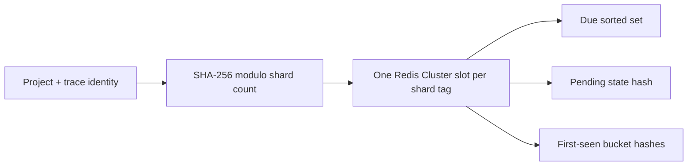

# Internal cloud trace-batch experiment

Two cloud-only modes share the batch worker. Deploy the same mode to every
worker; jobs queued before a switch are processed the same way, so no drain is
needed. `LANGFUSE_TRACE_BATCH_DISPATCHER_ENABLED` and
`QUEUE_CONSUMER_TRACE_BATCH_QUEUE_IS_ENABLED` still choose which service runs
each role.

- **Legacy Topics** (`LANGFUSE_TOPICS_ENABLED`, dispatch off): tracks and
  dispatches traces of active allowlisted Topics projects through the
  `{trace-batch:<shard>}` maps.
- **Trace dispatch** (`LANGFUSE_TRACE_DISPATCH_ENABLED`, default off): moves
  tracking and dispatch to the new maps: ingestion → Redis → dispatcher → batch
  jobs. A trace is admitted when it passes its project's Topics rule sampling or
  the experiment sampling (`LANGFUSE_TRACE_DISPATCH_SAMPLING_RATE`); both use
  the same deterministic trace-ID value.
- **Consumer, both modes**: reads ClickHouse only for traces of active Topics
  projects within their rule's sample; those have their transcript stored and
  one `topics-trace-queue` job enqueued. Every other admitted trace ends at the
  dispatcher without a ClickHouse query.

## Recording trace-rule selections

Requires cloud, `LANGFUSE_TRACE_DISPATCH_ENABLED=true` and direct events-table
writes. `LANGFUSE_TRACE_DISPATCH_SAMPLING_RATE` selects the experiment cohort by
trace ID. Recording atomically updates keys under `{trace-dispatch:<shard>:<suffix>}`:

| Map              | Contents                                                                                                                                  | Retention                                             |
| ---------------- | ----------------------------------------------------------------------------------------------------------------------------------------- | ----------------------------------------------------- |
| `b:<trace-hash>` | One string key per trace: MessagePack `[minStart, maxStart, serializedEventBytes]`, including nonmatches; raw 16-byte SHA-256 prefix of the JSON identity. | Native TTL, bounds TTL after the latest activity (24 hours by default). |
| `pending`        | `{ revision, rules, failed_cnt }` with deduplicated rules; JSON `[projectId, traceId]` identity.                                          | Eligible for cleanup two hours past due.              |
| `due`            | Same JSON identity, scored by Redis arrival time plus project idle interval.                                                              | Eligible for cleanup two hours past due.              |

The tag suffix is the smallest base36 value whose CRC16 slot sits mid-range in the
shard's share of the 16384 slots, so shards spread evenly over cluster masters with
equal slot ranges. Drain pending work and switch writers and readers together when
changing key layout or shard count.

Activity merges bounds and resets their TTL. After bounds expire, arrivals
start fresh and discard old selections. Dispatch removes pending entries whose
bounds are missing.
Calls clean up at most 100 expired pending entries, so sparse traffic can delay
removal; key TTLs reclaim inactive maps.
Env-sampled nonmatches use `__trace_batch_experiment__`, a storage-only sentinel
that must never execute as an evaluator.

Bytes measure accepted UTF-8 event rows after overflow, excluding the size field itself.
Failed writes are unrecorded; retries may double-count. Acceptance precedes the
ClickHouse flush. `eventUpdateCount` is a TypeScript measurement only, not Redis state.

### Recording experiment

Example (10% of traces, four-hour retention; Topics projects additionally admit their rule's sample):

```env
LANGFUSE_TRACE_DISPATCH_ENABLED=true
LANGFUSE_TRACE_DISPATCH_SAMPLING_RATE=0.1
LANGFUSE_TRACE_DISPATCH_BOUNDS_TTL_MS=14400000
```

The new TTL is independent of legacy history retention. Sampling defaults to zero.
Sampled traces carry matched rule IDs or the storage-only sentinel; neither is
executed by this experiment.

The dispatcher reads at most 10,000 oldest due candidates per shard per run,
hydrates 50 at a time, and reuses the existing batch selection and byte limits.
New bounds contain no event count, so count budgets apply only to legacy estimates.
It enqueues before removing matching revisions, preserving newer ingestion and
bounds. Excess candidates stay due for the next run. Cleanup uses bounded Lua
calls but may repeat; there is no hard five-second deadline.
The consumer reads ClickHouse only for traces of active Topics projects within their rule's sample. Other traces of a batch are counted as `langfuse.trace_batch.skipped_traces{reason:no_topics_project|rule_sampling}` and the job completes without a query when none remain. Storage is required: a trace whose input cannot be stored is not enqueued.

`langfuse.trace_batch.redis_key_bytes` / `redis_key_entries` sample the active pipeline's maps every 60 seconds per reporting worker, summed across shards: `key:pending|due` in new mode, `key:due|state|first` in legacy mode. Per-trace bounds keys have no index, so new mode additionally reports `redis_key_bytes{key:bounds,shard:sampled_mean}`, the mean `MEMORY USAGE` of the bounds keys of up to 20 random pending traces per shard; no keyspace scan. Use max/latest across reporters, never sum these global gauges.

Metrics use `langfuse.trace_dispatch`:

- `event_updates` / `serialized_event_bytes`: `stage:admitted|recorded`, after
  sampling versus acknowledged Redis chunks. Timeouts can leave applied writes
  unacknowledged, so the difference does not prove loss.
- `tracked_traces` / `expired_traces`: acknowledged updates / cleaned pending entries.
- `dispatcher_traces`: fetched, hydrated and successfully enqueued counts per run
  (`stage`). Use `langfuse.periodic_runner.duration_ms` with
  `runner:trace_batch_dispatcher` and `outcome:success|failed` for total runtime,
  excluding skipped lease attempts; compare with ready backlog and oldest due age.
- `filter_outcomes` / `filter_duration_ms`: per-span rule selection, excluding the sentinel.
- `recording_batches` / `recording_duration_ms`: flush outcome and duration. Recording failures warn without failing ingestion; metrics collection failures fail the `trace_batch_metrics` runner.

Compare admitted volume with ingestion latency, worker CPU/RSS, Postgres load and
Redis CPU/memory. Queue metrics remain under `langfuse.trace_batch`.

## Readiness requirements

- Every admitted event refreshes the trace's idle deadline. Tracking uses the
  project's configured idle interval, or the deployment default when unset.
- Keep pending scheduling state separate from retained historical bounds. Enqueue
  acknowledgement clears pending state; history survives to support later arrivals.
- A late arrival within history retention opens a new pending window and reads the
  whole known trace, using the earliest and latest retained event starts plus the
  existing two-minute buffer. Backdated arrivals must preserve the previous tail.
- The consumer checks existing summaries against the job enqueue time. Retries
  skip facets completed by this job; later redispatches append updated summaries.
- Bounds, counters, revision and due time are merged atomically. Readiness is
  revalidated before enqueue, and acknowledgement must preserve any newer revision.
- Pending state must survive its idle interval plus recovery grace. Historical
  values have an independent logical TTL and expire without field scans.
- Use Redis 7-compatible operations on standalone Redis, Sentinel and Cluster.
  Every multi-key Lua call stays in one slot; cleanup and Lua batches are bounded.
  One renewable dispatcher lease coordinates scheduling across all shards.
- Redis loss and events outside retained history can leave gaps. There is no
  reconciler, and retained timestamps cannot recover data that was never observed.

## Controls

[worker env](../../env.ts) owns defaults and limits. The active pipeline is selected in [traceBatchSampling.ts](traceBatchSampling.ts):

- `LANGFUSE_TRACE_DISPATCH_ENABLED` selects trace dispatch; otherwise enabled Topics uses legacy readiness.
- `LANGFUSE_TRACE_BATCH_DISPATCHER_ENABLED` and `QUEUE_CONSUMER_TRACE_BATCH_QUEUE_IS_ENABLED` choose the service roles.
- With trace dispatch, `LANGFUSE_EVENTS_DISPATCH_ENABLED` sends dispatched traces to `events-dispatch-queue` instead of trace-batch; `QUEUE_CONSUMER_EVENTS_DISPATCH_QUEUE_IS_ENABLED` (worker-cpu only) consumes it with `LANGFUSE_EVENTS_DISPATCH_CONCURRENCY` jobs. It reuses the trace-batch read settings, pending-bytes cap and `LANGFUSE_TOPICS_TRACE_CONCURRENCY`.
- `LANGFUSE_EVENTS_DISPATCH_STORE_ALL_TRACES` (experiment) also reads and stores traces without consumer rules, counted as `trace_outcomes{outcome:stored}`; consumers are still enqueued only where rules apply.
- `LANGFUSE_TRACE_DISPATCH_SAMPLING_RATE` admits an additional experiment cohort; it does not make those traces eligible for Topics or input capture.
- A project's `tracing_readiness_settings.trace_idle_ms` overrides `LANGFUSE_TRACE_BATCH_IDLE_MS`. Saving refreshes its cache; failed reads fall back to the deployment value.

The older `LANGFUSE_TRACE_BATCH_INGESTION_ENABLED`, `LANGFUSE_TRACE_BATCH_READ_ENABLED` and `LANGFUSE_TRACE_BATCH_SAMPLING_RATE` declarations are not consulted by the current pipeline. In particular, setting the old read flag to false does not drain jobs without reads.

Cloud guards cover intake, dispatcher execution, worker registration, processing and shared queue access. Rule sampling is deterministic by trace ID. Consumers recheck active Topics settings and the rule's sample before reading ClickHouse.

## Legacy Topics Redis state and expiry

- `{trace-batch:<shard>}:due`: sorted set, with JSON `[projectId, traceId]` members and
  Redis server time plus idle delay as the score.
- `{trace-batch:<shard>}:state`: hash with the same members and JSON
  `{minStart, maxStart, revision, historyBucket, eventUpdateCount, serializedEventBytes}` values. Bounds describe observed event start
  times; revision protects newer ingestion from an older dispatch acknowledgment.
- `{trace-batch}:dispatcher`: renewable dispatcher lease.
- `{trace-batch:<shard>}:first:<bucket>`: hourly hashes retaining the minimum and
  maximum event starts independently of pending state. Fields are the first 16 binary
  bytes of SHA-256 of the JSON project/trace pair; values are MessagePack
  `[minStart, maxStart, expiresAt, eventUpdateCount, serializedEventBytes]`.
  A bounds-only tuple has unknown estimates. This accepts the negligible collision probability of a
  128-bit identity. Key shape is independent of the processing unit.

Sharding uses the shared SHA-256 shard helper on the complete project/trace pair,
so a large project spreads across shards. Every Lua call uses only keys with
one shard's hash tag. The single dispatcher lease covers all shards; batch
packing combines ready traces from every shard. Queue slots are unchanged.

When pending state is absent or has no bucket pointer, tracking looks up the
bounded set of live time buckets (26 keys for the default TTL), never scans their
fields, and atomically merges the historical bounds. Valid pending state contains
both bounds, cumulative size estimates and its current history bucket, allowing direct movement to the new
bucket on subsequent activity and guarded acknowledgement. The Redis server clock owns
both retention and readiness. Values with an elapsed deadline are ignored;
whole-key expiry at bucket end plus retention removes storage without scans.
Physical removal can lag logical expiry by up to one hour (or the TTL for a
shorter test override). Activity and guarded acknowledgement refresh retention,
so the post-dispatch window lasts the configured TTL independently of idle delay.
One live copy per identity
is retained under a consistent TTL.

No event payloads are stored here. Atomic Lua updates accumulate estimates and
refresh bounds, revision and readiness:

```text
due = last admitted activity + effective project idle
pending expiry = due + recovery grace
```

Tracking uses the project's configured idle duration when available. The default
is 600 seconds outside DEV and 120 seconds in DEV, with the existing environment
override.

Both pending keys receive a whole-key `PEXPIREAT` covering the required expiry,
preserving any existing later deadline with `PEXPIRETIME` (Redis 7+). During
activity, cleanup removes at most 100 members per call with
`due <= now - recovery grace`, using the existing due index. This supports
different project idle durations without another per-member expiry index.
Cleanup runs during ingestion and dispatch; whole-key expiry also clears abandoned
state if all processes stop. Acknowledgement normally removes pending entries
as soon as enqueueing succeeds, independently of their safety deadline.

### Sharding and atomicity

The shard is `SHA256(JSON.stringify([projectId, traceId]))[first 32 bits] % N`.
It is stable for a fixed shard count and hashes the trace identity rather than
the project alone. Redis Cluster then maps the shared `{trace-batch:N}` tag to
one of its 16,384 slots; the number of logical readiness shards is independent
of the number of Redis primaries. Standalone Redis executes the same layout.
Use a `REDIS_KEY_PREFIX` without its own hash tag: Redis uses the first tag in
the full key, so a tagged prefix would collapse every shard onto one slot.



| Operation       | Atomic boundary                                                                                                                                                                            |
| --------------- | ------------------------------------------------------------------------------------------------------------------------------------------------------------------------------------------ |
| Track activity  | One Lua call reads retained starts and pending state, merges min/max and counters, replaces the revision, sets readiness, moves first-seen history and sets expiry. All keys share a slot. |
| Snapshot/expiry | One Lua call removes a bounded expired cohort and returns readiness counts and the cutoff.                                                                                                 |
| Hydrate         | One Lua call rechecks due scores and reads corresponding state/revisions. Freshly reactivated traces are not dispatched from an obsolete snapshot.                                         |
| Acknowledge     | One Lua call compares the revision, refreshes first-seen retention from dispatch time and removes due/state only when it still matches.                                                    |
| Enqueue         | A separate BullMQ operation precedes acknowledgement. Stable job IDs reduce duplicates if acknowledgement fails. Concurrent arrivals survive the guarded acknowledgement.                  |

No application-side read-then-write decides a trace's bounds, revision or due
score. `TIME` before tracking selects the bounded bucket keys; Lua reads Redis
time again and rejects a stale bucket selection before mutating anything.
Scripts serialize within a Redis primary; different primaries can execute
different shards concurrently. Tracking, hydration and acknowledgement calls
contain at most 50 traces; cleanup handles at most 100. Ingestion sends at most
four tracking scripts per pipeline, all in one shard, using one Redis clock lookup
per ingestion call. A group requiring only one script uses a direct call.
Successful pipeline commands remain committed when a sibling
fails; only commands rejected with `NOSCRIPT` are retried using `EVAL`. A pipeline
is not one atomic operation; each Lua call is atomic independently.
Dispatch still pools
up to 1,000 hydrated candidates for locality selection, so script call size does
not constrain queue batch packing. Scripts use cached `EVALSHA`, falling back
to `EVAL` after a missing script cache on the selected primary. Dispatch holds one renewable lease across
all shards, and checks/extends it while making progress. The lease excludes other
dispatchers; it does not lock ingestion. Only each synchronous Redis command or
Lua call blocks its primary, not the dispatcher's entire read/pack/enqueue run.

Lua atomicity prevents command interleaving, but is not an ACID transaction
across Redis, BullMQ and ClickHouse and does not roll back writes on a runtime
script error. Duplicate runs and the accepted Redis failover gap remain part of
this pipeline's delivery contract. There is no reconciler.

## Dispatch and reads

In legacy mode, one dispatcher holds the renewable lease and snapshots each shard in turn. It selects the complete due cohort at each shard's cutoff; there is no per-run trace limit. Trace-dispatch mode instead caps candidates per shard, as described under recording trace-rule selections. Each due-ID range read and the combined in-memory candidate list grow with the due cohort, even though subsequent Lua calls and selection pools are bounded. It sorts ready IDs by project and due time across shards, then hydrates and revalidates state in single-slot calls of up to 50. Locality selection combines those calls into pools of up to 1,000. Jobs contain up to the configured trace cap and weight budgets; project leftovers can share a job. The dispatcher enqueues before acknowledging matching revisions, so concurrent intake stays pending and failed enqueueing can be retried. Successful enqueues are acknowledged by shard after each hydration window, including when a later enqueue fails, so Redis calls stay bounded by 50 traces rather than job size. Stable job IDs limit duplicates.

Acknowledgement removes due/state only. Late arrivals within first-seen
retention reopen readiness with the merged historical and incoming minimum and
maximum starts; the existing two-minute query padding reads the trace again.
Tracking does not classify events as late by comparing timestamps. Every admitted
event updates readiness; retained history supplies the earlier bound even when
the incoming start equals it. History without pending state can also result from
pending expiry, so it does not prove a previous dispatch. Concurrent arrivals
replace the revision and survive an acknowledgement of an older snapshot.

The consumer reads the supplied trace window and checks existing summaries for
each facet. A summary processed since this job was enqueued is skipped on retry;
a later redispatch generates and appends an updated row. There are no Redis
completion markers or staged results. BullMQ still uses Redis for queue delivery.

`ReplacingMergeTree(processed_at)` retains the greatest processing timestamp
when the Topics sort key matches. That key includes the start minute: an event
revealing a genuinely earlier start in a different minute can leave the previous
summary under its original key. `processed_at` is assigned when summary
processing starts, so it orders processing attempts rather than dispatch windows.
An older, narrower dispatch processed later can replace a summary that includes
newer events. This is an accepted limitation; dispatch-order versioning must be
revisited before requiring the newest dispatch window to win.

Retaining the historical maximum preserves the previous tail even when a late
event's start precedes that tail by more than the query buffer. Once historical
bounds expire or are lost, the prior window cannot be reconstructed from this map.

### Trace-window size estimates

Accepted direct-v4 writes contribute their final serialized UTF-8 event size after field overflow handling. This JSON size estimate is computed only when trace-batch intake is enabled and is independent of ClickHouse's persisted `event_bytes`. The accounting field itself is excluded. Acceptance means admission to the writer, not confirmation of a ClickHouse flush. `eventUpdateCount` counts accepted updates, including retries and repeated observation versions, rather than unique observations.

Pending state and history carry cumulative estimates for the retained read window.
Tracking adds newly accepted updates to valid pending totals. When reopening a
trace, it initializes totals from retained history before adding the new updates.
Acknowledgement preserves estimates with the bounds, including for oversized
exclusions. A late window therefore cannot make a known oversized trace appear
small or understate its batch weight by counting only its new events.

Missing estimates remain unknown through updates and redispatch until their
retained window expires. They are not replaced with zero or a count of only the
new events. These are admission estimates, not hard limits on actual ClickHouse
rows or query memory; the two-minute query buffer can include additional rows.
Tracking-volume metrics still count only updates accepted in the current ingestion
batch; dispatcher size distributions use the cumulative estimates.

The dispatcher emits `estimated_event_update_count` and
`estimated_serialized_event_bytes` distributions under `langfuse.trace_batch`, tagged
with `scope:trace|batch` and `strategy`. Batch totals require known estimates for
every member; `estimates_unavailable` counts unknown traces and affected batches.
Estimates stay out of queue payloads and job IDs. Dispatch retries can emit
another sample.

Serialized event bytes differ from the reader's `input_bytes`, `output_bytes`
and `metadata_bytes` metrics: they include the serialized event fields and JSON
encoding, and do not represent RAM, network transfer or ClickHouse scan bytes.
The job return still sums those three as `ioMetadataBytes`; that sum is not a
custom metric.

### Weight budgets and oversized traces

Both strategies close a job before its summed estimates would exceed
`LANGFUSE_TRACE_BATCH_MAX_BATCH_EVENT_UPDATES` or
`LANGFUSE_TRACE_BATCH_MAX_BATCH_SERIALIZED_BYTES`, in addition to the trace cap.
Locality treats an over-budget slice like one past its time envelope, and
partials coalesce only within the budget. A single trace always forms a job, so
a trace heavier than the budget runs alone. Locality packs traces above half of
either budget in a separate lane, so one heavy trace does not split the light
traces around it into extra jobs. Unknown estimates weigh nothing.
Budget-limited jobs report `fill:partial`; the `scope:batch` estimate
distributions show how close jobs run to the budget.

After hydration, a trace whose retained read-window estimates exceed
`LANGFUSE_TRACE_BATCH_MAX_TRACE_EVENT_UPDATES` or
`LANGFUSE_TRACE_BATCH_MAX_TRACE_SERIALIZED_BYTES` is never queued or read. The
dispatcher acknowledges it like a dispatched trace, increments
`langfuse.trace_batch.excluded_traces` tagged with
`reason:event_updates|serialized_bytes` and `strategy`, and logs
`Trace batch excluded oversized trace` at warn level with `projectId`, `traceId`,
`reason` and both estimates. Group that log by `@projectId` to find repeat
offenders. Activity after the acknowledgement starts a new pending window that
is evaluated again using its retained cumulative estimates, so a trace that keeps
growing may be logged more than once.
Traces with unknown estimates are never excluded.

The worker streams full `events_full` payloads and records batch observation,
trace and logical payload-byte metrics. The `input_bytes`, `output_bytes`
and `metadata_bytes` distributions under `langfuse.trace_batch` each report one
total per completed batch read. Distinct project count stays on the span and
completion log.
Sizes count UTF-8 bytes, including metadata keys and values, excluding JSON
transport framing/escaping and compression. They do not measure ClickHouse bytes
scanned or per-trace ingestion size; retries can record another batch sample.
Exact `(projectId, traceId)`
pairs protect tenant boundaries; project, trace hash and a shared outer time
window prune reads. Each selected trace also gets its own interval, so unrelated
batch companions cannot widen the payload returned for that trace.
`TRACE_QUERY_BUFFER_MS` pads each recorded interval by two minutes on both sides.
This fixed margin neither waits for arrivals nor guarantees trace completeness;
repeated intervals for the same pair form a union without duplicating rows.
Queries use response compression and chunked multipart parameters for up to
10,000 UUID-sized trace/project IDs. The fixed 30-second timeout fails the job
rather than accepting partial results. Beyond the dispatcher's weight budgets
and trace exclusion, this does not cap observation count, query memory or
dispatcher snapshot memory.

## Input storage

Trace-batch stores the assembled transcript for traces that pass the internal-environment exclusion, Topics settings and at least one rule's sampling gate, then enqueues one `topics-trace-queue` job per trace with the IDs of every rule that sampled it. The per-trace job resolves those rules' facets at their current version and reads the object back; trace-batch makes no model calls. The latest event's environment determines eligibility. Storage and enqueue run inside the Topics concurrency limit. Each S3 request is bounded by `LANGFUSE_TRACE_BATCH_TRANSCRIPT_STORAGE_REQUEST_TIMEOUT_MS` (default 10 seconds) so a stalled request cannot hold a slot indefinitely; the SDK attempt budget stays at its default. An oversized input or failed upload counts the trace as failed and enqueues nothing. Jobs are deduplicated per `(projectId, traceId, revision)` for the batch's two-hour lifetime, so a retried batch does not summarize a revision twice.

The shared `server/traceBatch` module uses the event-upload bucket and credentials:

```text
<prefix>trace-batch/trace/<hash>/<projectId>/<safeTraceId>/<revision>.json
```

`hash` is the first three hex characters of SHA-256 over
`JSON.stringify([projectId, traceId])`. Identifiers use the shared blob-key
escaping helpers. The revision comes from the queued readiness entry; a new
revision uses another key, while an ordinary PUT of the same revision can replace
its object. A reader needs all three identifiers; no latest-revision lookup or
durable job reference is stored.

The stored envelope contains `schemaVersion`, a nullable transcript, `executionIssues` and trace context (nullable session/name, source timestamp and environment). The frozen schema is [versions/v1.ts](../../../../packages/shared/src/server/traceBatch/versions/v1.ts); [serialization.ts](../../../../packages/shared/src/server/traceBatch/serialization.ts) adapts it to live types. Schema version and readiness revision are independent.

The queue injects `TraceBatchInputStorage` from `createTraceBatchInputStorage()`. Keep storage details behind that interface. Context uses the Topics metadata selection; the transcript alone cannot reconstruct it. Dates inside messages are restored on read, while the trace-context timestamp stays an ISO string. Null transcripts are valid; missing objects, invalid content and download errors fail.

Mixed versions happen: rolling deploys, and self-hosters updating web and worker
at different times. A reader that meets an unknown `schemaVersion` must fail with
the retryable `UnsupportedTraceBatchInputVersionError`, never discard the job or
treat the object as missing. Consumers read inside retried jobs whose backoff
spans a deploy, so the retry lands on an updated reader. Deploy readers for a new
version before enabling its writer; if a writer ships first, the retries cover the
gap. Compatible optional fields may be added to V1 when absent values are safe for
old readers. A breaking change adds `versions/v2.ts`, its adapters and a read
dispatch on `schemaVersion`; existing objects are never rewritten.

Serialize the full envelope once. Skip the entire upload if `json.length` exceeds
1,000,000; do not truncate. This measures UTF-16 code units, not UTF-8 bytes, and
does not bound assembly or serialization memory. Size skips emit an info log with identifiers,
actual length and limit. StorageService owns upload retries and logs: SlowDown at
warning level, other failures including request timeouts at error level. Exhausted
failures mark the `trace-batch-store-inputs` span as failed. Neither outcome stops
Topics. The span records outcome and JSON length without transcript content;
there are no additional outcome counters.

Deploy with writes disabled. Before enabling, configure and verify an enabled
bucket lifecycle rule for the full `<prefix>trace-batch/trace/` path, matching
span-eval retention, including noncurrent versions where applicable. A rule for
`evals/` alone does not cover this path. Enable on a small worker rollout and
check storage spans, size-skip logs, S3 failures and Topics latency. Roll back by
disabling writes. Existing Topics processing continues to use in-memory inputs;
future consumers that require files must schedule only after a successful PUT.

Like temporary span-eval inputs, these objects have no ingestion deletion
references. Trace/project deletion and per-project retention do not immediately
remove them; bucket expiry is the accepted cleanup mechanism, and the deletion
paths are intentionally not extended. The lifecycle rule above remains the
precondition for enabling writes.

## Per-trace transcripts

The reader groups rows by project and trace. It assembles a trace when the pair changes and flushes the last trace only after successful end of stream. A stream error discards the partial final trace while draining already accepted work. Completion covers that query window, not future arrivals. Preserve exact tenant and trace boundaries when changing the reader.

[traceBatchTranscript.ts](traceBatchTranscript.ts) owns assembly and diagnostic measurements; the [shared transcript README](../../../../packages/shared/src/server/transcript/README.md) owns transcript semantics. `assembleTranscriptContext` supplies both the conversation transcript and execution issues for storage. The per-trace Topics job reads the stored transcript and applies [its own model projection](../topics/assembledTranscript.ts). The generic and Topics plain-text renderers used for size comparisons are not the model input; their clipping limits do not limit inference.

Assembly runs serially per batch. Storage and enqueue run under `LANGFUSE_TOPICS_TRACE_CONCURRENCY`. Reads continue until queued logical payload bytes exceed `LANGFUSE_TRACE_BATCH_MAX_PENDING_SUMMARY_BYTES`, then resume as soon as completed work brings them back under that threshold. The socket idle timeout must allow for these pauses. The threshold excludes object overhead and the trace currently being read, so it is not a hard memory cap.

The `trace-batch-transcript` span records project/trace identifiers, a source peek link, assembly and rendering durations, structure counts and character counts, without transcript content. `LANGFUSE_TRACE_BATCH_TRANSCRIPT_METRICS_ENABLED` additionally emits distributions; failure counters remain enabled independently. Diagnostic renderings do not undergo tokenization. Topics separately uses local token counts to enforce its [model input budgets](../topics/README.md).

When comparing measurements:

- Full assembled JSON character counts include wrappers and provenance.
- Generic and Topics text lengths measure diagnostic renderings of the same trace. They do not represent the serialized Topics inference request.
- Tool-response/content character shares use serialized parts on both sides; divide aggregate sums for a traffic share, not per-trace percentages.
- Span duration includes diagnostic rendering; use the assembly-duration attribute for assembly performance.

The peek link shows current observations, not a saved copy of the measured transcript. Late arrivals and retries can produce different samples for the same trace, and APM sampling controls which spans remain searchable.

## Capacity measurements

The following metrics use the `langfuse.trace_batch` prefix. All additions are
inside the existing cloud experiment paths; normal ingestion with tracking
disabled performs no new aggregation or Redis calls.

| Metric                                                     | Kind / tags                          | Meaning                                                                                                                                                                                                                                                                                                                               |
| ---------------------------------------------------------- | ------------------------------------ | ------------------------------------------------------------------------------------------------------------------------------------------------------------------------------------------------------------------------------------------------------------------------------------------------------------------------------------- |
| `event_updates`, `serialized_event_bytes`                  | Counters; `stage:eligible\|recorded` | Accepted, valid-start-time updates before sampling, and in Redis-acknowledged chunks. Repeated updates count again. Selected volume is `sampling_decisions`.                                                                                                                                                                          |
| `active_reads`                                             | Per-process gauge                    | Streams currently being consumed; failures decrement the count too.                                                                                                                                                                                                                                                                   |
| `failed_read_observation_count`, `failed_read_input_bytes` | Distributions                        | Partial logical rows and input bytes consumed before a stream failure. Separate from successful throughput. Output and metadata bytes stay on the completion log.                                                                                                                                                                     |
| `queue_depth`                                              | Gauge; `type:delayed`                | Delayed BullMQ jobs. Waiting, active, and failed depth stay on `langfuse.queue.trace_batch.depth`. Request rate, wait time, and processing time use the generic `langfuse.queue.trace_batch` series, the same as every other queue. Processing time is recorded when the processor returns. Discard reasons stay on `discarded_jobs`. |
| `queue_waiting_head_age_ms`                                | Gauge                                | Maximum creation age of the next FIFO jobs in waiting/paused lists. Zero when empty.                                                                                                                                                                                                                                                  |
| `pending_traces`, `ready_traces`, `oldest_due_age_ms`      | Gauges, untagged                     | Dispatcher snapshot summed (age: maximum) across shards, emitted by the current dispatcher lease holder.                                                                                                                                                                                                                              |

The eligible and recorded counters reuse the already-computed serialized size and
per-trace aggregates. Recorded volume is emitted after each acknowledged Lua
chunk: earlier chunks remain counted if a later one fails. A timeout can mean
Redis applied an update without acknowledgement, so the stage difference includes
uncertain outcomes; it does not prove data loss. Writer acceptance still precedes
the ClickHouse flush. No additional serialization is performed.

`TraceBatchMetricsRunner` starts when ingestion, dispatcher or consumer is enabled in a cloud worker, independently of the generic queue-metrics flag. It samples the active pipeline's maps every 60 seconds per process and polls the queue every 30 seconds when dispatcher or consumer is enabled, plus collection time. No completed jobs or progressing dispatcher are required. Queue-age collection reads only the next waiting/paused job IDs and their timestamp fields; it never fetches or parses batch payloads. One failed collection does not suppress the others; failed samples are not reported as zero. Check `langfuse.trace_dispatch.memory_samples` for memory collection outcomes. Periodic-runner timestamps indicate runner activity, not successful memory collection.

Memory collection uses bounded per-shard Lua calls with `MEMORY USAGE ...
SAMPLES 5`, preserving the shared key prefix and Redis Cluster slot routing.
Missing keys report zero; there is no keyspace scan or exact full-hash traversal.
Memory sampling estimates storage, not process RSS or event payload size.

Map gauges are summed across readiness shards before they are emitted. Each
worker emits them, so a shard tag would multiply custom metrics by the shard
count on every reporting worker. The dispatcher snapshot gauges are untagged for
the same reason. Inspect a single shard's keys in Redis when diagnosing skew.

Queue/map snapshots are global and can be emitted by several workers: use
max/latest across reporters, never sum duplicates. In contrast,
`active_reads` is local to a worker; distinct live worker series may be summed.
It is emitted on stream start/finish and on each metrics-runner cycle, including
zero when idle, so unchanged long-running reads remain visible.
Instantaneous gauges can miss short-lived peaks. A retried job may re-enter
behind newer jobs, so waiting-head age is a bounded-cost backlog indicator, not
an exact oldest-created-job measurement across the entire queue.

With an experiment ID, start/completion logs include `jobId`, `attempt`,
`queryId` and `experimentId`, with the completion outcome. The per-read UUID is
forwarded to ClickHouse as `query_id` and remains the root correlation ID for
the stream. Discards and validation failures have no query ID. Identifiers are
not metric tags and logs contain no event payloads. Successful batch metrics and
job return values retain their existing meanings.

Completion logs also correlate the requested `batchTraceCount`, distinct
`batchProjectCount`, `eventTimeSpanMs` (outer event-time span, without query
buffering), and `maxTraceSpanMs` with the outcome and `durationMs`. These are
batch-locality proxies, not measured ClickHouse scan costs. `observationCount`,
`foundTraceCount`, `foundProjectCount` and separate `inputBytes`, `outputBytes`,
`metadataBytes` describe rows consumed by that attempt. `partial: true` marks
failed reads, including failures before any row arrives; zero then does not mean
the requested batch was empty. Successful counts cover the completed stream,
not unique ingested events. Discarded/unparsed jobs omit stream counters.
Use these existing logs to compare batch shape and volume across outcomes by
query ID; no payload contents, project-ID lists or per-batch metric tags are added.

With an experiment ID, the BullMQ processing span also carries attributes under
`langfuse.trace_batch.*`: `experiment_id`, `job_id`, `attempt` (one-based),
`query_id`, `batch_trace_count`, `batch_project_count`, `event_time_span_ms`,
and `max_trace_span_ms`. Shape and query ID are attached before reading, so they
remain available if the stream fails. Completion adds `outcome`, `duration_ms`,
`observation_count`, `found_trace_count`, `found_project_count`, `input_bytes`,
`output_bytes`, `metadata_bytes`, and `partial`, with the same semantics as the
logs. Discards and validation failures omit query/stream fields. These reuse
existing aggregates without additional queries or serialization. Payloads and
project/trace-ID lists are not attached. Dispatcher size estimates remain aggregate
metrics, not per-job span attributes; consumed bytes are not estimated total size.
Span availability follows the existing tracing sampling and retention settings.

For reader comparisons, hold the traffic cohort, sampling and concurrency fixed. `LANGFUSE_TRACE_BATCH_EXPERIMENT_ID` correlates attempts with ClickHouse query IDs and logs; query settings do not enable a pipeline. Compare worker and query memory/latency with successful and failed reads. `max_block_size` is a row-count hint, not a byte or memory limit.

### Opt-in locality grouping

`LANGFUSE_TRACE_BATCH_STRATEGY=locality` changes grouping only after dispatch is
explicitly enabled in a cloud region. The default `project` strategy preserves
project ordering and carries unfinished jobs across hydration chunks.

Locality sorts each hydrated window by project, minimum start minute, maximum
start minute and `xxHash32(traceId)`. It finds the fewest feasible jobs under the
trace cap, the weight budgets and an event-time envelope of at most one hour, or
125% of the first trace's observed span if larger. Within that job count, it minimizes project
boundaries, then minute × trace count, then gaps between trace hashes. These are
read-locality proxies, not measured ClickHouse scan costs.

Locality combines each window of at most 1,000 hydrated candidates with retained
partials. Compatible same-project partials may merge when their buffered time
intervals overlap and the combined batch respects the cap and envelope limits.
At most `maxBatchSize - 1` traces are retained across all partials; oldest-due
partials dispatch first when that budget is exceeded. The last window flushes
all remaining partials, so carry never outlives the current dispatch run.

Locality bounds selector input, not the legacy ready-ID snapshot. Measure selector duration before increasing scale, especially with distant event times that force many jobs.

Compare `dispatched_batches` (tags `strategy`, `fill`),
`event_time_envelope_ms`, `candidate_buffer_size` and
`selector_duration_ms` under `langfuse.trace_batch`. Per-trace event span stays
on the completion log as `maxTraceSpanMs`. The envelope metric includes
the reader's two-minute margin on each side; the selector's envelope limit does
not. Payload and Redis state are unchanged.

## Monitor dispatcher memory

Legacy mode snapshots the complete ready cohort; trace-dispatch mode caps candidates per shard/run. Batch size limits jobs, not all dispatcher memory. Watch memory alongside backlog growth.

The worker enables Datadog Node runtime metrics. In Metrics Explorer, filter to
the experiment environment and worker service, and inspect the maximum per
worker/container rather than a fleet average:

- `runtime.node.mem.rss`: total process memory; compare with the container limit.
- `runtime.node.mem.heap_used`: JavaScript heap in use.
- `langfuse.trace_batch.snapshot_size`, `pending_traces`, `ready_traces` and
  `oldest_due_age_ms`: snapshot and backlog growth.
- `langfuse.trace_batch.expired_traces`: tagged `source:ingestion` or
  `source:dispatcher`. Sum within one source; the two writers are different events.
- `langfuse.periodic_runner.duration_ms` and `completed`, filtered by
  `runner:trace_batch_dispatcher`: run duration and outcome.

Runtime memory is shared with other work in the process, so correlation with
dispatch runs does not isolate the dispatcher's allocations. Periodic sampling
can miss short peaks, and `snapshot_size` is emitted only after parsing/sorting
finishes. Check worker restarts/OOM events as well. Verify live metric delivery
and available instance tags in Datadog before relying on these signals.

## Mode and layout changes

Changing pipeline mode does not require draining queued jobs: both modes use the same consumer. Redis key-layout, shard-count or legacy history-retention changes are different: coordinate writers and dispatchers, drain pending work using the old layout, and preserve retained history until it expires or explicitly accept losing it. Deleting pending keys is not a drain. There is no history migration or reconciler.

Disabling the consumer leaves BullMQ jobs queued; they have no autonomous TTL. The processor discards jobs at least two hours old when picked up. Keep an active, unpaused consumer and an enabled pipeline to consume queued work. The obsolete read flag cannot disable queries.

On shutdown, the dispatcher stops scheduling and waits a bounded time for its active dispatch. This wait does not cancel issued Redis commands. Queue retention options are owned by the shared trace-batch queue accessor.
